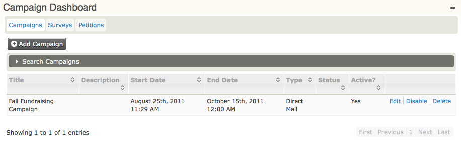
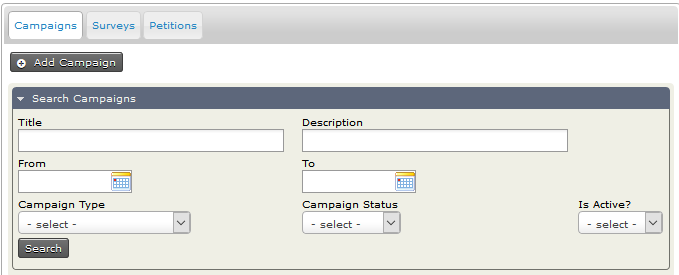
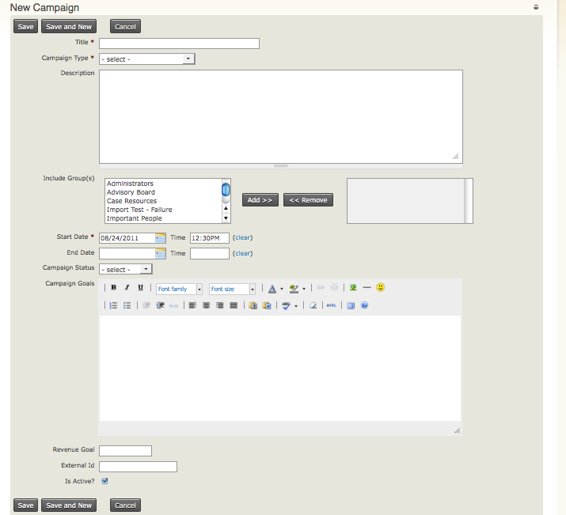

# Manage campaigns and campaign activities

This page describes everyday tasks related to managing campaigns with CiviCampaign.

## Manage campaigns from the dashboard

The Campaign Dashboard allows you to create, configure, manage, and view campaigns. You can also manage surveys and petitions from the dashboard. For details, see [Surveys](../survey/everyday-tasks.md#managing-your-surveys) and [Petitions](../petition/everyday-tasks.md#manage-your-petitions).

To view the Campaign Dashboard, go to **Campaigns &gt; Dashboard &gt;
Campaigns.**

From the Campaign Dashboard, you can edit, disable, and delete existing campaigns or create new ones. If you have many campaigns, open the campaign search accordion and set filters to display only the campaigns you want to see.

## Create a new campaign

1. Go to **Campaign &gt; New Campaign**.

   

2. Enter information about your campaign:

   - **Title** (required): Enter a unique name that describes your campaign. A naming convention can help campaigns alphabetize in drop-down lists and make them easier to find when associating an activity with a campaign.
   - **Campaign Type** (required): Select the type of campaign, e.g. Constituent Engagement. To add options to the Campaign Type drop-down list, see [setting up CiviCampaign](set-up.md#add-a-new-campaign-type).
   - **Description**: Enter text that describes your campaign.
   - **Include group(s)**: If appropriate, select the group containing the individuals you are targeting. To learn more about creating groups, see [Tags and Groups.](../organising-your-data/groups-and-tags.md)
   - **Start Date &amp; Time** (required): Enter the start date and time of the campaign.
   - **End Date &amp; Time**: Enter the end date and time of the campaign. If these fields are empty, the campaign will be considered ongoing.
   - **Campaign Status**: Select the status of the campaign, e.g. In Progress or Planned. To add options to the Campaign Status drop-down list, see [setting up CiviCampaign.](set-up.md#campaign-status)
   - **Campaign Goals**: Describe the goals and/or objectives of your campaign. You may also want to describe the activities you plan to conduct to meet those goals.
   - **Revenue Goals**: If applicable, enter the amount you plan to raise during your campaign.
   - **External ID**: If you want to track the campaign ID from another database, enter the ID number of your legacy campaign.
   - **Is Active?**: Check the box if the campaign is active. If the campaign is inactive, uncheck the box.

3. Click **Save** to save the campaign.

## Target constituents: create a group

You may want to target a specific group of individuals for all campaign activities. Create a group to target those individuals. See [Tags and Groups](../organising-your-data/groups-and-tags.md) for more information about creating a group.

## Send a mass mailing

A mass mailing to your target audience can generate interest and participation or call for donations.

1. Create the email using CiviMail. See [Email](../email/mass-mailings-using-civimail.md) to learn more about configuring and using CiviMail.
2. Select the appropriate campaign from the drop-down list when setting up the mailing.

## Associate an event with a campaign

Events created using [CiviEvent](../events/what-is-civievent.md) can be associated with a campaign.

1. Create and configure the event.
2. Select the appropriate campaign from the drop-down list when setting up a mailing for the event.
3. Send a mass email using CiviMail to your target audience using a group or groups, and ask people to register for the event.
4. Again, select the name of the campaign on the mailing set-up.
5. Search for individuals who have indicated they want to register for the event.

## Record campaign contributions

As contributions come in, either online or offline, associate them with a campaign by selecting the appropriate campaign from the drop-down menu when recording the contribution.

To learn more about configuring and using CiviContribute, see [Contributions](../contributions/key-concepts-and-configurations.md).

## Record event participation

During and after an event, organizers can record who participated by collecting sign-in sheets and entering participants manually, or by recording participation directly online.

Have participants write their contact information on sign-in sheets when they arrive. If you have an internet connection at the event venue, you may be able to enter participants directly into the database.

To learn more about recording participant information for an event, see [Events](../events/manual-event-registration.md).

<!-- Source: campaign/everyday-tasks.md -->
