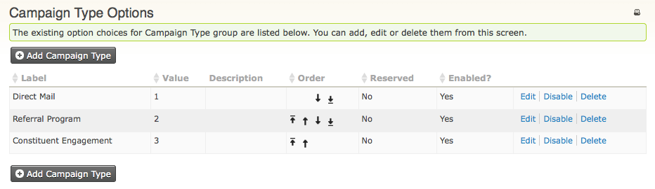
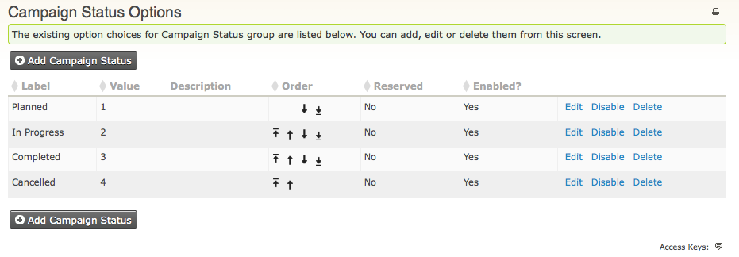
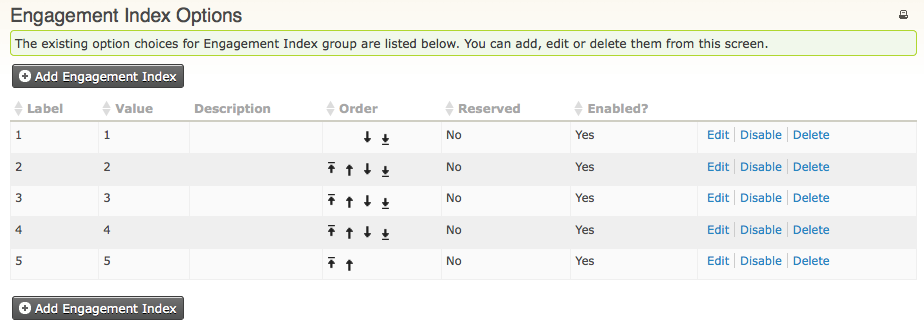

# Set up CiviCampaign

Set up CiviCampaign to track related activities, such as contributions, surveys, and mailings, that are part of a campaign or project.

## Enable CiviCampaign

1. Go to **Administer &gt; System Settings &gt; Components**.
2. Select **CiviCampaign** and click **Enable** then **Save**.

Once enabled, CiviCampaign appears as a new **Campaigns** menu item along the top of your CiviCRM screen.

## Add a new campaign type

CiviCampaign provides three default campaign types:

- Direct Mail
- Referral Program
- Constituent Engagement

You can add campaign types appropriate for your work and disable those that aren't.

1. Go to **Administer &gt; CiviCampaign &gt; Campaign Types**. This displays the existing campaign types:

   

2. Click **Add Campaign Type** and give the new type a label and, optionally, a description.
3. Optionally, change the default weight. This affects the order in which this new event type appears in drop-down menus; smallest numbers appear highest.
4. Click **Save**.

The campaign type will be available to assign the next time you add a campaign.

## Campaign status

Assign a status to a campaign to track internally which stage it is in. The default statuses are Planned, In Progress, Completed, and Cancelled.

1. Go to **Administer &gt; CiviCampaign &gt; Campaign Status**.
2. Click **Add Campaign Status** and give it a name and, optionally, a description.
3. Changing the weight is not necessary, but it affects the order in which the new status appears in drop-down menus.
4. Click **Save**. The new status will be available to assign to campaigns.

## Engagement index

CiviCampaign lets you track an individual's level of interest or engagement in a particular activity. The Engagement Index can be recorded for general activities or actions, such as Send an Email, Meeting, Phone Call, and Interview, as well as additional custom activities or actions you create. To find out more about recording an activity for an individual, see Contacts in the Organising Your Data section.

To configure the Engagement Index:

1. Go to **Administer &gt; CiviCampaign &gt; Engagement Index**.
2. Configure the engagement index as a number, e.g. 1 is a high level of engagement, and 5 is low level of engagement.

This information can supplement your outreach employees' or organizers' assessment of member engagement or interest in your organization.

<!-- Source: campaign/set-up.md -->
