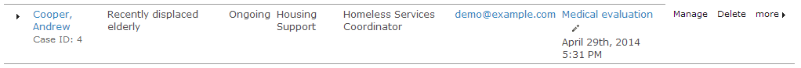
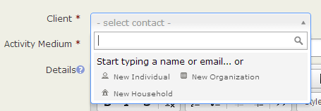
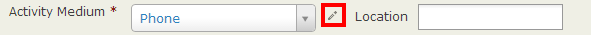
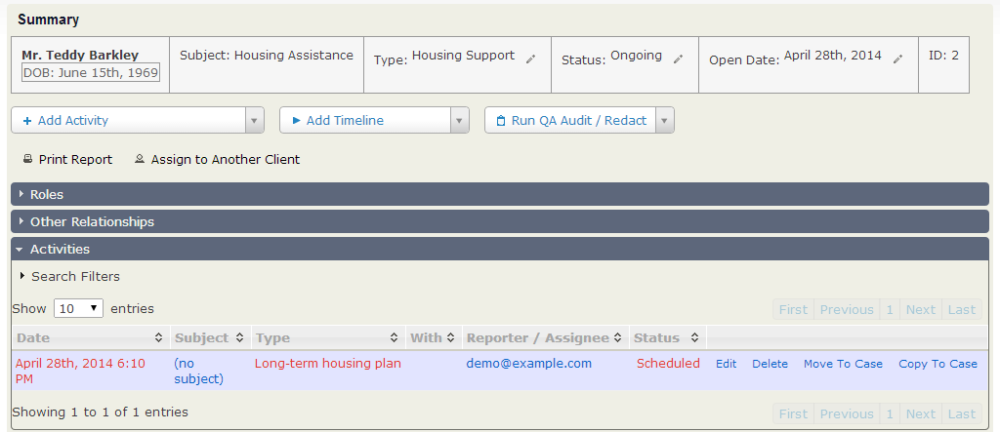
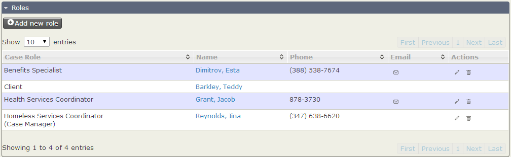
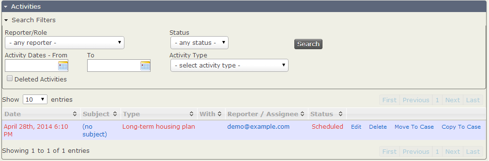

# Everyday tasks

This page describes everyday tasks you can perform using CiviCase.

## Viewing the Case Dashboard

The Case Dashboard helps you keep track of case-related tasks. It provides:

- A summary of cases in the system (Summary of Case Involvement).
- A list of your cases with upcoming activities scheduled in the next 14 days.
- A list of your cases with activities completed in the last 14 days.

If you have permission to view cases other than those you are working on, you can also see lists of all cases with upcoming activities and all cases with recently performed activities. Click the link at the top right of the content area to switch between Your Cases and All Cases.

Click the **Edit** icon next to the Next Sched. activity name to work on that task. In the following screenshot, the Next Sched. activity is Medical evalution. Click its title to view it in a pop-up window, or click the edit pencil to the right of the title if you are ready to work on it.

Click the triangular expand icon (►) to the left of a client’s name to see all activities for that case. You can view or edit any activity in the list. Click **Manage Case** to work on several tasks within a case, change its status, print a case report, or view case roles.

To add a case from the Case Dashboard, click **Add Case** at the top left of the content area.

## Finding cases

If you know the Case ID, you can use full-text search from **Search > Custom Search > Fulltext Search**, or from the fulltext search block if you have enabled it.

To search for cases, go to **Search > Find Cases** or use **Cases** in the menu bar at the top of the CiviCRM screen. You can use the search options individually or combine them:

- **Client name or email address:** Type characters from the name or email address into the Client name or email input field.
- **Case types:** Check the types you want to search for.
- **Case status:** Select a status from the dropdown menu.
- **All cases or your cases:** If unselected, the default is to filter by your cases.
- **Deleted cases:** Click the **Deleted cases** checkbox.

Selections across different sets of criteria are combined: results must meet at least one requirement in each set. For example, if you enter a client name and select a case type, results must match the client name AND case type. Multiple selections within one set are treated differently: if you check two case types, results can match *at least one* of them.

## Opening a new case

You can open a case for an existing contact or create a contact while opening the case.

### Open a case for an existing contact

Creating a case from an existing contact’s summary screen or actions menu automatically links the case to that contact.

1. Go to the contact’s summary screen.
2. Select **Add Case** from the **Actions** dropdown menu, or click the **Cases** tab.
3. Fill in the required fields in the **Add Case** form.
4. Click **Save**.

### Open a case for a new contact

When you open a case for a new contact, CiviCRM creates the contact record at the same time.

1. Go to **Cases > New Case** or select the **Create New > Case** dropdown button. This button is provided as a block in Drupal or on the left hand side in Joomla!.
2. If you have not navigated from an existing contact, you may want to check whether the contact is already in the database. Type the contact’s name or email in the **Select Contact** field to see potential matches.

   

3. If you do not find the contact, select the contact type from the **create new contact** list. A pop-up window lets you enter the contact’s name and other information while opening the case. Its fields are controlled by the **Add Individual** profile, so you can add or modify the fields provided. You can read more about profiles in the Profiles chapter.

   Complete the case fields as appropriate:

   - **Medium** and **Location** record where and how the case came to your attention. For example, you might select **In Person** for Medium and **At the Annual Gala** for Location. To manage Encounter Mediums, select the edit icon.

     

   - **Details** holds information about the overall case, rather than a specific *activity*. For example: “Jane is concerned about some illegal land use that she has witnessed in her neighbourhood, and would like us to see what can be done about it. I told her that the best person to look into this was Tom, and she asked whether her husband could be included on any correspondence.”
   - **Subject** appears next to the case client’s name in search results and other case listings. A brief, unique description is more helpful than using the client’s name as the subject.
   - **Case Type** lets you choose the type of case. Many case types have specific activities and timelines, so choose the appropriate type at this point. You can change it later by clicking **Manage Case** next to the case in the **CiviCase Dashboard**, or from the contact’s record **Case** tab, then selecting **Change Case Type** from the **New Activity** dropdown menu. Changing an ongoing case may require you to update or re-enter some data.
   - **Case Status** indicates the current status. Generally you will use a status such as Ongoing or Urgent. If you are adding a case that has already been completed for tracking purposes, select Resolved.
   - **Case Start Date** defaults to the current day. Adjust it if you are entering a completed case or an upcoming case that has not yet started.
   - **Duration** records, in minutes, the time spent collecting the data needed to fill out the create case form—not the time spent filling out the form. For example, you might record the minutes spent on the phone with a constituent as they described the case.

4. After completing the fields in the pop-up window, choose an action:
   - **Save** saves the case and opens the Manage Case page, where you can modify activities, add attachments, and assign case roles.
   - **Save and New** saves the case and resets the form so you can add more cases without interruption. This is particularly useful for data entry.
   - **Cancel** discards the case data you entered and returns you to the CiviCRM dashboard.

## Manage Case Page

The manage case page lets you manage these aspects of a case on one screen:

- View summary case information.
- Change case status or reassign.
- Create/manage activities.
- Create/manage timelines.
- Create/assign case roles.
- Identify/manage client relationships.
- Run case audits (reports).

## Assigning case roles

You can assign case roles to contacts who work on a case or need to stay informed about its activities. Users with access to CiviCase who are assigned a case role will see the case in their My Cases view. The case displays each role holder’s phone number and email address.

To assign a contact to a case role:

1. Click the **Case Roles** area to open it.
2. Find a role showing **(not assigned)** in the **Name** column, then click its edit icon.
3. In the **Assign Case Role** pop-up window, begin typing the contact’s *last name* until their name appears in the dropdown list.
4. Select the contact and click **OK**.

To assign more than one contact to a given case role, click **Add New Role**. In the pop-up window, select a role defined in your case configuration and a contact from your database. The new role relationship appears in the Roles pane of the case management screen.

Generally, anyone who might be assigned to a case should already be in the database. If you cannot find the person, add them as a contact first using **Contacts > New Individual**.

Each assigned case role has mail, edit, and delete icons under the **Email** and **Actions** columns. You can email contacts with roles in the case or modify their relationships to it. Click the edit icon to change a case role or the delete icon to delete one. Emails sent from here are automatically added to the case activities in sequence, providing an audit trail of case-related communications.

## Bulk add contacts to a case with a specific role

An action on contact search results lets you add several contacts to a case with a specific role:

1. Perform a search on Contacts.
2. Select the contacts to add from the search results.
3. Choose the **Add to case as role** action.
4. Use the form to choose the case and the role the contacts will have in it.
5. Click **Submit** to add the contacts, or **Cancel** to return to the search results.

## Finding activities within a case

To find an activity for reference or modification, scroll to **Case Activities** and click it to open it. By default, scheduled activities appear first, sorted by date, followed by completed activities. Click a column header to sort by that column—for example, by activity type.

If a case has many activities, click **Search Filters** to narrow the list. For example, you can find all **Follow up** activities performed for the case. The filters are:

- Reporter/Role
- Activity Status
- Activity Dates: Fill in both date fields for a range, or only the first field for a specific date.
- Activity Type: For example, select **Follow up** to find follow-up activities.
- Deleted Activities: Available to people with permission to view deleted activities.

After selecting your criteria, click **Search** on the right. The table filters out activities that do not match.

## Adding and managing activities

After working on an activity, click **Save** to save it and return to the case page, or **Cancel** to discard your work.

### To add a single new activity to a case

1. Navigate to the case using **Find Cases** or the **Cases Dashboard**.
2. Choose an activity type from **New Activity** in the **Case Summary**.
3. Click **Go**.
4. Fill out the activity form. The Client field is pre-populated with the case’s client data.

!!! note
    The drop-down list of activities is configurable. Refer to the
    [set-up chapter](set-up.md) for more information.

### Adding a set of activities

The Standard Timeline is added when the case is created. You can add an additional set of activities when appropriate.

1. Navigate to the case using **Find Cases** or the **Cases Dashboard**.
2. Choose a Timeline or Sequence from **New Timeline** in the **Case Summary**.
3. In the dialog box, confirm that you want to add the activities by clicking "OK".

The set of activities is added to the case.

### To send a copy of the activity to anyone with a case role for the case

1. Open **Send a Copy**.
2. Check the contacts or case roles you want to alert about the activity.

### To schedule a follow up activity

1. Open **Schedule Follow-up**.
2. Select the follow-up activity type, the number of days until the follow-up should occur, and its subject—for example, “confirm that Jane’s problem is fixed”.
3. Click **Go**.
4. Complete the form and click **Save**.

### To add an attachment to the activity

1. Open **Attachments**.
2. Click a **Choose file** button.
3. Select an attachment from your file browser. You can attach up to five files to an activity.
4. Click **Choose**. The attachment’s name appears to the right of the **Choose file** button.

The attachment is not saved into CiviCRM until you save the activity.

## Editing an activity in a case

1. Navigate to the case from the **Case Dashboard**, the **Find Cases** search form, or the contact’s **Cases** tab.
2. Click **Edit** at the far right of the activities table at the bottom of the case form.
3. Edit the activity form as you would when creating an activity for a case. Many fields will already be filled in.

To assign a scheduled task to a staff member while adding or editing a case:

1. Start typing the staff member’s name in **Assigned to**. A list of possible contacts appears.
2. Select from the suggestions and check that the staff member’s full name appears in **Assigned to**.

You can assign multiple contacts to an activity. If you select the wrong contact, click the X by their name to remove them.

## Updating the status of case activities

You can update an activity’s status from the Activities table without opening its edit form:

1. Navigate to the case from the **Case Dashboard**, the **Find Cases** search form, or the contact’s **Cases** tab.
2. Click the **status** text, such as “Scheduled”, in the activity’s table row.
3. In the pop-up form, select a new status and click Ok to save the update.

## Changing the status of a case

The case status helps you determine how a case is progressing. Sample values include Ongoing, Resolved, Not Assigned, and Urgent.

1. Navigate to the case from the **Case Dashboard**, the **Find Cases** search form, or the contact’s **Cases** tab.
2. Click **Manage Case**.
3. Click the **Edit** icon next to the current status column in the Case Summary table.
4. The **Change Case Status** form opens. This is an activity with an additional Case Status field.
5. Set the case status to the new status.
6. If the case has linked cases, they appear in a table within the form. To update their statuses too, check **Update Linked Cases Status**.
7. Modify the other fields as you would when editing an activity in a case. Set the **Status** field: it is required but not set by default.
8. Click **Save** to return to the case page. A message states that the Change Case Status Activity has been created.

An activity is recorded when a case status changes because something happened. Recording *who* and *why* is usually as important as recording *what*. This behaviour is consistent throughout CiviCase. An activity is also recorded for a linked case if **Update Linked Cases Status** was checked and that case’s status differed from the parent case’s new status.

<!-- Source: case-management/everyday-tasks.md -->
