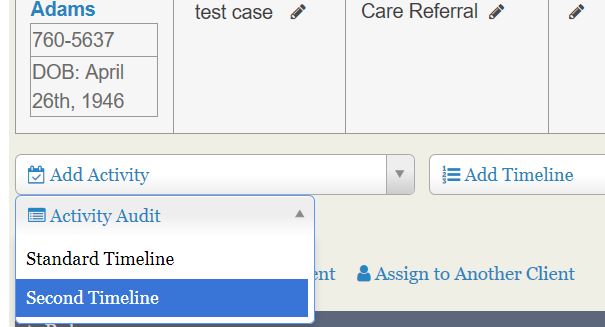
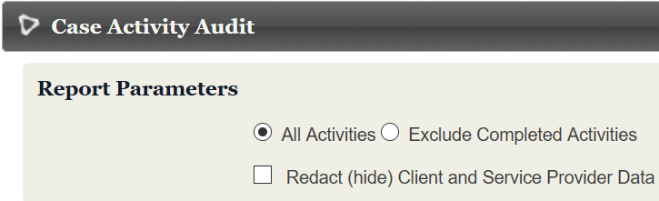
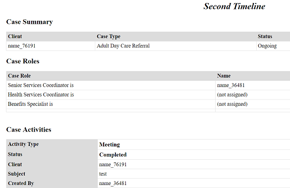
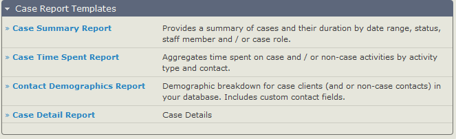
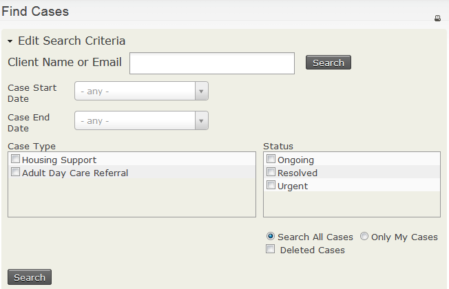
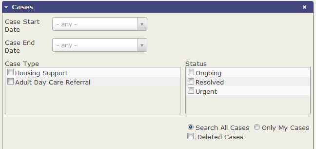

# Reports and analysis

You can review casework in several ways. Within a case, you can run an audit of its activities. The case dashboard gives a quick overview of current cases, with a row for each case type and columns showing totals for each status. Clicking a number takes you to a list of cases of that type and status; 0 is not linked.

For more detailed or customised views for case workers and administrators, use CiviCRM's search features and CiviReport.

## QA audit / redact

Run this report from the contact's case management screen. It is similar to the Print Report link on that screen, but includes only activities defined in a selected timeline. You can include activities with any status or exclude those with 'Completed' status.

If you select **Redact (hide) Client and Service Provider Data**, the report uses randomly assigned numbers instead of names. The same contact has the same number throughout the report.

## CiviCase reports

There are four report templates specifically for cases:

- Case Summary Report
- Case Time Spent Report
- Contact Demographics Report
- Case Detail Report

Because cases are made up of activities, the Activity report template is also useful for providing a dashlet for each user involved in casework to track activities assigned to them. These case activities appear alongside non-case activities, so you may want a protocol for activity names that includes a case reference.

### Printing case reports

To print a report listing all case and case activity data:

1. Navigate to the case from the Case Dashboard, the Find Cases search form, or the contact's Cases tab.
2. Click Print Case Report in the Case Summary section.

Your installation may define additional reports for audit or quality assurance purposes. If so, they appear in the &quot;Run QA Audit/Redact&quot; dropdown menu.

## Searching based on cases

Find Cases lets you search by Case Type, Status, client name, or email. It can help you identify cases needing specific input when the case dashboard is large or cluttered.

Advanced search combines these options with other normal search criteria, so you can find case types filtered by location or custom fields applied to the contact.

Activity Search, under **Search &gt; Custom Searches &gt; Activity Search**, is based on activities rather than contacts, unlike Advanced search.

## Print/merge document

You can create a letter or document using case [tokens](../common-workflows/tokens-and-mail-merge.md) on the case management screen, or on multiple cases through a Find Cases search. On the case management screen, beside &quot;Print Report,&quot; the &quot;Export Document&quot; option exports a PDF, DOCx, ODT, or HTML page. Alternatively, select multiple cases through a search and use &quot;Print/merge Document&quot; to create a document for each case, compiled in a single PDF.

When working with DOCx, turn off spelling and grammar check for best results.

## Further analysis

If the Case Dashboard, CiviReport, and contact and activity searches do not provide what you need, consider commissioning a new report or custom search.

Read the section on [reporting](../reporting/what-is-civireport.md) and the page on [searching](../searching/searching.md) for more information.

<!-- Source: case-management/reports-and-analysis.md -->
