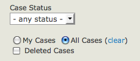
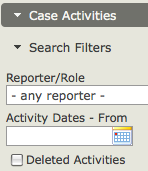

# CiviCase permissions

Create a contact record for each staff member or service provider who will use CiviCase to enter or view case information. These individuals also need a Drupal, Joomla! or WordPress user account.

For Joomla! and WordPress installations, staff members must have back-end (administrator) access. All CiviCase functions are done within the Joomla! and WordPress Administrator interfaces.

Also add contact records for service providers who will be assigned case roles but will not access CiviCase. This lets staff email them pertinent case and client information via CiviCase and record case-related interactions they report.

To let users add and manage cases, configure CiviCase-related permissions in your CMS. You may want case management-specific user roles for staff based on their responsibilities. Permissions control access to the CiviCase component and the case data users can see.

The CiviCase-related permissions are:

- **Access my cases and activities:** Allows a user to create new cases, add activities to cases they've created, and edit those activities. Users with this permission can NOT see cases or activities created by others.

  To restrict users to ONLY seeing case data—that is, to hide all other contact information from them—assign "access my cases and activities" permission WITHOUT "edit and view contacts" permission. This permissioning model is useful for users external to your organisation who should not see contact details.

- **Access all cases and activities:** Allows a user to create new cases, and view and add activities to any case, regardless of who created it.

  

- **Delete in CiviCase:** Allows a user to mark cases or case activities as deleted. They are never physically deleted from the database, but are hidden when marked as deleted.

  Users with this permission can also find and undelete them by checking the Deleted Cases option in Find Cases and the Deleted Activities option in the Case Activities Search Filter.

  

- **Administer CiviCase:** Gives access to Administer > CiviCase options, including:
  - create and edit case types and case statuses
  - set rules for redacting case data. These rules disguise data that could identify the case client in case reports shared with external reviewers.

<!-- Source: case-management/set-up-part4.md -->
