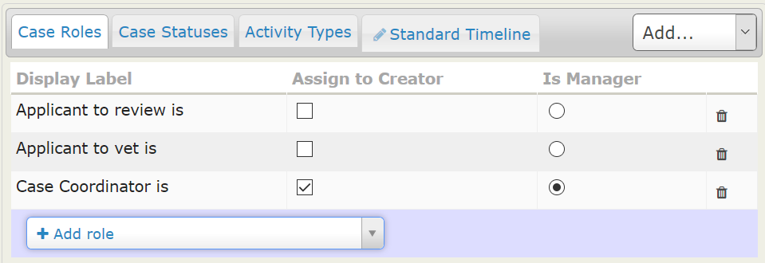
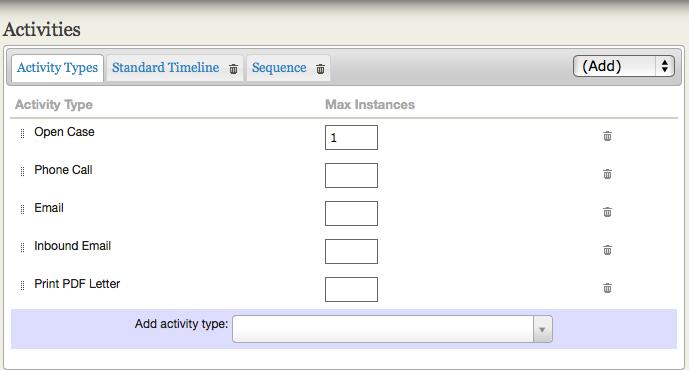
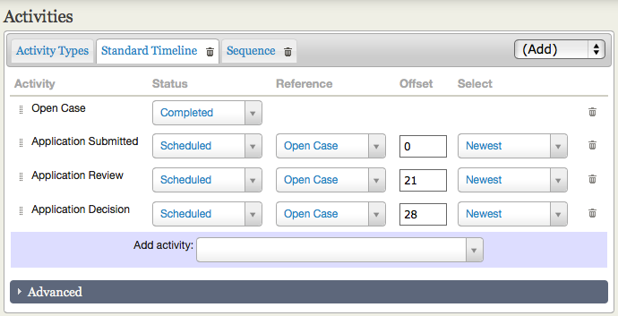
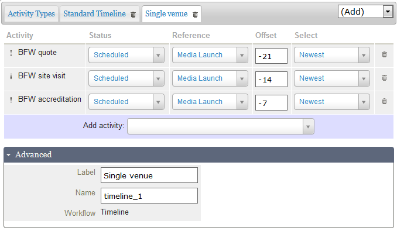

# Set-up

Now that you've gone through the planning process and determined the types of cases, activities and case roles that you need, you're ready to configure your CiviCase installation.

## Enable the CiviCase component

The CiviCase component is included in CiviCRM downloads, but it is NOT enabled by default. To enable the component:

1. Go to **Administer > System Settings > Components**.
2. Select **CiviCase**.
3. Click **Save**.

You will now see **Cases** in the navigation menu.

## Define case types

You can create one or more new case types. To add a case type:

1. Go to **Administer > CiviCase > Case Types**.

2. Click **New Case Type**. Enter a "Title" and an optional "Description" of the case type.

    The case type has both a "Title" and a "Name". The title will be displayed to users, and the name is used internally by CiviCRM. CiviCRM will autofill the name field. The default name is usually fine, but an advanced user may unlock and change it. Once the case type is created, the name should not be changed.

3. Optionally choose to restrict **Activity Assignment**.

    By default, any contact can be selected as the assignee for case activities. You can optionally restrict this by group or by contacts with a user account on your website.

4. Include **Case Roles**.

    This section lists the types of people involved in the case. Roles listed here will be automatically included in each case when a new case is opened. Select the roles you want from the "Add role" drop-down shown below the listing of roles.

    To create a new custom role, click the drop-down and type its name into the field. Alongside any matches from the existing roles, a blue bar will show your keyed entry, underlined. Click it to define the new role. The role will be created when you save your new case type. You can use this method to create as many new roles as you need.

    Each selected or created role appears in the listing of Roles, where you can set "Assign to Creator" and "Is Manager":

    - A role marked "Assign to Creator" is automatically assigned to the person who creates the case.
    - You may mark one role as the manager. The case manager's name will be displayed prominently in case listings and reports.

    Specific people may be assigned to case-roles after a case has been opened.

    New roles/relationship types created through the Case Type interface are individual-to-individual relationships. If you want roles that are individual-to-organisation relationships, once you have finished creating your case type, you can change the relationship definition at **Administer > Customize Data and Screens > Relationship Types**. There you can also review and edit other details of the roles/relationships.

    

5. Include **Activities**.

    When working on a case, the user has an **Add Activity** drop-down menu in the case summary for quickly recording a new activity as part of the case. For example, a case manager could make a phone call to check a point with a colleague, then select **Phone Call** from the menu and record the call's details. The **Phone Call** activity automatically gets filed on to the case.

    When defining the Case Type, you can choose which Activity Types are available in this menu. If you include most or all of your custom Activity Types in the **Standard Timeline**, or another timeline or sequence, you may not want to include them in the '**Add Activity**' menu, particularly if you want tight control over the workflow pattern. Alternatively, including some or all of them gives users more control over the pattern and flow of activities.

    First, create a list of the Activity Types you want readily available from within the case. This is the listing under the 'Activity Types' tab. Select the types users will find useful, such as **Phone Call**, **Email**, **Meeting**, **Follow Up**, and any custom activity types. CiviCRM also includes special activity types such as **Open Case,** **Change Case Status**, and **Change Case Type**; you do not need to add these manually.

    The Activity Types listing needs only activities a user **might choose** to add to the case. Activities included in a Timeline or Sequence do not need to be in this list.

    

    Select the types you want from the "Add activity type" drop-down below the listing. To create a custom activity type, click the drop-down and key its name into the search field. Alongside any matches from existing activity types, a blue bar will show your keyed entry, underlined. Click it to define the new type. It will be created when you save your new case type. You can use this method to create as many new activity types as you need.

    Each selected or created type appears in the listing of Activity Types. You can optionally use '**Max Instances**' to specify how many times a type can be used in a case.

    Once you have created your case type, you can review and amend any new activity types at **Administer > Customize Data and Screens > Activity Types**. New types created through the Case Type interface have default settings that should be fine in most situations. You may wish to amend the label, add a more useful description, or make the type available outside CiviCase by changing the 'Component' setting from 'Cases only' to Contacts AND Cases'.

6. Define the **Standard Timeline**, any additional **Timelines** and/or a **Sequence** you want to use within the case type.

    These are groups of activity types that define a series of interactions, allowing you to pre-define one or more standardised workflows.

    In a **Timeline**, you control the scheduling of each activity relative to the date the case is opened or to another activity, using the 'Reference' and 'Offset' fields. All activities in a timeline are created when that timeline is added to the case and are visible in the case summary. You can create multiple timelines for a case type.

    The **Standard Timeline** is the default for each new case type and provides essential elements that make case types work correctly, so each case type must have one. Its activities are added automatically when the case is opened. It starts with one predefined activity, Open Case; additional timelines start empty. Because you control when an additional timeline is added, you choose its first activity, which may also be a key reference activity for that timeline.

    A **Sequence** defines the order of a set of activities but, unlike a timeline, has no information about time intervals. The next activity in a sequence is created only when the preceding activity is marked as completed. Make sure an activity type included in your timeline(s) is not also included in your sequence, and vice-versa.

    You may add additional timelines or a sequence from the (Add) menu. Currently, you can add only one sequence to a case type.

    

    To add activities to a timeline, select the tab for the timeline you want to work with:

    1. Select or create an activity using the drop-down list.
    2. Select a status for the activity (the default is Scheduled).
    3. Enter a Reference Activity. The default reference activity is Open Case and this is often appropriate. For the Standard Timeline any activity in the timeline can be selected as the reference for any other activity. For other timelines you can select any activity in the case type as a reference, bearing in mind that at the point in alive case where the additional timeline is activated, the reference activity must already exist in the case.
    4. Enter an Offset (in days). Offset values can be positive, negative or zero.
    5. The 'Select' option is helpful if there are multiple instances of the reference activity type, as it allows you to select whether the oldest or most recent instance of the reference activity should be used.

    You can use the "end date" of a case (i.e the final defined activity) as your reference and use negative offset values to schedule activities, as in this example:

    

    You can rename additional timelines or a sequence using the fields in the 'Advanced' section below the main Activities section of the page, as shown above.

    To add activity types to a sequence, select or create them using the Add Activity drop-down menu. Once you have all the types needed for your timeline(s) or sequence, you can re-order them using the drag and drop handles to the left of each activity type.

A set of sample case types is installed when you enable the CiviCase component. You can use these to see what a complete case type looks like or as a starting point for your own case types.

<!-- Source: case-management/set-up.md -->
