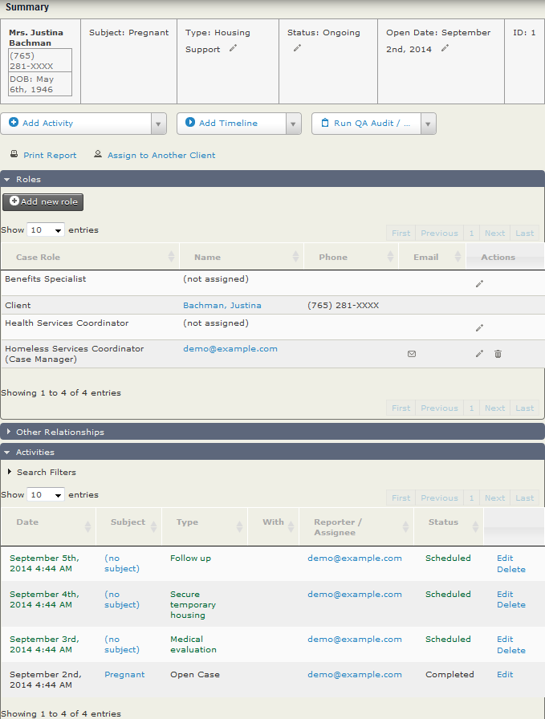

# What is CiviCase?

CiviCase is a tool for tracking and managing sequences of interactions between people in your organisation and contacts in CiviCRM. It's similar to a case management system. In addition to tracking and managing your organisation's interactions with clients or constituents, CiviCase can also help you manage internal organisational interactions.

Cases are used to track complex interactions or communication processes. A case can be used to:

- Track a specific workflow or set of procedures that must be followed and that involves a number of different organisational staff.
- Allow staff to manage and track interactions while avoiding duplication.
- Automate the task of remembering and scheduling follow-up activities.

CiviCase relies heavily on [Activities](../organising-your-data/activities.md), and a solid understanding of activities will help you understand CiviCase more easily.

Organisations have employed CiviCase in a wide variety of situations. The following scenarios show how different types of organisations use it.

## Scenario: managing legislator-constituent interactions

A legislator's staff manages hundreds of interactions with constituents and communities daily. Legislative staff can manage and track these interactions while avoiding duplicating work. For example, if a constituent calls in about an issue, the staffer taking the call can look at the activities in the case related to the issue, see that another staffer is already working on it, and relay that information to the caller.

CiviCase also automates the task of remembering and scheduling follow up activities by presenting staffers with a list of upcoming case activities that require their attention.

CiviCase came in handy to track a series of related tasks that legislative staff do as a result of interactions with constituents, including:

- A legislative staffer received a phone call about illegal dumping near the caller's home. The staffer created a case recording the details and location of the reported issue. She then assigned the task of following up with the Health Department to another member of the legislator's staff. Upon logging-in to CiviCRM, the other staff member saw that the task was assigned to them. He then contacted the Health Department on behalf of the constituent, and contacted the constituent to confirm that the Health Department was informed of the situation.
- The legislator's office received a phone call from a constituent requesting support from an agency. A staffer logged the call in CiviCase and then set up a follow-up call for the next week to make sure that action was taken on the agency's behalf.
- The legislator's staff records event invitations on an ongoing basis that a legislator's scheduler must respond to.

## Scenario: complex application process

An organisation administering a health department grant programme to distribute several million dollars worth of grants used CiviCase to manage the grant applications process. When interested parties submitted their initial applications, a case was automatically created to manage each. The case created contained several activities which were automatically assigned to different staff managing the application process.

In this instance the users were actually from three separate organisations who each had to apply their assessment of the application in turn. First, a basic initial assessment was made to check that certain criteria were met. Then an external organisation made a more technical assessment. The activities were all offset from the start of the case by the number of days in which it was anticipated they should be completed and a coordinator from each organisation assigned the case activities to members of staff according to their capacity as they came in.

At various stages in the process, the status of the case was changed for one reason or another. In this process the main options were:

- passed basic checks
- failed basic checks
- technically feasible
- technically infeasible
- suppliers approved
- suppliers disallowed
- deferred to next round
- accepted

Even though there were thousands of applications and tens of thousands of parts of the application review process, the coordinators from the first two organisations assigned activities to staff members so they each saw a case dashboard showing only the work assigned to them, helping them focus their energy on just their segment of the applications.

For the final assessment, the two organisations hired an external organisation to process the remaining applications. For this process, a review committee was able to view the key details of applications with different statuses, and finally, just review the summary details of all applications with an accepted status to make a final determination.

## CiviCase in use

Here's a simple example of a Housing Support case. The Open Case activity is marked as Completed when the case is opened. Three additional activities are automatically scheduled when the case is opened. A medical evaluation is scheduled for the following day (reference offset is 1); then secure temporary housing (reference offset 2); and finally a follow-up three days later.

In this example there are three case roles. The Homeless Service Coordinator is both the creator and manager of these cases. In addition, a Health Services Coordinator and a Benefits Specialist role are created when the case is opened.

<!-- cividoc:popular-extensions:start -->
## Popular extensions

These are widely used extensions in the relevant category of the official CiviCRM Extensions Directory. Usage is a popularity signal, not a compatibility or suitability guarantee.

- [Documents](https://civicrm.org/extensions/documents) — reported usage: 337
- [CiviCalendar](https://civicrm.org/extensions/civicalendar) — reported usage: 250
- [New CiviCase UI](https://civicrm.org/extensions/civicase-v5) — reported usage: 206
- [CiviProspect](https://civicrm.org/extensions/civiprospect) — reported usage: 176
- [CiviCase Tokens](https://civicrm.org/extensions/civicase-tokens) — reported usage: 123

[All extensions for this component](https://civicrm.org/extensions?category=99)

Check development status, current CiviCRM compatibility, CMS requirements, and release notes before installation.

Usage snapshot reviewed: 2026-10-13.
<!-- cividoc:popular-extensions:end -->

<!-- Source: case-management/what-is-civicase.md -->
