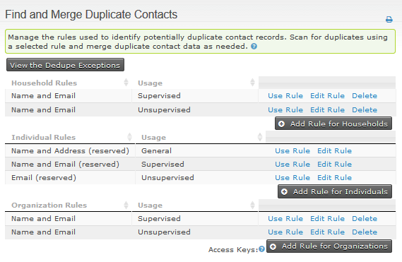
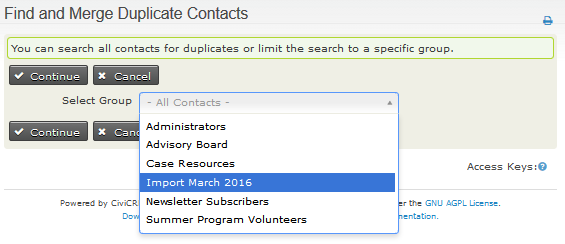
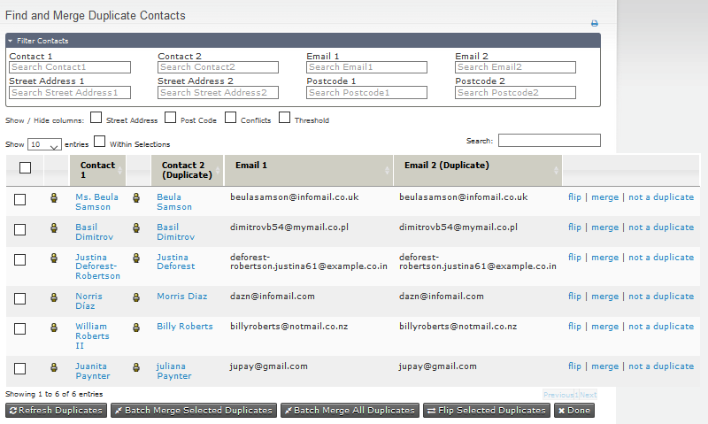
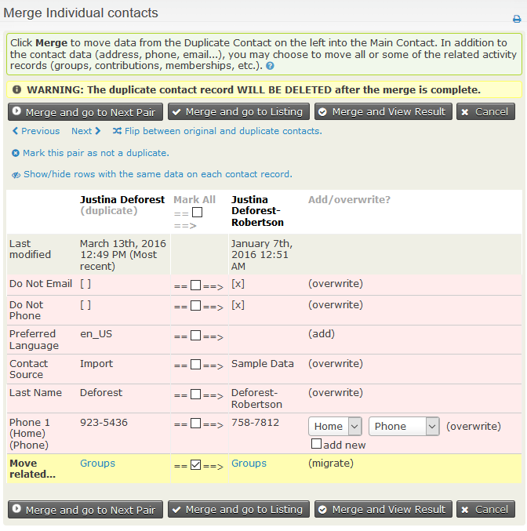
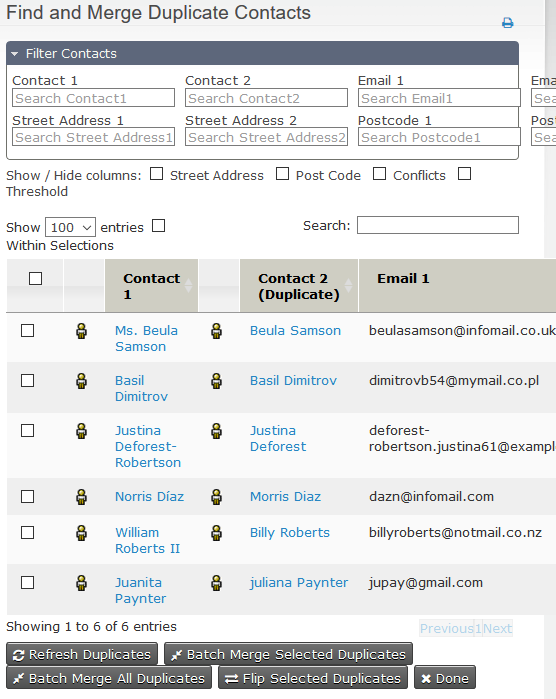
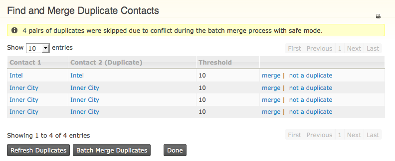

# Deduping and merging

## What is deduping?

Duplicate contacts can enter your database in several ways:

- An administrator or user creates a contact through the admin interface when that contact already exists.
- A contact signs up online using a different email address or name from the one already on their record.
- Duplicate contacts are included in an import.

Duplicates can also arise when people fill in forms about themselves without realising they are already in your list of contacts, perhaps with a differently spelled name or another email address.

## CiviCRM features for deduplicating contacts

CiviCRM has features that attempt to prevent duplicate contacts from being created and features that help you find and merge duplicates already in your database. Some act automatically, or *unsupervised*; others involve a user, or *supervised*.

These features include:

- Scanning your database for duplicates using a selected dedupe rule and merging duplicate contact data as needed.
- Selecting two contacts from search results and choosing to merge them.
- Automatically suggesting duplicates when contacts are added or edited via the user interface.
- Automatically merging a person's details into an existing contact when they sign up online for Events, Membership, Contributions or Profile pages.
- Automatically merging a person's details when importing contacts.

## Dedupe rules

Dedupe rules specify when CiviCRM should consider contacts to be duplicates. For example, a rule could treat two contacts as duplicates when both their email addresses and first names match.

### Using the default rules

If you do not want to configure dedupe rules at this stage, you can use the default rules to find duplicates.

To view the rules, go to **Contacts > Find and Merge Duplicate Contacts** in the navigation menu.



Different rules are configured for each contact type: individuals, organizations and households. A default supervised rule and a default unsupervised rule are set for each type. CiviCRM uses these default rules for automatic checking, as described below.

### Understanding supervised, unsupervised and general rules

CiviCRM now includes three categories of dedupe rules:

- **Unsupervised:** The 'Unsupervised' rule for each contact type is automatically used when new contacts are created through online registrations, including Events, Membership, Contributions and Profile pages. These rules are also selected by default when you Import contacts. They are generally configured with a narrow definition of a duplicate to avoid accidentally merging a false match.
- **Supervised:** The 'Supervised' rule for each contact type is automatically used to check for possible duplicates when contacts are added or edited via the user interface. The UI alerts the user if a contact they are creating matches another contact under the rule. The user can decide whether to edit the existing contact or continue creating a new one. Supervised Rules should have a broader definition of a duplicate because the user can decide whether to act on the match.
- **General:** You can configure only one 'Unsupervised' and one 'Supervised' rule for each contact type, but you can configure any number of additional 'General' rules to provide other criteria for finding possible duplicates.

### Configuring rules

To determine whether two contacts are duplicates, CiviCRM checks up to five fields that you can specify. You can set a length value to determine how many characters in a field are compared. For example, a length of 2 on **First Name** makes “Mike” match “Michael” because their first two characters are the same. At a length of 3, they do not match. If the length is blank, CiviCRM compares the entire field value.

Each field also has a numeric weight representing the relative importance of a match on that field. When a field matches, its weight is added to the rule's total weight. After each field is checked, contacts are flagged as suspected duplicates if the total weight equals or exceeds the rule's numerical threshold.

## Using rules and merging duplicate contacts manually

!!! tip
    An alternate UI is available in [the deduper extension](https://github.com/eileenmcnaughton/deduper/blob/master/Readme.md).

1. Go to **Contacts > Find and Merge Duplicate Contacts**.
2. Click the **Use Rule** link to scan for duplicate contacts using the selected rule.
3. Choose whether to search all contacts or limit the search to a particular group. If you choose a group, CiviCRM looks for duplicate pairs where at least one contact is in that group.

   

   Contacts of the type assigned to the rule are scanned and compared. If a pair's match meets or exceeds the rule's threshold score, the contacts appear in a list of possible duplicates. The list has show/hide tickboxes for Street Address, Post Code, Conflicts and Threshold.

   

4. Click **Merge** for a pair to view a table of their details. CiviCRM designates the record in the left column as the duplicate. The record in the right column is the original, into which selected data from the duplicate will be merged.
5. To move information in the opposite direction, choose **Flip between original and duplicate contacts** at the top of the page.

   

6. Review the colour-coded rows on the merge screen:
   - Green indicates that the information is the same for both contacts. You can hide these rows by clicking **Show/Hide rows with the same data on each contact record**.
   - Red indicates that the information differs. For each field, leave the check-box in the middle column unticked to keep the original data shown on the right, or tick it to use the duplicate contact's value. For email addresses or phone numbers, you can keep both values by ticking both the checkbox in the middle column and “add new” in the right column to copy the duplicate data.
   - Yellow indicates that the check-box is ticked by default, meaning data from the duplicate will be **added** to the original record. This applies to tags, groups and activity data, including event attendance and contributions. If you untick the check-box, the duplicate's data will be lost.
7. Click **Merge...** to complete the merge, or **Mark this pair as not a duplicate** if the contacts are not the same.
8. Contacts marked as 'not a duplicate' are excluded from all dedupe results listings. To review them, click the “View the Dedupe Exceptions” button on the main “Find and Merge Duplicate Contacts” screen.

## Merging multiple contacts simultaneously

You can merge multiple pairs from the possible duplicates screen, which can display up to 100 rows.



Beneath the list, you can choose **Batch Merge All Duplicates**, which merges **all** duplicates found, not just those displayed on your screen. Alternatively, choose **Batch Merge Selected Duplicates** to merge rows selected using the box on the left. **Flip Selected Duplicates** is in the same area. When duplicates are merged, Contact 1 is kept and contact 2 is merged and then deleted, so you may want to switch their order first.

Batch merging merges all contacts under the given rule, or all selected contacts, provided there are no data conflicts. For example, two contacts named “Michael Blake” might match on their first and last names while neither has an email address. They can be merged if their data is identical or one has information the other lacks, such as a work phone number on one contact and a mobile number on the other. If both have different home telephone numbers, they are skipped rather than merged.

After a batch merge, you return to the original list. If records were skipped because of data conflicts, a message is displayed. Click **Refresh Duplicates** to see the updated list of contacts that were not merged; the page does not refresh automatically because searching a large database could cause a significant delay. You can then assess and merge the remaining duplicates manually.

To increase the number of pairs that can be resolved in a batch merge, the [deduper](https://github.com/eileenmcnaughton/deduper/blob/master/Readme.md) extension provides a range of resolutions, including options to make conflicts on certain fields non-blocking or to handle diacritic names.

Batch merging can also be done from the command line, for example:

```
 echo '{"search_limit": 10000, "criteria":{"contact" : {"id" : {">" : 200}}}}'
   | drush --in=json cvapi Job.process_batch_merge

```

Would find any contacts that match any of “the first 10000 contacts found with an id greater than 200” and attempt to automtically merge them using the defaults of 'safe' mode (skip when there are conflicts) and the default rules for individuals.



!!! warning
    Before you begin to consider using batch dedupe, please take note of the points below.

    * This feature is intended for use with large data sets that have strictly managed field structures. If you have a small database with only a few duplicates, we recommend you merge them manually using your own judgement.
    * Once merged, the links between the duplicate contact and records elsewhere in the system will be transferred to the original contact (e.g. event participant records, groups, tags, contributions, activities, cases and memberships). You will NOT be able to reverse this change.
    * Duplicate records, once merged, will be deleted and are not recoverable, unless you have database logging enabled. We strongly recommend backing up your data before running a batch merge.

## A multi-stage deduping process

Using only one dedupe rule can leave duplicates in your system. The following process applies multiple rules systematically. If your individual unsupervised rule is strict enough, you may be able to batch de-dupe in the first stage and dedupe manually in the second.

1. Look for duplicates using the “Individual unsupervised” rule: click the **Use Rule** link for contact type “Individual” at the usage “unsupervised”.
2. Select **All Contacts** or a particular group.
3. Click **Continue**.
4. If duplicates are found, merge or delete the duplicate contacts.
5. Look for duplicates missed by the stricter rule using a “supervised” or “general” rule: click the **Use Rule** link for “Individual supervised” (contact type “Individual” at the usage “supervised”).
6. Select **All Contacts** or a particular group.
7. Click **Continue**.
8. If duplicates are found, merge or mark them as 'not a duplicate'.

## Merging contacts from search results

If you notice duplicate contacts in search results, you can merge them there instead of using the separate **Find and Merge Duplicate Contacts** process.

1. Select the duplicate contacts by clicking the check box at the left of each record.
2. Select **Merge Contacts** from the **Actions** menu.
3. Follow the normal steps for merging duplicate contacts.

<!-- Source: common-workflows/deduping-and-merging.md -->
