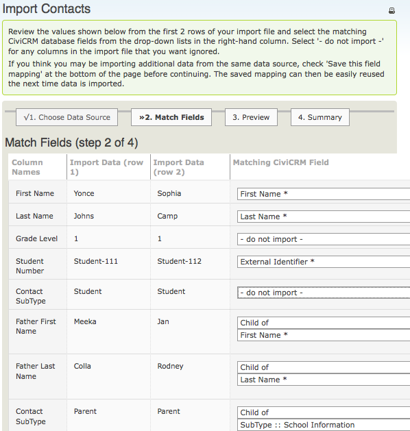
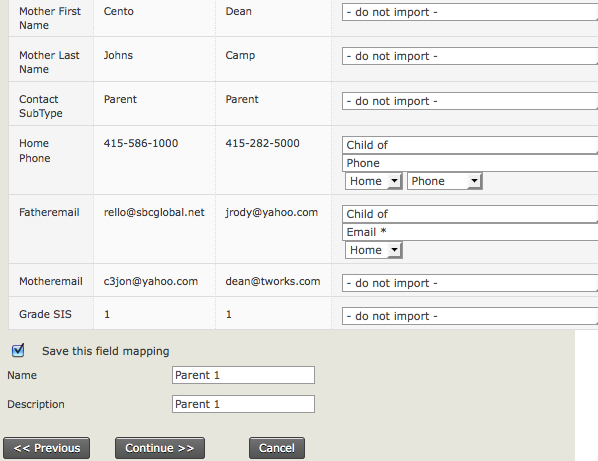

# Importing related contact data

Import a separate CSV file for each type of related data, such as organisational addresses with employees, parent–child relationships, activities or contributions.

CiviCRM has specific tools for importing related contact data, and specific import tools for contributions, memberships and event participation. See their respective chapters for details. To import relationships, run multiple contact imports.

For example, importing a child and both parents takes three imports: one for the child, one for the father and one for the mother.

1. Import the child with an external identifier that can be used to match the child to the parents.
2. Import the father as a related contact, linking him to the child using the child’s external identifier.
3. Import the mother as a related contact in the same way.

In the example below, one CSV file contains both father and mother information. It is used twice during the import. The images show the fields used.

The father is linked to the original child using the external identifier, and the related father name is imported using the ‘Child of’ relationship type.

After the import, search for the parent and examine the relationship tab. The parent should have a relationship linking them to the child. Repeat the process for the mother and for other relationships as necessary.

<!-- Source: common-workflows/importing-data-into-civicrm-part2.md -->
