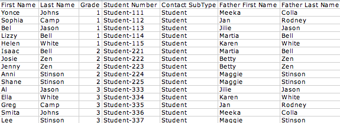
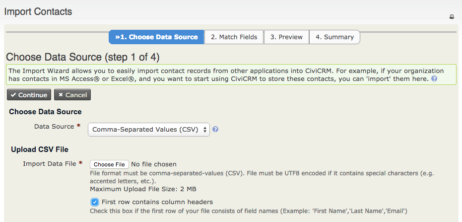
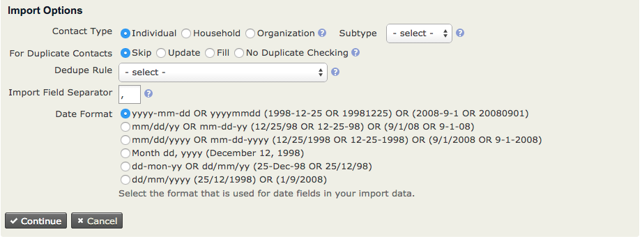
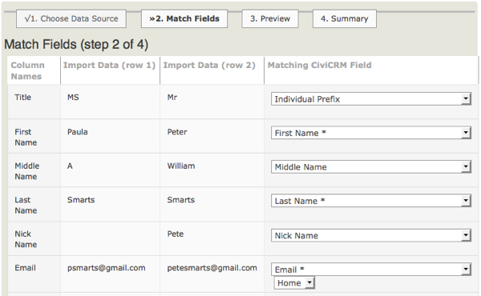
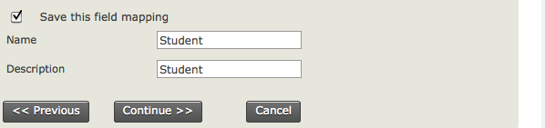
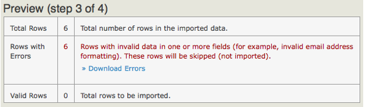
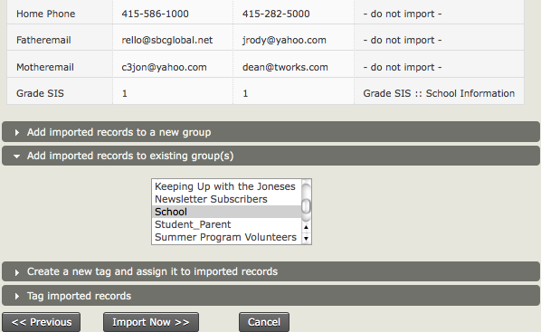
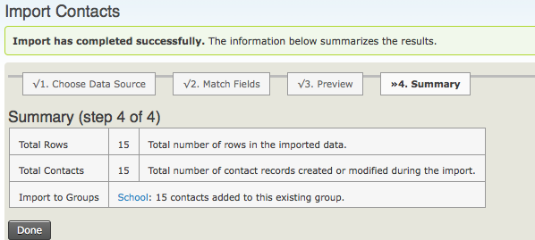

# Importing data into CiviCRM

Most organisations have data outside CiviCRM, such as data in previously used database platforms, spreadsheets created for specific events or other purposes, and email address books. Manually entering large amounts of data can be tedious. CiviCRM provides a way to import data en masse if the source can export it into a common format such as a Comma Separated Version (CSV) file.

Imports can also update existing data. The options for updating contacts are covered under [Running an import](#running-an-import).

## Considerations before importing

For more detail on how to think about your data before importing it into CiviCRM, read [“Organizing your data”](../organising-your-data/overview.md), especially [“Mapping your data into CiviCRM”](../organising-your-data/mapping-your-data.md).

## Preparing to import data

Importing data requires attention and care. You can import core and custom data for contacts, as well as data for event attendance, activities, memberships, and contributions. This page focuses on the contact import process; the processes for other data are similar.

There are two ways to import data:

- **From CSV files.** Most database and spreadsheet applications (e.g. OpenOffice.org Calc, Google Spreadsheets, Microsoft Excel) can create and manipulate CSV files. It is often easier to view and clean data in a CSV file than in an old database. Each column maps to a CiviCRM field, so use a different column for every distinct bit of information.

    Depending on your country or region, fields in CSV files might be separated by semicolons (`;`) instead of commas. If so, change the Import/Export Field Separator value in the CiviCRM Localization settings by going to **Administer > Configure > Global Settings > Localization** in the navigation menu.

- **From another SQL or MySQL database stored on the same server, using an SQL query.** This option is only for advanced users with a clear understanding of server and database administration.

If you do not understand your existing data and how it maps to CiviCRM fields, you may encounter problems during import. Read about each type of data in the other sections of this CiviCRM Manual.

The following recommendations can help you prepare:

- Test an import with a small subset of records. After importing the test set, visit the records in CiviCRM and check that the data was imported and functions as expected.
- Consider creating a test contact with every attribute defined in your existing data set. Import that contact and check that CiviCRM represents all the data correctly.
- When mapping source columns or fields to CiviCRM fields, you can save the mapping as an *import map* for future use. This helps when importing multiple files with the same structure. To save one, click the “Save this field mapping” check-box at the bottom of the Match Fields screen of the import wizard, then enter a name and description. To reuse it, select it from the Load Saved Field Mapping dropdown menu on the Choose Data Source screen (step 1).
- If imports time out or take too long, try smaller batches. If you have the appropriate permissions on your web server, you can also increase the `memory_limit` and `max_execution_time` values in `php.ini`.
- You can add all contacts in an import to new or existing groups or tags. Every contact in a single import receives the same groups and tags:
    - Assign only groups and tags that apply to every contact in the set. For contact-by-contact assignments, import small, discrete batches whose contacts share the same groups and tags. Alternatively, create searchable custom data fields containing the groups and tags you want to assign. After import, search those fields and use the “Add Contacts to Group” or “Tag Contacts” batch actions on the results.
    - You can use a new group or tag to identify an import batch. This can help you find when contacts were imported and undo an entire import if necessary.
- Put first and last names in separate CSV columns, because CiviCRM stores them in separate fields. Do the same for city and postal code/zip code. Most spreadsheet programs have tools for splitting text across fields.
- Express country names as they appear in CiviCRM: for example, ‘United States’ rather than ‘United States of America’, and ‘United Kingdom’ rather than ‘Britain’.
- If importing multiple locations, the first becomes the primary location address. You may need to move columns so that the desired location becomes the Primary Location, or split the import if different records need different types of Primary Location.
- If you choose the location type ‘Primary’ for an address field, it updates an existing contact’s primary address, if there is one. For a new contact, or a contact without an existing address, the location type will be your site’s default.
- When importing into multi-choice custom fields, such as check-boxes or radio buttons, the data source can use either the label visible in CiviCRM or the value stored in the database. For multi-choice core data fields, specify only the value(s), not the label.
- When updating multiple-choice options, new values replace the entire field. For example, updating a contact’s Colors field from “blue” to “orange” results in orange, not orange and blue.
- To import multiple values into a multiple-choice field, use the “,” (comma) character as a separator, using either the Label OR the Value of the required options: for example, “1, 2, 3” or “fred, red, yellow”.
- Use an accepted date format in the data source and select the same format on the Choose Data Source screen of the import wizard.
- Set up any name prefixes and suffixes you use in the administration interface at **Administer > Option Lists** in the navigation menu.
- If you plan later imports of related data, such as contributions, event participation, or memberships, give contact records unique IDs that also appear in the related data. In the initial contact import, map those IDs to CiviCRM’s External ID field. You can then use the original, or legacy, IDs to match contacts in later imports.
- Master Address Belongs To is a special import field that works only with `CiviCRM_Address.id`. The information needed to use it is available only directly from the MySQL database tables. It is not shown elsewhere in CiviCRM, including data screens, link urls, profiles, or exports. [Information on how to use this special field is available in the Wiki](http://wiki.civicrm.org/confluence/display/CRMDOC/Importing+Data+-+Notes "CiviCRM Wiki - Importing Data").

### Required fields for contact imports

Include the required fields in your CSV import file. They are marked red and starred in the interface. If you have less data, **selecting one field is enough**. The External Identifier field is useful only if you want to update existing contacts. The field marked **(Match to Contact)** is required for deduplication purposes.

- **Email (Match to Contact)**
- **External Identifier**
- **First Name**
- **Last Name**

### Setting up a CSV file for importing

The following image shows an example spreadsheet in .csv format:

Plan your column headings around the data you are collecting. You may need more than one .csv file and multiple imports.

If you plan to import related data for a contact, such as event participant information or contributions, make sure each contact record has a unique identifier, or has First Name, Last Name and Email, so you can link related data in later imports. If you have a unique ID, map it to CiviCRM’s External Identifier on import.

### Address standardisation

For many organisations, standardising addresses is an important part of cleaning data. In the US, this means conforming to conventions defined by the United States Postal Service’s Standards for Addresses. Standardised addresses can improve address search results because CiviCRM can parse addresses based on USPS standards if you choose to do so.

For more on how Address Parsing is handled and used in CiviCRM, refer to the Installation chapter of the Configuration section of this manual. When adding or editing contacts, enter and edit elements such as street number, street name, and Apt/Unit/Suite number according to these standards.

## Running an import

The import process has four steps.

### Step 1: Setup

Specify the basic details of the import, including its data source: a CSV file or an SQL query of a database on your server. A check-box lets you indicate whether the first row of the file contains column headers.

Imports use the default **unsupervised** Dedupe Rule to decide whether a contact is a duplicate, unless you select another Dedupe Rule during this step. Refer to the *Deduping and Merging* chapter in this section for information on duplicate matching rules.

Choose what happens when the import encounters a duplicate:

- **Skip**: Leave the original record unchanged.
- **Update**: Update the original record with database fields from the import data. Fields absent from the import data remain unchanged.
- **Fill**: Add imported data to fields that are missing or blank in the original record. Fields with existing values remain unchanged.
- **No Duplicate Checking**: Insert all valid records without comparing them with existing contacts.

You can match imported data directly to existing Contact IDs only in Update, Fill or No Duplicate Checking modes.

**Import mappings** tell CiviCRM how fields in the import file correspond to CiviCRM fields. The first time you import from a particular data source, it is a good idea to check “Save this field mapping” at the bottom of the page before continuing. You can request that the saved mapping be loaded at this step for a later import of similar data.

### Step 2: Match the fields

If the file has column headings, they appear in the first column on the left-hand side of the Field Map. The next two columns show two rows of data to be imported; the fourth shows the Matching CiviCRM Field. If you loaded an import mapping in Step 1, its choices appear here. You can change them for this import.

Matching CiviCRM fields include standard fields such as First Name and Last Name, as well as custom data fields configured for contacts on your site. Use the dropdown list to match each field. For example, match a source column headed Surname to Last Name.

Select “- do not import -” for columns you do not want to import.

You can modify and save a mapping when a spreadsheet gains new columns. Put new columns to the right of those previously mapped in CiviCRM. This lets you reuse the saved mapping for the original fields and then map the new ones.

If you add new columns *before* previously mapped columns, you cannot use the saved mapping and must map all import fields again. After mapping, either leave the original saved mapping unchanged or check “Update this field mapping” to include the new mappings.

### Step 3: Preview

The preview reports the number of rows to be imported and lets you check the field matches.

If rows contain data that does not meet CiviCRM’s requirements for one or more fields, an error message shows the number of invalid rows. Click Download Errors, review the errors in the downloaded file, and fix them before importing.

At the bottom of the form, you can add contacts to an existing group, import to a new group, create a new tag, or tag imported records. Adding imported records to a separate group is strongly recommended so you can find them quickly and, if necessary, delete and reimport them.

### Step 4: Summary

The final screen reports successful imports, Duplicate Contacts and Errors. If you set the import to add all contacts to a Group or Tag, you can click through to see the imported contact records.

Search for the contacts you imported. Examine their fields and custom data to check that the import worked as expected.

<!-- Source: common-workflows/importing-data-into-civicrm.md -->
