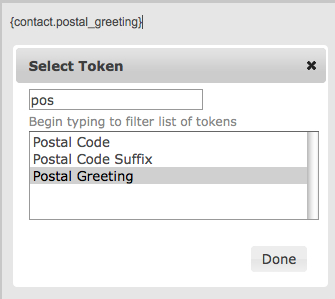

# Postal mail communications

CiviCRM supports postal mail and postal mail campaigns. This page assumes a strong understanding of CiviCRM's search features, custom fields, activities, profiles, and mail merges using word processing software.

## Planning your mailing

Before sending postal mail, identify your goals and plan the steps. Consider:

- What types of mailing do you send to your constituents?
- Do you send mailings to everyone in the database, or do you frequently target a select group of contacts?
- How do you want to greet recipients (for example, "Dear Jane" or "Dear Jane Doe")?

There are three ways to use CiviCRM for postal mailings:

1. Generate labels: print standard address labels when you don't need to personalise the content, for instance to send a printed brochure.
2. Export contacts and do a mail merge in an external tool, such as OpenOffice or Microsoft Word. See [Exporting](exporting-your-contacts.md) for detailed exporting instructions.
3. Use CiviCRM's [Print/merge document](#print-merge-document) function to do the merge directly in CiviCRM.

Many nonprofit organisations in the USA need to sort mailing recipients by zip code for bulk mailing. If this applies to your organisation, create mailing labels in a word processor where you can control the sort order, rather than in CiviCRM. You can reuse the same spreadsheet for your mail merge.

## Greetings and salutations

You can set a postal greeting format for each contact, from the friendly "Dear John" to the more formal "Dear Mr. John Doe". You can also enter a *customized greeting*, such as "Your royal highness".

Edit postal greetings in the Communications Preferences section of the contact edit form. To set or reset postal greetings en mass, see [Scheduled Jobs](../initial-set-up/scheduled-jobs.md) and the [wiki documentation](http://wiki.civicrm.org/confluence/display/CRMDOC/Update+Greetings+and+Address+Data+for+Contacts).

## Print/merge document {:#print-merge-document}

CiviCRM provides tools to create merge letters directly from the interface. You can insert tokens representing database fields into a letter, optionally save it as a template, and output it in PDF, HTML, Word (`.docx`), or Open Document (`.odt`) format.

To create a letter:

1. Conduct a search (for example **Search &gt; Find Contacts &gt; Advanced Search, or a Custom Search**. If you want to print letters for members of a Group, go to **Contacts &gt; Manage Groups** and click "Contacts" next to the Group you want.
2. Enter your search criteria and click **Search** (not applicable if using a Group).
3. Select the contacts who will receive the letter.
4. From the Actions dropdown menu, choose **Print/merge document.**
5. Optionally select a template as the basis for your letter. You may also associate the letter with a Campaign.
6. Review Page Format and make any desired adjustments to the paper size, margins, and page orientation.
7. Enter your text and adjust its formatting in the WYSIWYG editor. You can also insert image files, such as your organisation's logo or a signature. Click in the body of the letter where you want the image to appear, then click the Image icon.
8. Personalise the letter with [tokens](tokens-and-mail-merge.md), which are placeholders replaced with field values for each selected contact. Postal Greeting is a commonly used token. Click in the body of the letter where you want the token, then click the **Insert Tokens** dropdown above the letter at the top right and select the desired token.

    

9. Decide whether to save the letter as a new template for future use. If the letter was based on a template, you can update the existing template. Saving a letter as a template can streamline future workflows.
10. Select an output format: PDF, HTML, MS Word (`.docx`), or Open Document (`.odt`). Depending on the complexity of the letter, some formats may handle its layout and design better than others.
11. Click **Download Document** to generate the letter(s). Depending on your browser configuration, a pop-up may ask where to save the file, or you may be prompted to open it immediately. After the download completes, review the file's formatting. The window remains open so you can adjust the letter and generate it again.

You can also use Print/merge document for documents other than letters, such as attendance certificates for a workshop.

Generating many letters can be resource intensive, particularly with PDF output. If this happens, consider implementing the wkhtmltopdf alternate PDF generation tool, which scales to higher volumes better than the default tool. Visit **Administer &gt; Misc &gt; Path to wkhtmltopdf executable** for details.

The Print/merge document action is also available from the Actions dropdown in a contact record. For contributions, you can use the **Thank you letters** search result action after using **Find Contributions**.

## Generate mailing labels

1. Perform a search to select the contacts you want to target.
2. Choose **Mailing Labels** from the **Actions** dropdown menu and click Go.
3. Select the mailing label style.
4. Decide whether to exclude people with "do not mail" checked in their privacy options (checked by default and recommended), and whether to merge records with the same mailing address into one label.

Merging records with the same mailing address helps avoid duplicate mailings to households or organisations. Each name at that address appears on a separate line on the label.

Your system administrator can configure the fields included in mailing labels. See the information on configuring address settings in the Contacts chapter for the available options.

<!-- Source: common-workflows/postal-mail-communications.md -->
