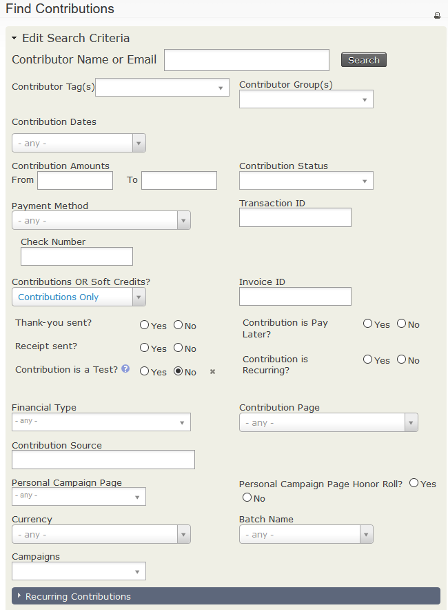
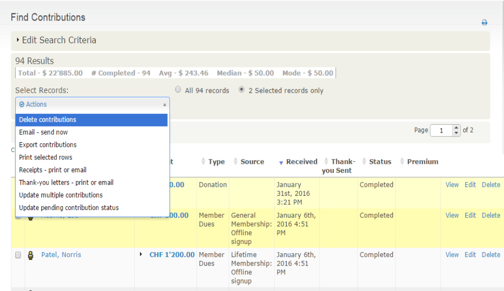

# Finding contributions

CiviCRM distinguishes between contributions and the people who made them. Consider which you need before searching. For example, if you want to send a gift to everyone who made a contribution in the last year, searching for contacts or contributions depends on whether you want someone who made two contributions to receive two gifts.

**Find Contributions** searches contribution data and returns contribution records. It is found at **Contributions &gt; Find Contributions**.

You can search by criteria such as Date Range, Contribution Amount, and Contribution Status. Contributions must match all specified criteria, so adding criteria narrows the search. For example, searching for the Financial Type "donation" and the Date Range "January 1st to May 31st" returns contributions that meet both criteria. Relative Date Ranges such as "Last Month" or "Last Year" are often useful.

Alongside the matching records, the results screen displays the Total Amount, Number of Contributions, Average Contribution Mean and Mode for the search results.

After selecting all or a subset of the results, you can choose from the **Actions** menu:

- **Update multiple contributions**: Useful for updating a large number of contributions' thank-you dates at once, for example. You need to [create the profile](../organising-your-data/profiles.md) you want to use *before* performing the search and batch update.
- **Delete contributions**: Removes contributions entirely, as if they had never been entered. Editing contributions and updating their status to canceled provides a better audit trail, but you may want to Delete a contribution entered on the wrong contact's record.
- **Export contributions**: Exports contributions. If you export multiple contributions from the same contact, the export file contains one row per contribution. To search for one result per contact, use the contact advanced search.
- **Receipts - Print or Email Contribution:** Creates a PDF file of all the receipts in the search, or emails the receipts to the associated donors. See "Sending thank you letters" below for more information.
- **Email - send now**: Sends an email to all or selected contacts found in the search.
- **Thank-you letters - print or email**: Creates a custom PDF letter for each selected contribution, with the option to update the receipt or thank you date for each.
- **Record payments for contributions**: Records payment details for all or selected online "Pay Later" contributions. This action only works for contributions with the status of Pending (Pay Later).

The **Advanced search** returns contacts by default, but you can choose **Contributions** for the **Display Results As** field to show contributions instead. Expand the Contribution pane to use the standard contribution search criteria. You can also filter results with additional criteria, such as "Find all donations to the tax appeal made by members of my organisation" or "Show me all contacts who have contributed more than $100 last year AND who live in California".

<!-- Source: contributions/finding-and-viewing-contributions-part2.md -->
