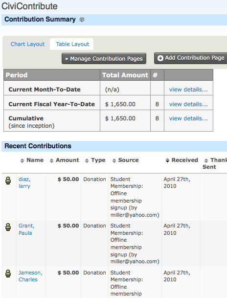
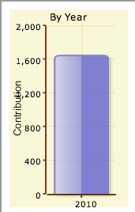

# Viewing the CiviContribute dashboard

The CiviContribute main page, or dashboard, summarises contributions received in the current Month-To-Date, Year-To-Date, and cumulatively since inception (all contribution records in your CiviCRM installation). You can browse contributions recorded automatically or added manually. The dashboard also has buttons to manage and add contribution pages.

Different layouts are available for viewing summaries. The following screenshot shows the most recent contribution to a campaign using the Table Layout tab:

You can view bar or pie charts comparing contribution totals across months of a given year and across years by clicking the Chart Layout tab:

You can also add any number of contribution [Report Dashlets](../the-user-interface/menu-dashboard-and-dashlets.md#dashlets) to your personal CiviCRM Dashboard. Examples include a bar chart summary of Year-To-Date contributions by Financial Type or month, and a list of the top 10 donors.

<!-- Source: contributions/finding-and-viewing-contributions.md -->
