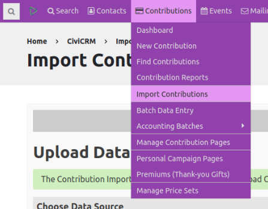
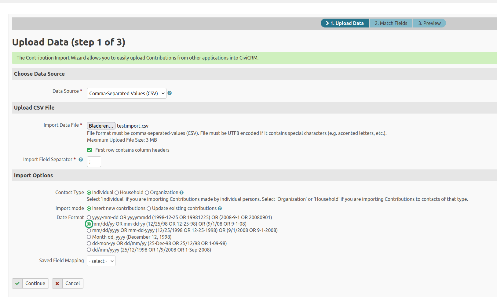
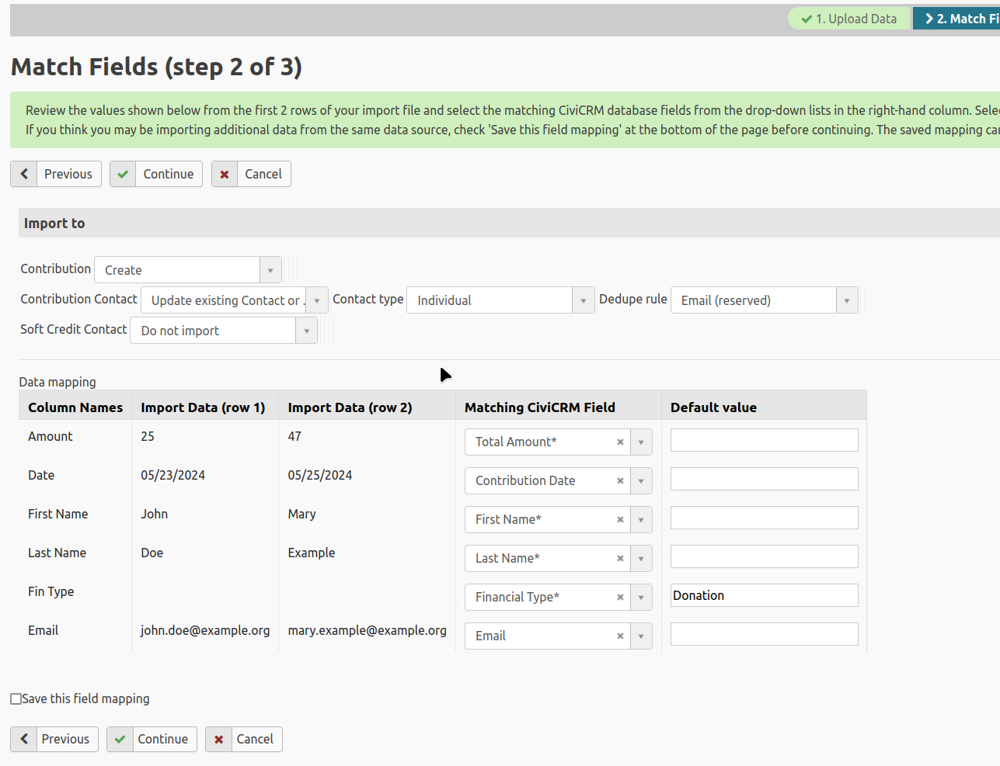
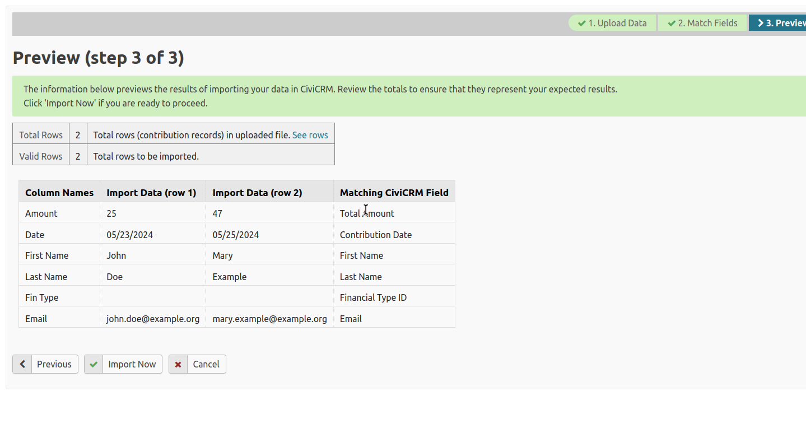
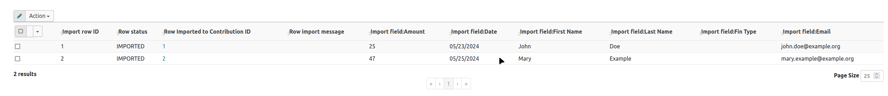

# Import contributions using Civi Import

This procedure assumes you have installed the Civi Import extension, which is shipped with CiviCRM.

!!! tip "Installing extensions"
    If you need more information about installing extensions, check the [Extensions section](../introduction/extensions.md).

Prepare a data file containing the donations you want to import. The file could come from a third party or be created internally. Then go to **Contributions>Import Contributions** to start building the import.

## Choose a data source and import options

### Choose a data source

This example uses _Comma-Separated Values (CSV)_. You can also import from a _spreadsheet_ (.odt or .xlsx files) or a _SQL Query_.

### Select your file

Use the button next to _Import Data File_ to select a file from your local computer or network.

!!! note "UTF8"
    Your CSV file, if you are using that format, needs to be UTF8 encoded if it has special characters. See the [Wikipedia definition][utf8] for background.

Specify the field separator used in your file.

!!! tip "Be careful with decimal values"
    Be careful when importing decimal values in combination with your field separator. In some countries, the comma (,) is used as a decimal separator. Using a comma as the field separator as well will mutilate your amounts. To be on the safe side, you might want to use ; as a field separator.

### Set import options

Select or specify:

- which _contact type_ you are importing contributions for;
- whether you are creating _new contributions_ or _updating existing contributions_;
- the _date format_ used in your import file;
- a previous mapping, if you want to use one, from the _saved field mapping_ select box.

In this example, select _contact type_ Individuals because the contributions were made by individual people. Select _insert new contributions_ because you are importing new data, and select the mm/dd/yy _date format_. Leave the saved field mapping blank because there is no saved template of mapped fields.

## Match fields

Click _Continue_ to open the Match fields page. Here you match fields in your file to fields in CiviCRM.

The options under _Import to_ set the rules and structure of the import:

- Because you selected new contributions, the _Contribution_ box is automatically set to _Create_ and cannot be changed.
- The _Contribution Contact_ box controls what happens to contacts imported with the contributions. This example updates or creates contacts; you could instead _match_ existing contacts or _update_ existing contacts.
- You selected _contact _type_ as _Individual_ on the first screen, but you can change it here.
- You must specify the _dedupe_ rule used when importing.
- You could also import _soft credits_, but this example does not.

!!! tip "More background on dedupe and soft credits"
    For more background on dedupe rules, see [Deduplication](../common-workflows/deduping-and-merging.md). For more background on soft credits, see [Soft credits](soft-credits.md).

In the data mapping section, match the fields in your file to the CiviCRM fields where their data should be imported. _Column Names_ shows the fields in your file; _Matching CiviCRM Field_ shows the corresponding field in CiviCRM. Select _do not import_ for any data in the file that you do not want to import.

You can specify a _Default value_ for a CiviCRM field. It is used whenever the field has no data in your input file. In this example, _Financial Type_ has no data in the file, so it uses a default value. The field must exist in the import file, but it can be empty.

When you are happy with the mapping, click _Continue_. If you want to use the mapping again—for example, to import more files with the same data layout—tick _Save this field mapping_.

## Preview and import

Preview what will happen. If you are happy, click _Import now_.

The results show how many rows were imported if the import succeeded, or how many rows had errors if it did not. Click _See rows_ to view detailed results or errors.

You can also click a hyperlinked contribution ID number to view a specific contribution and review its imported data.

[utf8]:https://en.wikipedia.org/wiki/UTF-8

<!-- Source: contributions/importing.md -->
