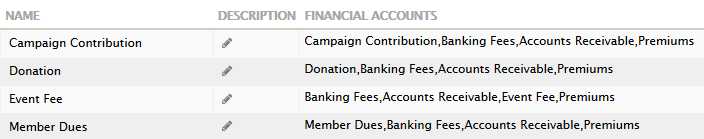
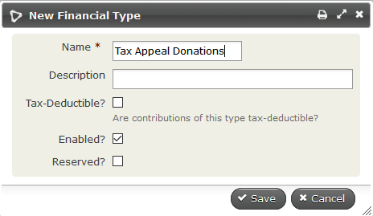
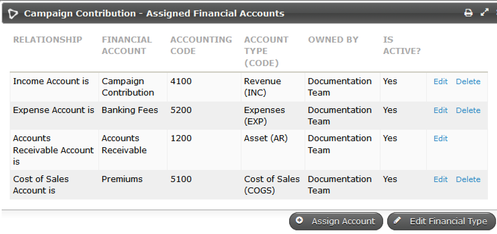
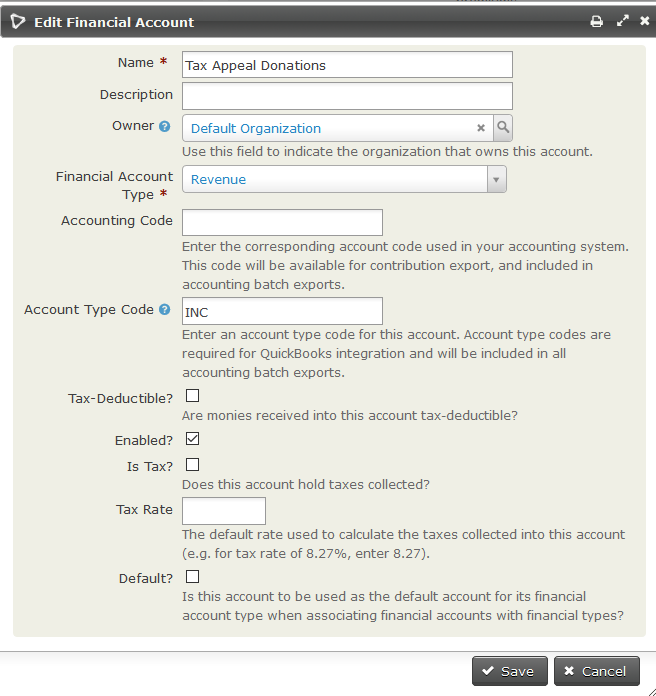

# Key concepts and configurations

This section explains the key concepts underpinning CiviContribute and outlines the high-level configuration needed for its use.

Before you begin, list the types of contributions your organisation receives, or wants to receive, and identify which you want to track using CiviCRM.

## Financial types, financial accounts and accounting codes

Organisations that use CiviCRM have differing financial reporting needs. Some want to know the total donation or membership income recorded in CiviCRM. Others want to export a full set of double-entry financial transactions to import into their accounting software.

CiviCRM caters for both groups by using **Financial types** to hide the complexity of double-entry bookkeeping from those who do not need it, while still recording those transactions for organisations that do.

Each **financial type** is linked to **financial accounts** that can track income, assets, fees and premiums (if applicable) as required. The following image shows the links for the four default financial types.

The **financial accounts** should be based on your organisation's Chart of Accounts. In CiviCRM, each contribution must be assigned a financial type. When the contribution is saved, the appropriate debits and credits are automatically recorded for the financial accounts linked to that financial type. If you are using price sets, each option in the price set could be linked to a different financial type, and CiviCRM will still record the appropriate debits and credits for all linked financial accounts.

Consult your organization's bookkeeper or accountant before setting up new or modifying existing financial types and financial accounts.

### Financial types

The standard financial types included with CiviCRM are event fee, member dues, donation and campaign contribution, as shown in the image above, but you can modify these existing accounts or set up new financial types to suit your needs.

Generally, you need one financial type for each type of income (revenue) you receive in CiviCRM and track in your accounts. For example, if you report on tax appeal donations, festive appeal donations and recurring donations separately, one "Donation" financial type will not work. You will need financial types called "Tax Appeal", "Festive Appeal" and "Recurring Donations".

To create a new financial type, navigate to **Administer > CiviContribute > Financial Types** and click **Add Financial Type**.

When you create a Financial Type of a specific name, CiviCRM automatically creates a similarly named revenue (income) account. It assigns that account and the default accounts for asset, expenses and cost of sales to the new financial type.

To edit the accounts allocated to a financial type, click **Accounts** to the right of the appropriate financial type on **Administer > CiviContribute > Financial Types**. This two-step process simplifies the common case where an organisation has only one each of Deposit Bank Account, Accounts Receivable and Accounts Payable, while allowing more sophisticated setups.

You can use CiviCRM's roles-based permission system to control user access to Contribution data by setting [Financial Type permissions](../initial-set-up/permissions-and-access-control.md#financial-type-permissions).

### Financial accounts

The list of preconfigured financial accounts will suit many organisations, but it can be customized if your organisation requires changes or additions. Each new financial type adds a new revenue account with the same name.

Edit financial accounts at **Administer > CiviContribute > Financial Accounts**.

The only required fields are Name and Financial Account Type. For revenue accounts, these are set when you create the financial type.

Your workflow determines how many of the other fields you fill in. If you plan to export financial transactions from CiviCRM to import into your accounting software package, you will need the accounting code (without extra or missing spaces). If you are using Quickbooks, you will also need the account type code.

!!! note
    Changing the financial account name will also change the financial type name.

## Payment processors

CiviCRM lets you take payments online on your website for purposes including fundraising campaigns, membership dues and event attendance.

To start taking payments online, [configure a payment processor](payment-processors.md) to connect your website to the credit card and banking infrastructure that processes the payment.

## Payment methods

Navigate to **Administer > CiviContribute > Payment Methods** to edit existing options that can be used for contributions or to add an option through **Add Payment Methods**. The common options—credit card, cash, check, debit card, and EFT—are installed by default. Ask your accountant or bookkeeper to confirm that each payment method is linked to the correct Asset account.

## Accepted credit cards

Navigate to **Administer > CiviContribute > Accepted Credit Cards** to edit existing acceptable credit cards or define an option through **Add Accepted Credit Card**.

!!! note
    If billing information is collected on the payment processor's website, you will need to configure accepted credit cards/payment methods on that site.

## Status

All Contributions have one Status. The most common are:

- **Pending (Pay Later)** indicates a contribution that has been entered but payment is not yet received. This is usually by paper or electronic check.
- **Pending (Incomplete)** was entered into CiviCRM and sent to online processing. However, either payment was not completed at the processor, or a response from the processor was not yet received. Contributions perpetually stuck in this status in CiviCRM yet completed at the processor warrant investigation of the communications between the two systems.
- **Failed** was entered into CiviCRM and forwarded for processing. However, the process declined, rejected or received an error and returned this result to CiviCRM.
- **Completed** entered into CiviCRM and payment processed and response received successfully.

Other status such as In Progress, Overdue, Partially Paid are used by optional features for partial payments and automatic recurring payments. Changing the labels of Contribution Status is possible at **Administer > System Settings > Option Groups**, but adding additional status is not recommended as it may interfere with the accounting validation of CiviCRM.

## Data needs and fields

CiviContribute has predefined fields to track contribution information. If you need to track more information, you can define custom data fields. Custom data might help you further categorize contributions or track additional information.

Write down all the information you want to track about your contributions, including reports (described later in this chapter), then compare your data needs with CiviCRM's predefined fields. One way to do this is to look at the screen for adding a new contribution. Useful functionality is built into the core contribution fields, so there is no point in duplicating them with custom fields. Your organisation may, however, have specific needs that require custom fields.

If you need to create custom fields, read [Creating Custom Fields](../organising-your-data/creating-custom-fields.md).

<!-- Source: contributions/key-concepts-and-configurations.md -->
