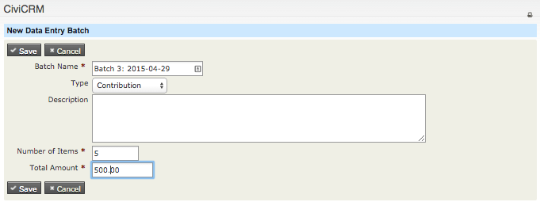
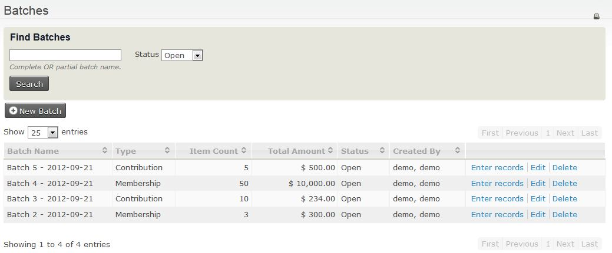
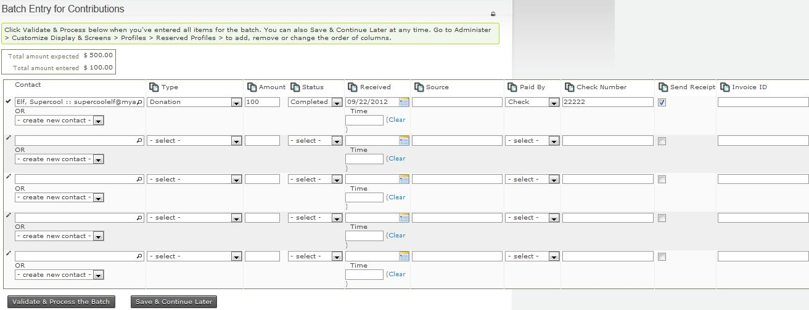

# Batch entry of Contribution, Membership or Pledge Payments

**Batch Data Entry** lets you enter off-line Contribution, Membership or Pledge Payments in a grid. You can use the ‘autocopy’ icons at the top of each column to fill in field values. It also lets you verify the total amount and count of items in the batch against the payments recorded on your deposit slip(s).

Each batch contains either Contribution Payments, Membership Payments or Pledge Payments. During batch data entry, you can create new contacts on the fly. You can save the batch and return later to continue entering payments. If you have the appropriate permissions, you can also edit the total amount and count of items in the definition of the batch.

The workflow is:

1. Create a new batch for data entry.
2. Enter Contribution, Membership or Pledge Payments (check, cash, EFT, etc.).
3. Validate and Process the Batch Totals or Save the Batch.

## Create a new batch for data entry

Create a batch to hold the multiple payments you want to record. From the menu, click **Contributions &gt; Batch Data Entry** or **Membership &gt; Batch Data Entry**.

Enter the following information:

- **Batch Name**: CiviCRM will create a default Batch Name ("Batch N" + open date), which you can Edit (required field).
- **Type**: Select the type of payment, e.g. Contribution, Membership or Pledge Payment. This selects the appropriate reserved profile to view in the Batch Entry Grid Screen (Contribution Batch Entry profile, Membership Batch Entry profile or Pledge Payment Batch Entry profile).
- **Status**: The default will be “Open”.
- **Number of items**: Total of payment items in the batch (required field).
- **Total amount**: Total Amount of all the payment items in the batch (required field).

!!! note
    Once a batch has a “closed status”, the batch will no longer be editable.

You can Edit or Delete Batch information later on by going back to the **Bulk Data Entry** screen, then clicking **Edit** or **Delete** next to the batch you want.

## Enter Contribution, Membership or Pledge Payments (check, cash, EFT, etc.)

Once you enter information about the batch, you can begin entering payments on each line.

Eight fields appear for all batches:

- **Contact**. In this column you can:
    - Start entering the name of an existing contact. CiviCRM will return a list of potential contact names for you to select.
    - Create a new contact by clicking the drop-down box for “-create new contact-“ and selecting **New Individual**, **New Organization**, or **New Household**. Enter the information about the contact here.

    !!! note
        If contact information such as phone number or email address are included in the grid profile, those values will be populated for an existing contact and can be updated as needed.

- **Financial Type**
- **Amount**
- **(Payment) Status**
- **Received – Date and Time**
- **Send Receipt:** Check the box if you want to send a receipt via email.
- **Soft Credit**
- **Soft Credit Type**

### Contribution Payments

When batch entering Contribution Payments, the additional fields in the standard profile are:

- **Source**: Enter text that describes the source of the payment.
- **Paid by**: Enter the type of payment vehicle, e.g. cash, check, EFT, etc.
- **Check Number**: If paid by check.
- **Invoice ID**

### Membership Payments

When batch entering Membership Payments, you can add a new membership or renew an existing membership. The extra fields in the standard profile are:

- **Type**: For a new membership you will select the organisation and type of membership. For the renewal you can change the membership type.
- **Member Since:** When you open the batch entry form, this is populated with the current date If you choose to renew a membership it will change to display the start date for that membership. It can be edited as needed.
- **Start Date**(reserved): This is blank. You only need to fill in this field if you want the start date to be other than the default.
- **End Date(reserved)**: If this is left empty, CiviCRM will use the membership rules to set it to the correct date.
- **Source**: Enter text that describes the source of the payment.
- **Paid by**: Enter the type of payment vehicle, e.g. cash, check, EFT, etc.
- **Check Number**: Enter if paid by check.
- **Invoice ID**

### Pledge Payments

When batch entering pledge payments, you can assign the payment to any of the pending pledges for that contact. If you have the appropriate permissions, you can also alter the amount or schedule for the pledge payment. Click **adjust payment amount** next to the **Amount** field. The extra fields in the standard profile are:

- **Source**: Enter text that describes the source of the payment.
- **Paid by**: Enter the type of payment vehicle, e.g. cash, check, EFT, etc.
- **Check Number**: If paid by check.
- **Invoice ID**

## Validate and Process the Batch Totals or Save the Batch

You can enter all transactions for the batch in one session, or save the batch and complete data entry later. To return later, click **Save &amp; Continue Later**.

To find and add or edit more transactions later, click **Contributions &gt; Batch Data Entry** or **Membership &gt; Batch Data Entry**, then click **Enter Records** next to the batch you want. Continue entering transactions in the batch.

Once you are finished entering payments, click **Validate &amp; Process the Batch**. The batch status will be set to “**Closed**” and will be available for searches and reporting later.

If the total amount or count of items does not match the values you entered when creating the Batch, you will be alerted when closing it. You can either:

- Override the entered count and total by clicking **Ignore Mismatch &amp; Process the Batch?**. The batch values are updated to match its transactions, and its status is set to “**Closed**”.
- Continue entering or editing payments, then click **Validate &amp; Process the Batch** again.

## Search for Contribution, Membership or Pledge Payments in verified and processed batches

You can search for Contribution or Membership Payments in verified and processed batches in several ways:

- Click **Searches &gt; Find Contributions**, enter criteria for the contributions, and under **Batch Name**, select the batch you want.
- Click **Searches &gt; Advanced Search**, enter criteria about the contact, then open the Contributions area and enter any contribution criteria. Under **Batch Name**, select the batch you want.
- Click **Contributions &gt; Batches**, then select **Closed** in the **Status** field.
- Click **Memberships &gt; Batches**, then select **Closed** in the **Status** field.
- Click **Pledge Payments &gt; Batches**, then select **Closed** in the **Status** field.
- Click **Reports &gt; Create Reports from Templates**, then click **Contribution Report Detail**. Enter your report criteria and, under Set Filters area, next to **Batch Name**, select “**is one of**” or “**is not one of**” and select the name(s) of the batch(es) you want.

<!-- Source: contributions/manual-entry-of-contributions-part2.md -->
