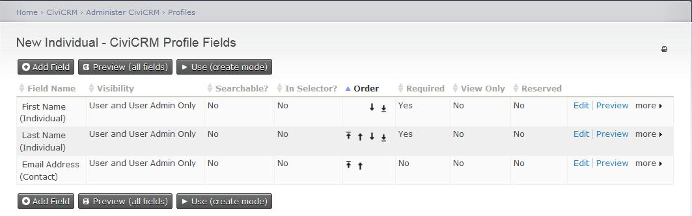
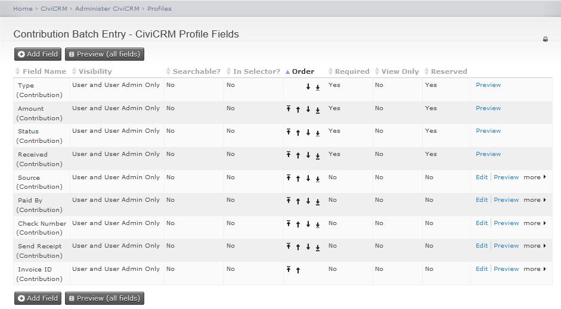
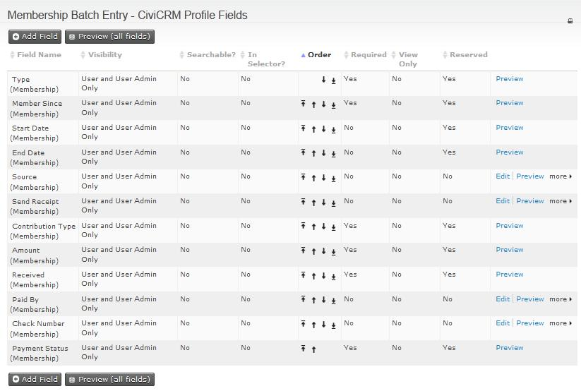

# Configure profiles for batch entry

## Profiles for new contacts

To alter the profile used when creating a new Individual, Household, or Organization while recording a contribution, update the reserved profiles **New Individual**, **New Household**, or **New Organization**:

1. Click **Administer &gt; Customize Data and Screens &gt; Profiles**, then click the **Reserved Profiles** tab. Click **Fields** next to **New Individual, New Household**, or **New Organization**.
2. Add, edit or rearrange the fields as you want to see them in the Batch Entry Input Grid. See [Profiles](../organising-your-data/profiles.md) to learn more about profiles.

!!! tip
    Reserved profiles for **New Individual, New Organization**, and **New Household** are used in other areas of CiviCRM. If you alter these profiles for use with **Batches**, the same changes will appear on other screens where you have the option to create a new contact inline.

The screenshot shows CiviCRM’s default configuration of the New Individual profile, which is used when you create a new contact for an individual during batch entry of Contributions or Membership Payments.

## Profiles for payments

To change the profile fields collected for Contributions or Membership Payments, update the reserved profiles **Contribution Batch Entry** or **Membership Batch Entry**:

1. Click **Administer &gt; Customize Data and Screens &gt; Profiles**, then click the **Reserved Profiles** tab. Click **Fields** next to the **Contribution Batch Entry** profile or the **Membership Batch Entry** profile.
2. Add, edit or rearrange the fields in the profile. For example, you may have other custom contribution fields you would like to display and collect in the Batch Entry Input Grid. To find out more, read [Profiles](../organising-your-data/profiles.md).

The screenshot shows CiviCRM’s default configuration for the Contribution Batch Entry profile, which is used when you record information about a contact’s Contribution or Pledge Payment.

The screenshot shows CiviCRM’s default configuration for the Membership Batch Entry profile, which is used when you record information about a contact’s Membership Payment.

<!-- Source: contributions/manual-entry-of-contributions-part3.md -->
