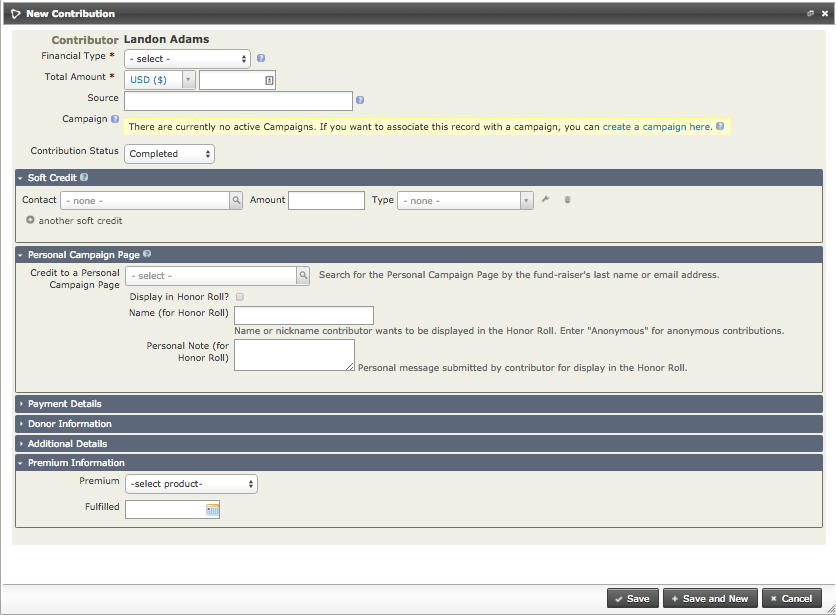

# Manual entry of contributions

When your organisation receives a contribution from a contact, you can add it to their record. This happens automatically if the payment is made through CiviCRM—for example, a membership or event fee paid with an online registration. Offline payments, such as cash and cheques, need to be recorded manually to ensure that reports generated from CiviCRM are accurate.

If the donor does not already exist in the database, first create a contact record for them. See [Contacts](../organising-your-data/contacts.md) for information on how to do this.

To manually enter a contribution for a contact in your database:

1. Find the contact's record using one of the contact search tools, for example **Search &gt; Find Contacts**.
2. Select the contact's **Contributions** tab.
3. Click **Record Contribution (Check, Cash, EFT...)**. Alternatively, if you have set up a payment processor that allows credit card transactions directly on your site, you may select **Submit Credit Card Contribution** and process the payment immediately.
4. Complete the New Contribution Form. The following screenshot shows the offline Contribution (i.e. contributions via check, cash, EFT, etc.) Form. If you selected to record a credit card contribution, the credit card form is almost identical except for the payment-related fields.

   

5. Record the Financial Type, Amount, Received Date (the default is the current day), Receipt Date (shown on the receipt generated by the system), and Status (the default is Completed). Any custom fields for contributions will also appear on this form.
6. The **Soft Credit To** field works with Personal Campaign Pages (PCPs) that harness your contacts' help for campaigns. When you enter a donation manually on the Contribution Form for the contributor, you can assign a soft credit to the owner of the PCP. There is more information about PCPs and campaign fundraising pages in the Set-up chapter of the CiviContribute section.
7. The **Additional Details** section near the bottom of the screen offers other options, including adding a note about the contribution and entering the date when a thank-you letter was sent.
8. The last two sections allow you to enter whether the contribution was in honor of someone else (**Honoree Information**) and whether there is a premium associated with the contribution (**Premium Information**).
9. Click **Save**, or **Save and New** if you are entering further contributions.

If you are entering more than a few contributions at the same time, consider using **Batch Data Entry**.

<!-- Source: contributions/manual-entry-of-contributions.md -->
