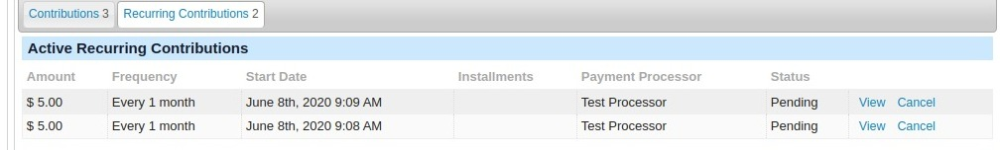

# Manage recurring contributions

PayPal and Authorize.net allow users to set up a Recurring Contribution, which is then managed through the Payment Processor site. Each time a payment is made, the processor creates a contribution record in CiviCRM. You must log onto the processor's site to make changes to the payment amount, frequency, etc.

Other processors (e.g IATS, eway, Payment Express, SagePay, Paypal Commerce/Checkout), expect you to manage the Recurring Contributions directly in CiviCRM. The payment is triggered from within CiviCRM, which sends a request to the processor, and returns a completed contribution record to CiviCRM if it's successful.

You can manage a Recurring Contribution by going to the **Contributions** tab on a contact record. In a separate tab, there is a separate section for Recurring Contributions. In order to be able to recharge a card, processors often store a payment token. This can be used to recharge a credit card, but only to put money into your account, not anyone elses. The rules around how these may be used vary and most Processors only use them for regular Recurring Payments.

You have the option to **View**, **Edit**, or **Cancel** the Recurring Contribution here. You can edit the Recurring Contribution Amount, Number of Installments, Next Scheduled Contribution Date, Financial Type, Status, Start Date, and whether or not the donor receives an email notification on each payment installation. The donation frequency (e.g. weekly, monthly) cannot be changed from within CiviCRM.

If you **View** the Recurring Contribution, you will also be able to **View**, **Edit**, or **Process** the card on file. Viewing or editing will bring up the customer and card information.

For iATS users, there is an administrative page where you can view recent iATS transactions. On the menu, navigate to **Contributions > iATS Payments Administration** to see the report.

<!-- Source: contributions/payment-processors-part3.md -->
