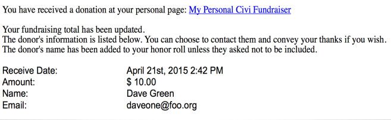

# Personal Campaign Pages

CiviCRM's features include allowing your constituents to create their own fundraising pages - and then ask others to fund their cause. These pages are called Personal Campaign Pages or "PCPs".

A Personal Campaign Page allows your constituents to personalize the fundraiser, event, organization, etc., by offering their personal reasons and/or experiences with the organization on their own personal page. Also, your contributors may in turn send the Personal Campaign Pages to their circle of friends. You can enable the "tell a friend" feature to help someone share their page even more.

Examples of this feature in action are typically called "Sponsor My 5k Walk", "Help Fund Our Trip" or "Let's Raise Money to Build A School".

## Administrator features

Administrators managing fundraising pages may use the following features via the Contribution Page Configuration:

- Requiring approval before a newly-created fundraising page becomes active
- Turning on or off 'tell a friend' so fundraisers can email others
- Setting an email address to notify admin when a new page is created
- Allowing PCP owners to always, sometimes or never receive notification when a donation is made via their page
- Choosing a profile of fields to collect from PCP supporters
- Customizing the text in the create button

Once PCP pages are active, administrators can:

- Disable or deny Personal Contribution Pages
- Edit PCP content
- View the amount of money collected by each PCP
- Run reports (using CiviReport) showing a summary of PCP fundraising
- Enter 'offline' contributions (i.e. checks) and credit the money to a PCP

## Fundraiser features

Those creating their PCPs enjoy the following ways to personalize their page:

- A title of their choice
- Descriptive text
- Selecting a monetary goal amount they hope to raise
- A single image they can upload that will appear on their page
- Choosing whether or not an 'honor roll' of supporter names will be shown on their page
- Option to display a 'thermometer' showing progress towards their goal
- Create a username (or login using a username they already have) so they can edit their PCP later

## Limitations

- CiviCRM's PCP functionality doesn't allow for team management. For instance, a fundraising leader recruiting members to a team, managing membership and then keeping track of which member brought in how much money is not supported by CiviCRM at this time.
- There is a limit of a single image uploaded to a PCP by the fundraiser. The image is not automatically re-sized.
- The thermometer and honor roll appearance can be modified, but changes are applied to all pages. These customizations cannot be done without the expertise of a coder.
- The automated emails (system workflow messages) sent to the PCP administrator and the page owner at various stages during a campaign can be modified. A working knowledge of Smarty 2 ([http://www.smarty.net/](http://www.smarty.net/)) is required. The default notification for the PCP owner when a donation is received is:

<!-- Source: contributions/personal-campaign-pages.md -->
