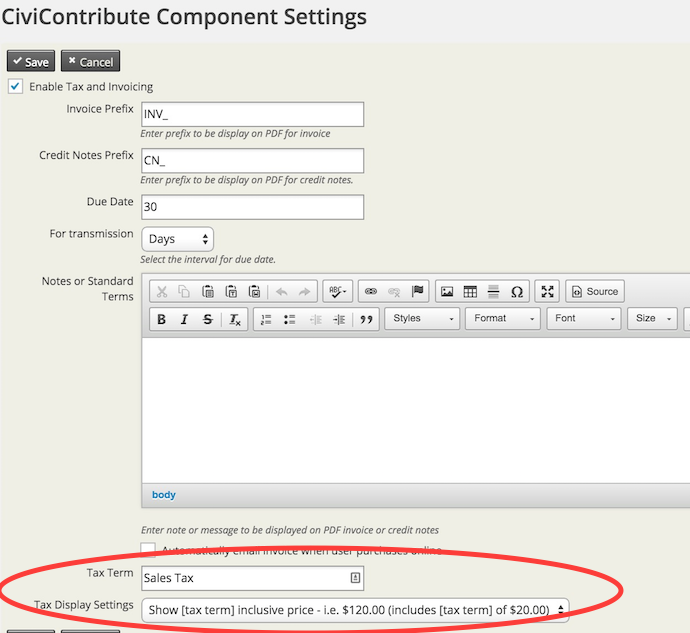
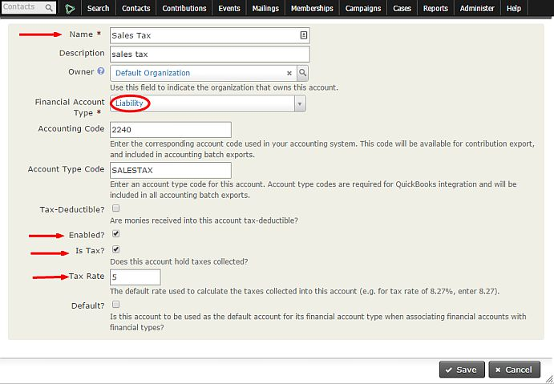
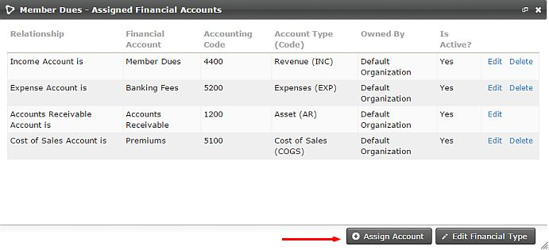
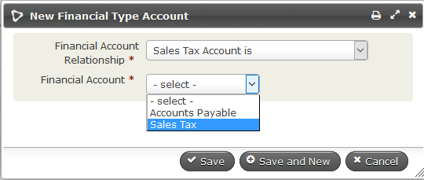
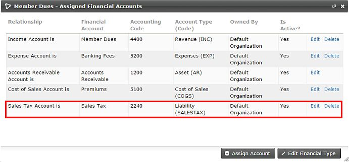

# Sales tax and VAT

If your organization charges Sales Tax or VAT, enable this feature.

## Enable Sales Tax/VAT

Go to **Administer > CiviContribute > CiviContribute Component Settings** and check the **Enable Tax and Invoicing** box.

On this screen, you can also set:

- **Tax Term** — the text your organization wants to use for the relevant Sales Tax or VAT.
- **Tax Display Settings** — how your organization wants to display the Tax/VAT:
    - No breakdown, total only
    - Shows as inclusive price - $120 (includes $20 tax)
    - Shows as exclusive price - $100 + $20 tax

## Add a Financial Account for Sales Tax/VAT

Once Sales Tax/VAT is enabled, create one or more Financial Accounts for Tax/VAT at **Administer > CiviContribute > Financial Account**. Scroll to the bottom of the page and click **Add Financial Account**.

To create the Sales Tax Account, set **Financial Account Type** to **Liability**. Select **Enabled** and **Is Tax**, and specify the **Tax Rate**. If you use **Quick Books**, the **Account Type Code** should be set to **SALESTAX**. **Accounting Code** should be based on the organization's specific Accounting Codes.

## Assign the account to a Financial Type

After creating the Financial Account, go to **Adminster > CiviContribute > Financial Types**. Find the Financial Type this Sales Tax applies to and click **Accounts**, then **Assign Account**.

For **Financial Account Relationship**, choose **Sales Tax Account is**. In the **Financial Account** field, select your **Sales Tax** account. Click **Save.**

The **Sales Tax Financial Account** will appear with the other **Financial Accounts** for that **Financial Type**.

For more advanced configuration with accounting software packages like QuickBooks, involve your organization's bookkeeper or accountant in setting up your **Financial Types** and **Financial Accounts**.

<!-- Source: contributions/sales-tax-and-vat.md -->
