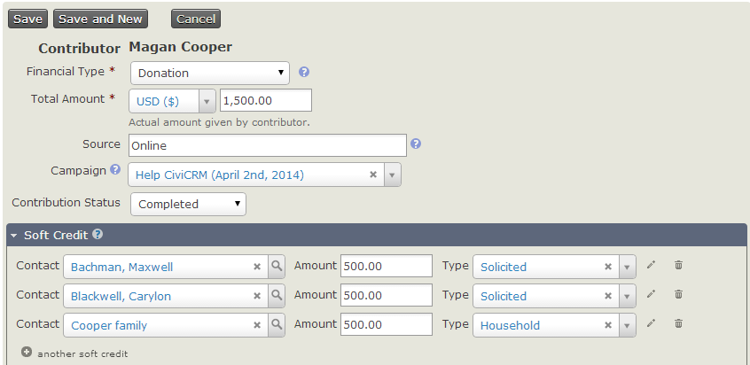
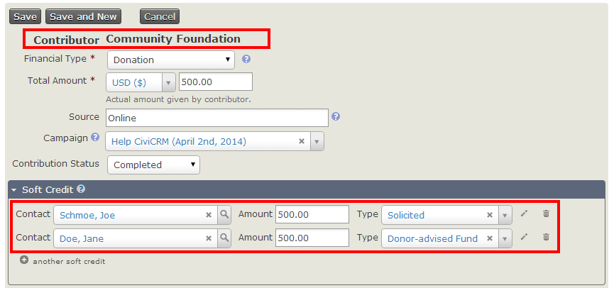
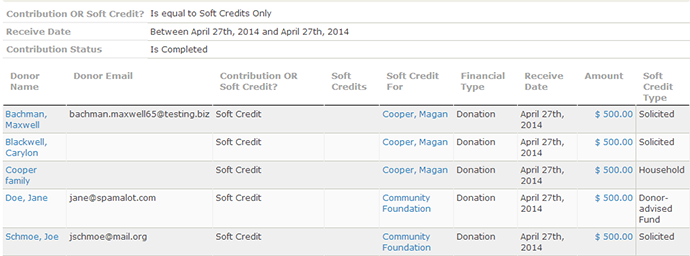
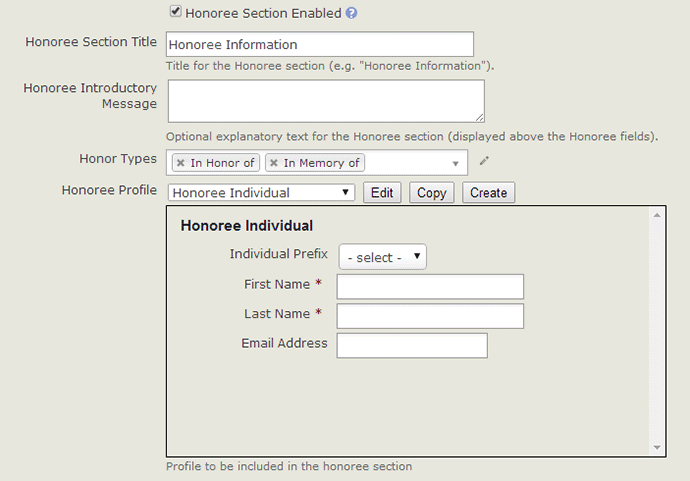
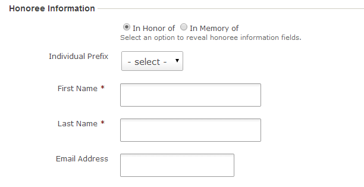

# Soft credits

Soft credits help your organisation understand the sources of its contributions. They let you assign credit for a donation to one or more people who are not the donor.

## Soft credit types

CiviCRM's soft crediting allows users to assign Soft Credit Types to contributions. Assigning an appropriate reserved or custom Soft Credit Type enables administrators to properly attribute contributions received through one or more charitable contribution types (such as Donor Advised Funds, Scholarships, Family Bequests, etc) whether solicited (P2P) or not.

CiviCRM uses the following reserved Soft Credit Types:

- In Honor of
- In Memory of
- Solicited
- Personal Campaign Page
- Gift

For example, if an active member of your organisation encourages 10 other people to contribute, soft credits let you credit that member and each actual donor without counting a contribution twice. You can also credit parts of a donation to multiple people.

In the screenshot below, Magan Cooper's contribution of $1,500.00 is credited to three different people.

Soft Credit Types can also attribute contributions in more complicated situations. For example, Joe is an active member of a community foundation that regularly contributes to your organisation. Joe solicits a contribution from Jane on behalf of the foundation, and your organisation receives a check from the foundation. The contribution can be attributed without duplicating it:

- The community foundation is the donor.
- Joe would receive the solicited Soft Credit.
- Jane would receive the donor advised Soft Credit.

This scenario is illustrated below.

As well as recording Soft Credits, we can also report on them. The contribution detail report has optional columns which show Soft Credit details. When checked, these will show four extra columns in CiviReport, which can be used to view soft credit information.

## Honoree information and profiles

When creating a contribution page, you can allow end users to make a contribution on behalf of an Honoree. To do so, select the **Honoree Section Enabled** checkbox. This reveals additional fields for specifying the Honor Types and Profile to include in the section.

Once configured, end users can enter Honoree info for online contributions. CiviCRM checks whether the Honoree already exists using your site's default duplicate checking rules. If no duplicate is found, it creates a new contact record. A soft credit is added to the Honoree's contact record.

## Soft credits and personal campaign pages

Soft credits are closely related to [Personal Campaign Page](personal-campaign-pages.md). When someone donates by a Personal Campaign Page, their donation is soft credited to the owner of the Personal Campaign Page.

<!-- Source: contributions/soft-credits.md -->
