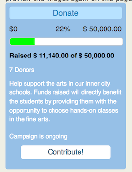
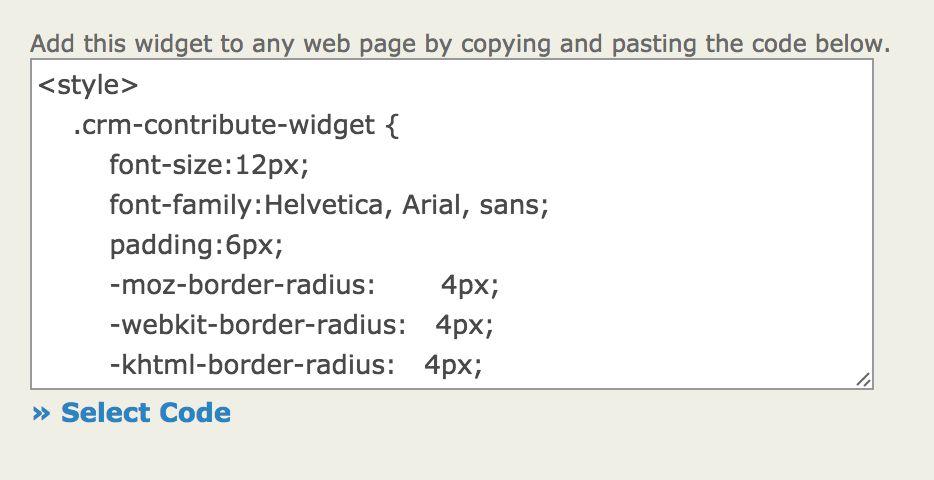
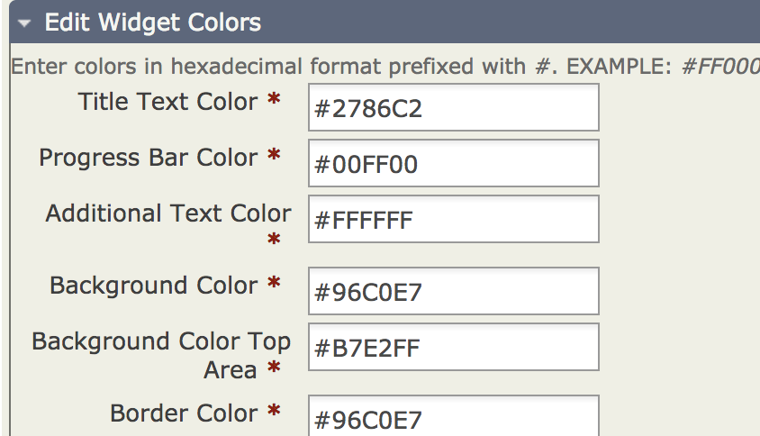

# Widgets

CiviContribute widgets help you and your supporters promote a fund-raising campaign with an automatically updated visual representation of the campaign.

When you create a widget, you receive code to embed it on your website or another website.

## Creating a widget

1. Go to **Contributions &gt; Manage Contribution Pages**. In the list of Contribution Pages, click **Configure** for your Contribution Page.
1. Select **Widgets** from the tabs at the top of the page.
1. Click **Enable Widget**.
1. Enter a **Title** for your widget. It will generally be the same name as your Contribution Page, but it does not have to be.
1. Optionally, enter the **URL to Logo Image**. To use this feature, you need to upload an image to your web server and obtain its URL (web address). You may need to ask your system administrator for help.
1. Enter a **Button Title** for potential donors to click to go to your donate page. In the example above, the button title is Contribute.
1. Use the editor to enter as much **About** text as you want. Adjust the amount of text based on where you want to use your widget.
1. Click **Save and Preview** when you are ready to preview your widget or have finished and want to update its code.
1. Find the code for embedding the widget on a web page on the right. You may need help from your system administrator or the person who administers your website to use this code.

    

1. Use the **Select Code** link to select all the necessary code.
1. Copy and paste the code into the place on your website where you want the widget to display.

## Customizing your widget

1. At the bottom of the configuration page, expand the **Edit Widget Colors** fieldset.

    

1. Get hexadecimal (or hex) codes for the colors you want to use. The fields let you modify the colors for each area of the widget. [W3schools](https://www.w3schools.com/colors/colors_picker.asp) provides a color picker that gives you hex values for selected colors.
1. Modify the colors. A designer you have worked with on your website may have specific standards for the colors to use.
1. Click **Save and Preview** to see how your changes look.

## Using widgets with WordPress

WordPress has a plugin, [CiviCRM Contribution Page Widget](https://wordpress.org/plugins/civicrm-contribution-page-widget/), that lets you embed a widget from CiviCRM anywhere that a WorderPress widget can go.

<!-- Source: contributions/widgets.md -->
