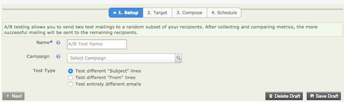
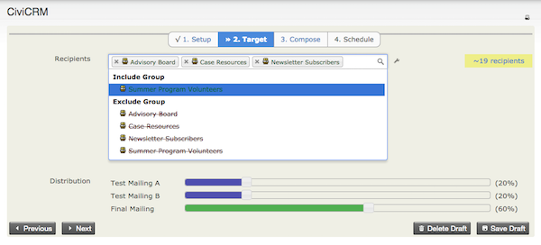
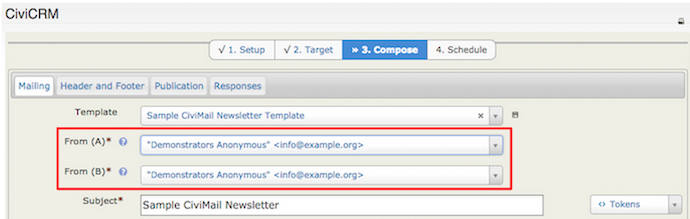
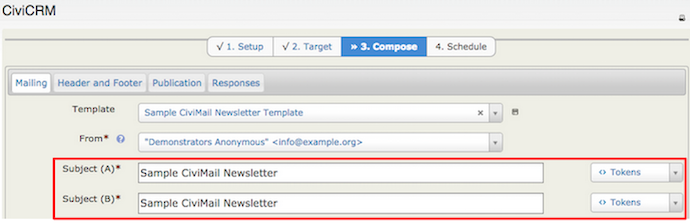
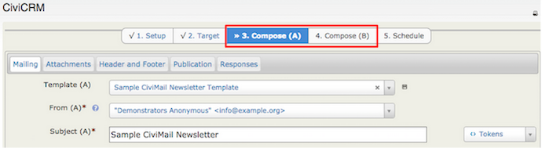
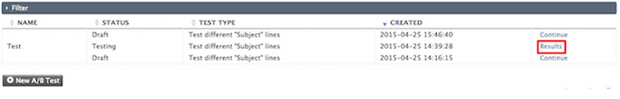
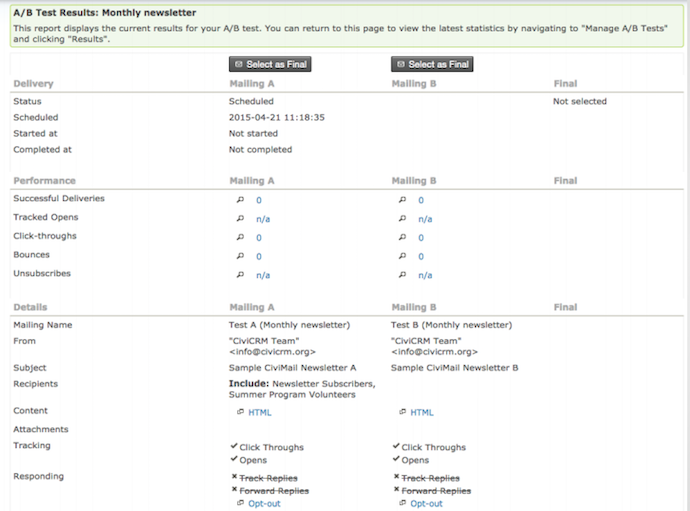

# CiviMail A/B testing

CiviMail A/B Testing lets you send two test e-mails to two random samples of your recipients. After the test mailings are complete, you can use the available metrics to choose which mailing to send to the remaining recipients.

Before conducting a new A/B Test, put your recipients in a Mailing List. To learn more about configuring a Mailing List, see the chapters on *Groups and Tags*.

## Create a new A/B test

1. Navigate to **Mailings > New A/B Test**.
2. On the Setup screen, define the campaign that corresponds with the mailing and select the type of test. You can test:
   - Different **Subject** lines
   - Different **From** lines
   - Entirely different emails

   

3. On the Target screen, define your recipients and the distribution percentage. Drag the blue percentage bar to change the percentage of test mailings and, in turn, the percentage of final mailings sent to the remaining participants. The test mailings and final mailing sum to 100%.

   

4. On the Compose screen, enter the fields for your chosen test type. The screen changes depending on the type of A/B Test:
   - For different **From** lines, enter From (A) and From(B).

     

   - For different **Subject** lines, enter Subject(A) and Subject(B).

     

   - For entirely different emails, add a **From** and **Subject** for each mailing.

     

5. Choose an email template that you have previously composed. Once you have selected the template and specified the From and Subject field, send a test email before scheduling or sending your final mailing.

## Review results and select a final mailing

Once the test mailings are complete, navigate to **Mailings > Manage A/B Tests** and select **Results**. On the A/B Test Results screen, monitor the results and select which mailing should be submitted as the Final mailing.

<!-- Source: email/civimail-ab-testing.md -->
