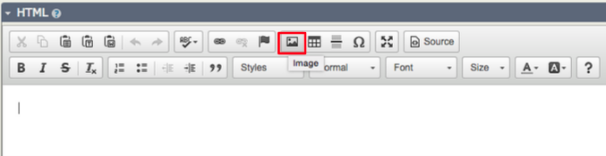
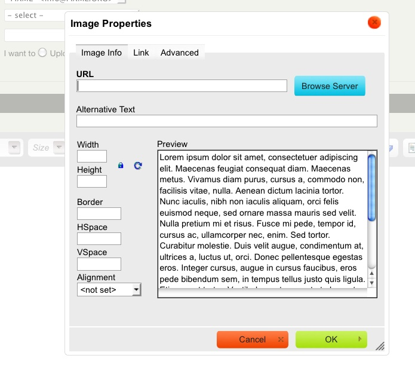
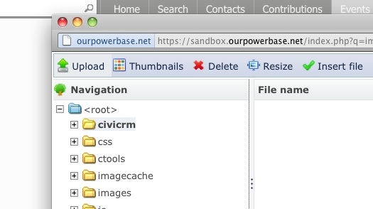
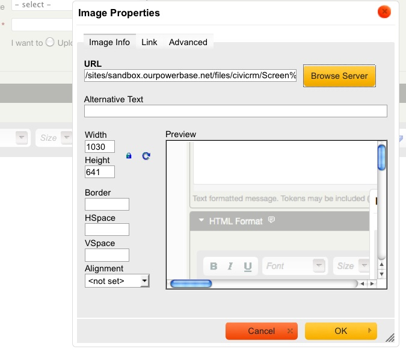

# Everyday tasks

This page covers everyday email tasks. For instructions on sending a mass mailing, see [Mass mailings using CiviMail](mass-mailings-using-civimail.md).

## Send an email to one person (with CC and BCC)

You can use CiviCRM to email an individual when you want other people at your organisation to see the email or you want to use a pre-defined template.

1. Find the person you wish to email using either method:
    - Use the Quick Search box on the top left. Click inside the box and begin typing part of the person's name or email address. Choose the person from the choices presented.
    - Navigate to **Search > Find Contact**. Enter part of the person's name or email address, click Search, then click the person's name in the search results.
2. From the contact summary page, click **Actions > Send an email**, or click the **Activities** tab and choose **Send an Email** from the dropdown menu.
3. Add any additional recipients using the CC and BCC fields.
4. If you have templates defined, you can choose one from the Use Template dropdown menu. Selecting a template populates the text content and HTML content fields with its message content, which you can then edit.
5. Enter your content or add to the template. To send only a Plain Text version, ignore the HTML Format section, click the Plain Text Format section, and enter your message in the box.
6. Click **Send**.

To see the recorded activity for the email you sent, click the contact's **Activities** tab.

## Send a quick email to fewer than 50 contacts

The actions dropdown menu in search results offers “Send Email to Contacts” for emailing more than one contact at a time. This method is relatively quick, but it has no options for tracking email and does not give contacts the option to opt out. It is limited to 50 contacts and should not be used for mass mailings. For mass mailings, use CiviMail.

1. Click **Search > Find Contacts** (or **Advanced Search**). Choose your search criteria and click **Search**, or use another search to find the contacts you wish to email.
2. In the search results, choose some or all of the contacts and click **Actions > Email -send now (to 50 or less)**.
3. Follow the steps under “Send an email to one person (with CC and BCC)” above.

The email is recorded as an Activity for each recipient and for the sender. The activity record also lists all other message recipients. Unlike mass mailing, there is no one place where all emails sent using the Send Email function are listed.

!!! note
    When a message is sent to multiple recipients, each recipient sees only their own email address in the To field. Because recipients cannot see who else received the email, you might want to identify the group in your message—for example, “TO: Members of the board, staff”.

## Insert an image in an email

1. Click the **image button** in the WYSIWYG editor.

    

2. In the Image Properties window, click **Browse Server** to look for image files on your server.

    

3. In the left sidebar, navigate through the file directory and select the image if it is already on your server. Otherwise, click **Upload** to choose a file from your computer.

    

4. In your computer's file-browsing window, find the image, select it, and click **Open**. You can repeat this process to upload multiple files to CiviCRM at once.
5. Double-click the image you want to insert. You will return to the email's Image Properties window.
6. Adjust the image's size, alignment, and border as needed. You can also fill in the Alternative Text field. Alternative text appears when the image is unavailable to a reader—for example, when they choose not to load images in their email client or use a [screen reader](http://en.wikipedia.org/wiki/Screen_reader "Screen reader") due to a visual impairment. To avoid losing information and make email accessible to all user communities, always include alternative text for images.
7. Click **OK** to insert the image.

    

<!-- Source: email/everyday-tasks.md -->
