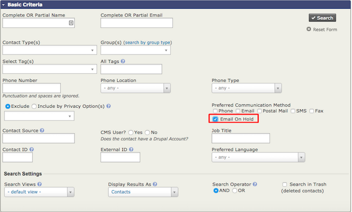

# Manage email addresses on hold

If an email address is put on hold, you can unhold it or fix/delete it.

## Release a hold

1. Go to **Advanced Search**.
2. In **Basic Search Criteria**, check the box to search for **Emails On Hold**.

    

3. Select the contacts with held email addresses. Choose **Unhold Emails** from the dropdown list and click **Go.**

## Correct or update held emails

First, create a group(s) for bad emails. Then:

1. In the top menu, go to **Reports**.
2. Select **Mail Bounce Report**.
3. The report will show contacts whose emails have bounced.
4. Open **Report Criteria** at the top of the mailing to limit the report to a specific bounce type.
5. Add the contacts in your search results to the group you created.
6. Pull up the group via **Advanced Search.** It is also recommended that you select **Email on Hold** to avoid querying records that have previously bounced but may have already been updated.
7. Select **Batch Update via Profile** for all results whose email addresses you can correct/update. This requires a profile that contains *just* **Primary Email**.
8. Select this profile and click **Update**.

<!-- Source: email/maintaining-healthy-email-lists-part2.md -->
