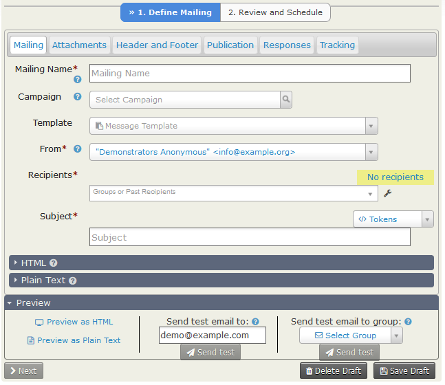
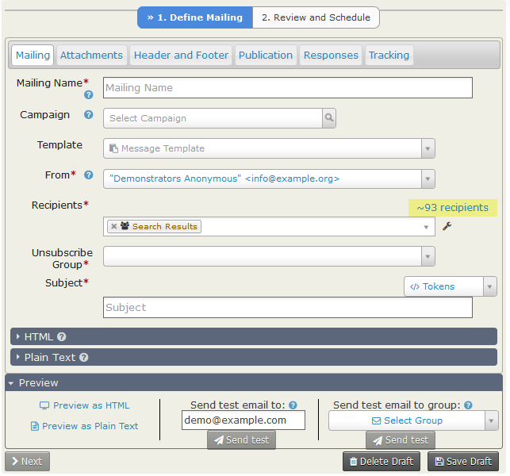
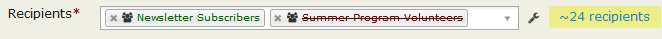
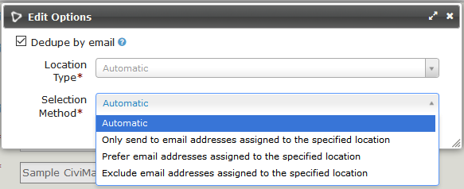
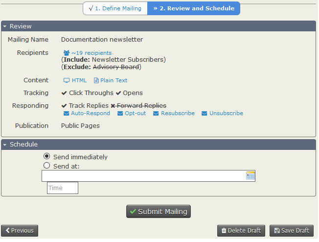
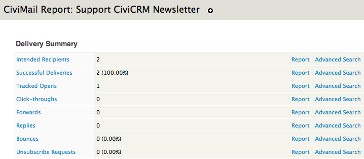
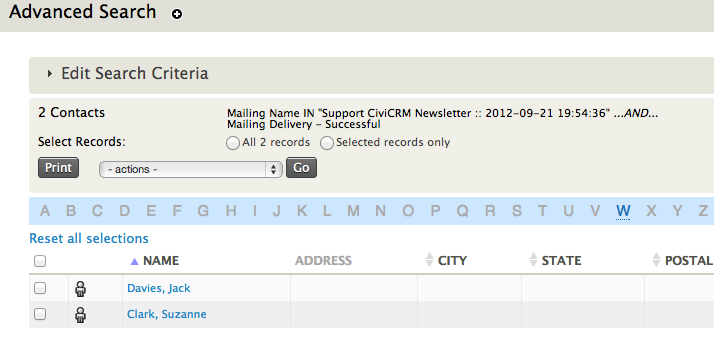

# Mass mailings using CiviMail

The Mailings functionality offered by CiviMail provides benefits over the Send Email activity: you can track respondents, process bounces, and allow people to unsubscribe. This page first covers creating and sending a mass mailing, then tracking and managing mailings.

## Choosing recipients: Groups versus search results {:#choosing-recipients-group-vs-search}

You can select recipients by sending to existing Groups or to search results. Most steps are the same, but a mailing to search results requires you to choose a Group from the Unsubscription Group dropdown menu.

Every mass mailing needs a way to track unsubscribe requests. A simple unsubscribe process is required by law in many countries and may help prevent mailings from being treated as spam. Mailings sent to Groups have this capacity built in: the next time a mass email is sent to that Group, anyone who has unsubscribed will not be included. Mailings sent to search results do not have this built-in way to track unsubscribes, so you must provide one.

If a contact who matches your search results is already unsubscribed from the Unsubscription Group you designate, that contact will not be sent the mailing. If a contact unsubscribes through the unsubscription link in the mailing, they will be unsubscribed from that Group and will not receive further emails sent to it. This applies whether or not they were originally a member of the Group.

The Unsubscription Group collects unsubscribe information only; it does not supply contacts to the mailing. Contacts in that Group who do not match your search criteria will not be included. To include them, include the relevant Group.

For example, your organization is having a big event next week. Several emails have already gone out about it, but you have added many new people to your database in the last week and want to send them an event announcement. Search for new contacts via **Search > Custom Search > Date Added to CiviCRM** and use those results as the basis of the mailing. If your organisation stores its event email list in a Group called Event Alerts, you would probably choose Event Alerts as the Unsubscription Group.

If you do not have an appropriate Group for the Unsubscribe Group, you may want to create one called something like "Miscellaneous Mail Unsubscribes". You could add that Group to future mailings to exclude people who have unsubscribed.

## Choosing recipients: When mailing recipients are set {:#choosing-recipients-when-set}

When you submit a mailing, its recipient list is set based on the contacts who are members of its groups at that moment. The list does not change after scheduling, even if the mailing is scheduled for a month in the future. However, contacts who are opted out, marked do not email, deceased, deleted, or whose email is on hold at the time of sending will not receive the mailing.

For a mailing to a smart group, recipients are set based on the smart group criteria when the mailing is scheduled. They are not updated when it is sent.

If you select `All NNN records` in search results and send those contacts a mailing from the Actions dropdown menu, you create a hidden smart group. Its members are updated based on the search criteria when the mailing is submitted. To avoid creating a hidden smart group, select all the records using the checkbox at the top of each page, then use `NNN Selected records only`. This creates a non-smart group whose membership will never update based on the search criteria.

## The Mailing set-up screens

If you are sending to an existing Group, go to **Mailings > New Mailing**. You will see this screen:

If you are basing the mailing on search results, perform your search—for example, using **Search > Advanced Search**—then choose **Email - Schedule/Send via CiviMail** from the **Actions** drop down. You will see this screen:

The screens are similar. For a search-based mailing, however, you must choose an Unsubscribe Group, and the "Search Results" group is included in the Recipients list and cannot be removed. The HTML pane is open by default; it was closed to fit the bottom buttons into these images. See [Choosing recipients: Groups versus search results](#choosing-recipients-group-vs-search).

You can save your mailing at any stage by clicking **Save Draft**.

### Step 1: Define Mailing

#### Mailing Tab

The **Mailing** tab contains all the compulsory fields for a new mailing. It may be the only tab you need to visit.

- **Mailing Name**: Enter a name that lets you and others in your organization identify the mailing’s purpose. Starting each name with a date, such as "2015/04/25 - Monthly Newsletter", is recommended. This makes it easier to include or exclude its recipients in future mailings. The name is for internal use only and is not shown to recipients. You will enter the Subject later.
- **Campaign**: Associate the email with a particular campaign if needed.
- **Template**: Select an existing message template to populate the HTML Format and Plain-Text Format fields. You can edit the content for this mailing, but you cannot update the template or create a new template through this form. CiviCRM ships with three sample newsletter templates. Users with the Administer CiviCRM permssion can customise them with your organisation’s details, or create new message templates, at **Administer > CiviMail > Message Templates**.
- **From**: This is populated with the default sender email address. You can select another address from the dropdown list. Users with Administer CiviCRM permssion can add addresses at **Administer > CiviMail > From Email addresses**.
- **Recipients**: Choose who will receive the mailing if you are mailing to Groups, or further refine or add recipients if you are mailing to search results. Select Groups to include, shown in green, or exclude, shown in red with a strike-through, from the "Recipients" dropdown. Only groups of the type "Mailing List" are available.

  

  You can also include or exclude recipients of previous mailings. For example, to avoid sending the same email twice to some people, choose the original mailing in "Exclude Past Recipients From". The message will then go only to members of the group who did not receive the original mailing. The estimated final number of recipients appears to the right of the Recipients field, highlighted in yellow.

- **The "wrench"**: Click the wrench to the right of the Recipients field and to the left of the recipient estimate to access **Edit Options**.

  

  - **Dedupe by email:** CiviCRM always dedupes a mailing based on unique contact records. A contact in three included groups receives only one copy. If multiple contacts use the same email address, this option determines how many copies are sent: unticked sends one per contact; ticked sends one per address. Set the default at **Administer > CiviMail > CiviMail Component Settings** by ticking or unticking "CiviMail dedupes e-mail addresses by default". You can override the default for any email.
  - **Location Type:** By default, CiviMail sends to the address location(s) set for "Bulk Mailings" or, if no location type has that setting, to the address location set as "Is Primary". In **Edit Options**, you can change the Location Type and the Selection Method. You can filter by Location Type to send only to email addresses with the specified location type, or exclude addresses with that location type.

- **Unsubscribe Group** (for search-based mailings only): Choose this carefully. See the example in [Choosing recipients: Groups versus search results](#choosing-recipients-group-vs-search).
- **Subject**: This is the subject of the sent emails. You can include [tokens](../common-workflows/tokens-and-mail-merge.md). The **Subject**, not the Mailing Name, is used when creating an activity or mailing record for each contact.
- **HTML** (expanding section): Compose the mailing here. You can personalize each email using [tokens](../common-workflows/tokens-and-mail-merge.md). If you only want to send a plain text email, ignore the HTML section. Click **Plain Text** to open that accordion and enter your message.
- **Preview**: This panel is a footer to the **Define Mailing** screen and appears in whichever tab is selected. You can:
  - Preview the HTML or Plain Text version. The HTML preview shows formatting and tokens converted with your data, but not attachments. Email clients are not guaranteed to display the email exactly as shown; the preview can still help you check font consistency, basic layout, and color.
  - Send a test email to a single email address. If the address does not already exist in CiviCRM, a new contact record will be created.
  - Send a test email to an existing group in CiviCRM. The test mailing fills in all the Tokens and includes any attachments you plan to send.

  It is a good idea to send a test to yourself and view it in your email client. For a complex layout, send it to your test group and check it in various mail clients; see *Testing templates* in the *Set-up* section for more tips. Preferably, more than one person should receive the test and give feedback.

The remaining tabs are:

#### Attachments tab

Upload files to send as attachments with your email.

#### Header and Footer tab

Each new mailing includes the default Header and default Footer defined at **Mailings > Headers, Footers, and Automated Messages**. To use different ones, select them on this tab. Define additional Headers and Footers via **Mailings > Headers, Footers, and Automated Messages** (see *Set-Up* for details).

#### Publication tab

**Mailing Visibility** has two options: "User and User Admin Only" and "Public Pages."

- **Public Pages** makes the content viewable as a web page by everyone with the "View public CiviMail content" permission.
- **"User and User Admin Only"** means that only users who received the mailing or administrators can view its content as a web page. Recipients must log in to view the message.

To link to the web version, insert the **Mailing permalink** token in your email message. It generates a URL where the message can be viewed. To display it properly in HTML messages, add the proper link tags using the Source icon in the editor.

#### Responses tab

- **Track Replies** checkbox: Sends recipients’ replies to a CiviMail specific address rather than the sender’s address, so they can be stored in CiviCRM. Checking it reveals two options:
  - **Forward Replies:** Check this if you also want the From address to receive recipients’ replies.
  - **Auto-respond to Replies:** Send a specific automatic reply to anyone who replies. Set up an autoresponder ahead of time in **Mailings > Headers, Footers, and Automated Messages**.
- **Opt-Out Message:** Sent to a recipient who has opted-out from all the mailing lists.
- **Resubscribe Message:** Sent to a recipient who has resubscribed to one of the mailing lists.
- **Unsubscribe Message:** Sent to a recipient who has unsubscribed from one of the mailing lists.

You can edit these three messages at **Mailings > Headers, Footers, and Automated Messages**.

#### Tracking tab

- **Track Click-Throughs**: Tracks how many users, and which users, clicked links in your message. All links are redirected through your server and overwritten with custom links containing your domain name.

  !!! note "Note for HTML mail"
      Some phishing filters may mark links displayed differently in HTML code and in the text as unsafe. It is therefore best not to use something like
      `<a href="http://example.com">http://Example.com</a>`
      but rather use
      ` <a href="http://example.com">click here to go to Example</a>` instead.

  !!! note "Note for Plain Text Email"
      If you use short, user-friendly URLs, they will all be overwritten with long links containing the name of your site and a long code looking like this http://example.com/sites/all/modules/civicrm/extern/url.php?u=529&qid=29011.

- **Track Opens:** Tracks how many people opened the email they received. This method has limitations: if a recipient does not show images in their email client—often called "blocking remote content"—their email will not be marked as opened, even if they open it. Blocking remote content is common.

You can set whether Click Through and Open Tracking are on or off by default at **Administer > CiviMail > CiviMail Component Settings**.

Once you have defined the mailing, click **Next >** at the lower left.

### Step 2: Review and Schedule

#### Review Panel

This panel summarizes the email’s details. The blue words are buttons:

- **~XX recipients** shows the names and email addresses of the contacts who will be sent the email.
- **HTML** and **Plain Text** show the email to be sent, including any header or footer.
- Each envelope displays the named message.

Ticks and crosses with strike-throughs show which tracking and response options you have and have not chosen. Use the panel to confirm your choices.

#### Schedule

Choose to send the email immediately or schedule a date and time, then click **Submit Mailing**. By default, CiviMail checks every 15 minutes for emails ready to send, so the start could be delayed by up to 15 minutes.

Mailings to large numbers of recipients are sent in batches of about 400 to reduce the likelihood of being caught in spam filters. Sending can therefore take several hours, depending on your server configuration.

## Tracking Sent Mass Mailings

To review statistics for a past mailing, go to **Mailings > Scheduled and Sent Mailings**. Find the mailing in the list or use the filters above it, then click **Report** in the "action" column. The report shows tracked actions, including the number of opens, link click-throughs, and the percentage of bounces (see *Managing bounces* below).

Click a statistic’s name to see the contacts it applies to and other details, such as the time an email was opened for tracked opens. Where a mass mailing has been sent to a contact, you can also view its "Bulk Email" record in the Activities tab of that contact’s profile.

To filter further—for example, to find recipients who opened the email and are between 21 and 30 years old, or registered for a given event—click **Advanced Search** next to a statistic. This starts an advanced search with the email attributes pre-filled. Clicking the link next to Tracked Opens, for example, sets the search fields to find contacts who opened the email, ready for you to add criteria. For more information, see *Searching*.

## Managing Mass Mailings

Mass mailings appear in three areas under the **Mailings** menu:

- **Draft and Unscheduled Mailings**: As soon as you name a message in Step 1 and click **Next**, it appears here. If you click **Save & Continue Later** or abandon a message after some steps, click **Continue** next to it to resume work. You can also **Delete** drafts here.
- **Scheduled and Sent Mailings:** A mailing you send or schedule stays here until it is archived or deleted. Click **Report** to track delivery, or **Copy** to start another mailing based on it. **Archive** and **Delete** are under **more**. For a mailing that is scheduled but not yet sent, **Cancel** is available instead of **Archive**. **Pause** and **Resume** are also under *more*. Pausing is gradual, not instantaneous; you can use it when you want another scheduled or pending mailing to send before the one you pause.
- **Archived Mailings:** This area lists messages archived from Scheduled and Sent Mailings. They cannot be included in or excluded from a recipient list. The area otherwise has the same functionality as Scheduled and Sent Mailings, including viewing Reports and using Copy.

<!-- Source: email/mass-mailings-using-civimail.md -->
