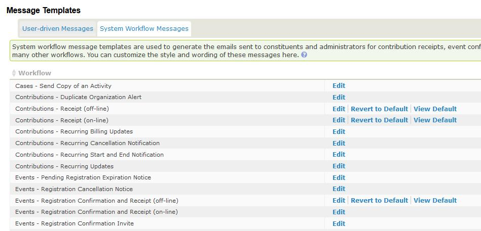

# Modifying system workflow message templates

The content and layout of these messages are pre-configured. They include program logic to display data sent to constituents, such as contribution amounts, payment methods and event fees.

Navigate to **Administer > Communication > Message Templates** and click the **System Workflow Message** tab to see the messages you can modify. Both HTML and Text formats are provided. Your organization may want to modify or add text, or add branding such as a logo to the HTML versions.

!!! caution "Your changes here can complicate CiviCRM upgrades"

    CiviCRM occasionally changes system workflow message templates during version upgrades. If you customize a template, CiviCRM stops applying updates to it. This preserves your changes, but you might miss important template updates as new functionality becomes available.

    The System Administrator Guide has [instructions for merging conflicting edits to these templates](https://docs.civicrm.org/sysadmin/en/latest/upgrade/#updating-system-workflow-message-templates) when you have customized a template and a CiviCRM upgrade would also have changed it. The process is not easy, so avoiding edits can save you or your system administrator time.

!!! danger "Don't break anything"

    Do not modify the program logic in these templates. Test the workflow and review the emails sent after making changes. In most cases, you can restrict changes to the top row in the HTML layout. If changes cause problems, errors or missing information, you can revert to the system default for that workflow.

!!! tip "Use tokens for logo and branding"

    As of CiviCRM 5.76, you do not need to edit Message Templates to insert your organization logo or other branding. Instead, use the {site.message_header} [Site Token](../common-workflows/tokens-and-mail-merge.md#site).

After customizing a system workflow message template, you can revert to CiviCRM’s version by clicking the "Revert to Default" link next to the template.

<!-- Source: email/message-templates-part2.md -->
