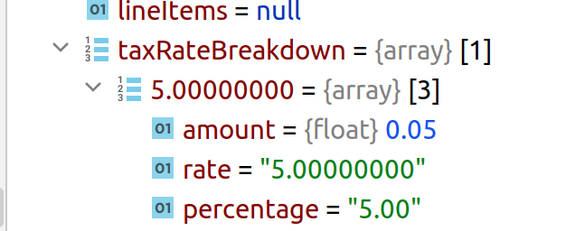

# Variables and tokens in workflow message templates

Workflow message templates can use both tokens and Smarty variables. A dollar sign distinguishes a Smarty variable from a token: `{contribution.tax_amount}` is a token, whereas `{$taxAmount}` and `{$contribution.tax_amount}` are Smarty variables.

In general, tokens are consistent across multiple screens. Available Smarty variables depend on what has been coded and vary considerably. CiviCRM is switching to tokens in workflow message templates where possible, but some variables are specific to a message template or are more complex. Work is underway to standardize and document the available Smarty variables.

As of 5.53, all contribution workflow message templates should support all contact and contribution tokens and the following Smarty variables:

| Variable | Meaning | Detail | eg. |
| -- | -- | -- | -- |
| `$isShowLineItems` | is the contribution using a price set | TRUE or FALSE | `{if $isShowLineItems}...{/if}` |
| `$isShowTax` | is sales tax enabled for the site | TRUE or FALSE | `{if $isShowTax}...{/if}` |
| `$taxRateBreakDown` | [array](https://study.com/academy/lesson/arrays-lesson-for-kids.html) of the amount charged at each tax rate. | `[]` for no tax or  | `{foreach from=$taxRateBreakdown item=taxDetail key=taxRate}{$taxDetail.percentage}%{/if}{/foreach}` |

`$lineItem` is an [array](https://study.com/academy/lesson/arrays-lesson-for-kids.html) of line items. Example usage:

```
  {if $isShowLineItems}
    <tr>
    <td colspan="2" {$valueStyle}>
      <table>
      <tr>
        <th>{ts}Item{/ts}</th>
        <th>{ts}Qty{/ts}</th>
        <th>{ts}Each{/ts}</th>
        {if $isShowTax && '{contribution.tax_amount|raw}' !== '0.00'}
          <th>{ts}Subtotal{/ts}</th>
          <th>{ts}Tax Rate{/ts}</th>
          <th>{ts}Tax Amount{/ts}</th>
        {/if}
        <th>{ts}Total{/ts}</th>
      </tr>
      {foreach from=$lineItems item=line}
        <tr>
        <td>
          {$line.title}
        </td>
        <td>
          {$line.qty}
        </td>
        <td>
          {$line.unit_price|crmMoney:'{contribution.currency}'}
        </td>
        {if $isShowTax && '{contribution.tax_amount|raw}' !== '0.00'}
          <td>
            {$line.unit_price*$line.qty|crmMoney:'{contribution.currency}'}
          </td>
          {if $line.tax_rate || $line.tax_amount != ""}
            <td>
              {$line.tax_rate|string_format:"%.2f"}%
            </td>
            <td>
              {$line.tax_amount|crmMoney:'{contribution.currency}'}
            </td>
          {else}
            <td></td>
            <td></td>
          {/if}
        {/if}
        <td>
          {$line.line_total+$line.tax_amount|crmMoney:'{contribution.currency}'}
        </td>
        </tr>
      {/foreach}
      </table>
    </td>
    </tr>

  {/if}
```

<!-- Source: email/message-templates-part3.md -->
