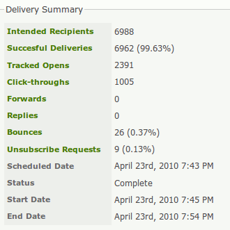
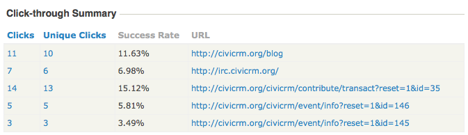
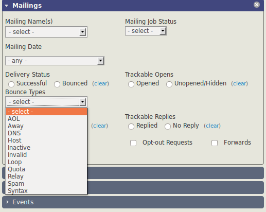

# Reports and analysis

CiviMail has tools for reporting and analysis; reporting is one of the key reasons to use CiviMail.

## Individual mail reports

You can view a report for each mailing from **Mailings &gt; Scheduled and Sent Mailings**. Reports use live information, so you can track emails in real time by refreshing the page. Each report has several sections. The data available depends on which items you enabled tracking for when you set up the mailing.

### Delivery summary

The delivery summary shows high-level statistics about the mailing. Clicking its links shows lists of contacts who took the corresponding actions.

- **Intended Recipients** shows the number of people the mailing was intended to reach.
- **Unique Opens** shows the number of people (or bots) that CiviCRM thinks have opened the email if you have chosen to enable *Open tracking*.
- **Total Opens** shows the total number of times that CiviCRM thinks people (or bots) have opened the email if you have chosen to enable *Open tracking*.

!!! info "How Open Tracking works"
    In the world of email, there is no 100% reliable way of
    knowing when someone has opened an email. CiviCRM uses a trick that is
    common amongst mass mailers &amp;mdash; it embeds a small image with a unique name
    in each email. When a client views the email and downloads the image,
    CiviCRM knows that they have read the email. Because this technique is
    common, to protect people's privacy, most email clients ask users to
    confirm whether they want to download images in emails. Hence your
    report really tells you the number of people who downloaded the images;
    the actual number of readers is higher than the number reported. Tracked
    opens statistics should be taken as indicative, rather than accurate. In
    our experience, a 30% reported opening rate can be considered good. This
    is obviously different for each organisation and each group you send
    emails to.

Do not focus too much on the absolute numbers. Instead, use them to compare mailings. You might experiment with layouts, writing styles, and lengths to see what works best for your constituents.

- **Click-throughs** shows the total number of times people have clicked links in your email *if you have enabled click tracking*.
- **Forwards** shows the number of times people have forwarded the email using the forward link, a [token](../common-workflows/tokens-and-mail-merge.md) that you can include in your mailing.
- **Replies** shows the number of times people have replied to the email *if you have enabled reply tracking*.
- **Bounces** shows the number of email addresses that could not be successfully delivered to *if you have enabled bounce processing*.
- **Unsubscribe requests** shows the number of people who have clicked any unsubscribe links included in your email.

### Click-through summary

This section shows two statistics for each link: **Clicks**, the number of times the link has been clicked, and **Unique clicks**, the number of people who have clicked on links.

## Managing bounces and contacts with invalid emails

If your server is set up to process bounces, contacts will be marked as **On Hold** when their email bounces. Further messages to those addresses will be suppressed. You can search for emails that are on hold from the Bounces report or with an advanced search, then investigate why the emails are bouncing.

Review bounces by clicking the **Bounces** link in the Delivery Summary. You can see the reasons for individual bounces, such as an incorrect email address (e.g., contact@gooogle.com), fix them, and remove their On Hold status. You can then re-use the mailing and simply add it to the EXCLUDE Recipients of These Mailing(s) list on the Select Recipients screen of the re-used mailing setup.

In the Mailings area of **Search &gt; Advanced search**, you can search by bounce type.

## Mailing reports with CiviReport

CiviReport has four reports—Mail Bounce Report, Mail Summary Report, Mail Clickthrough Report, and Mail Opened Report—that offer similar functionality to the reports described above. Using CiviReport from the **Reports** menu has two main advantages:

- You can run reports for multiple mailings.
- You can use other CiviReport features, including adding reports to dashboards and getting reports emailed.

Read the [Reporting](../reporting/what-is-civireport.md) section for more information.

<!-- Source: email/reports-and-analysis.md -->
