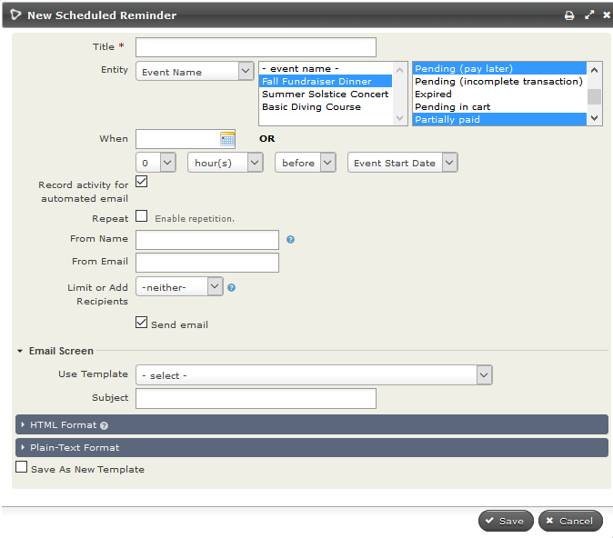
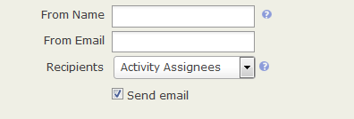
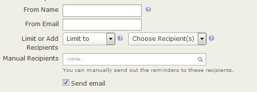
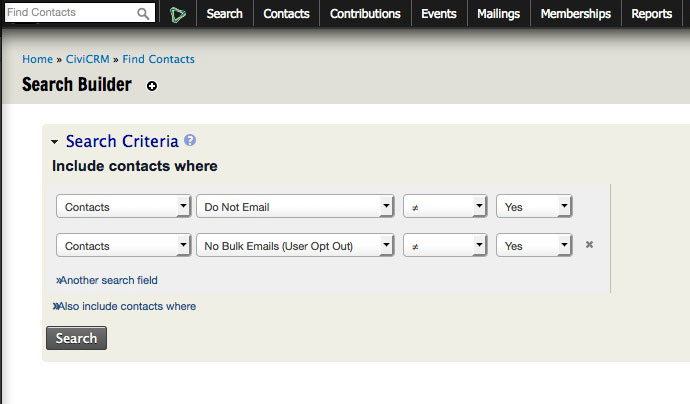

# Scheduled reminders

Scheduled reminders automatically send email or SMS messages to contacts when certain criteria are met. For example, you can send participants an SMS the day before a training course, or send contacts a series of membership renewal emails as their membership end date approaches.

Scheduled reminders are available for these CiviCRM components (Entities):

- Contacts
- Activities
- Memberships
- Events
- Contributions

You can create reminders for these components at **Administer > Communications > Schedule Reminders**. You can also set up event reminders on the event configuration pages.

## Tokens available to scheduled reminders

In addition to the standard [tokens](../common-workflows/tokens-and-mail-merge.md) available in CiviMail, scheduled reminder messages can contain tokens for the events, activities, contributions, and memberships they relate to. This lets you use one reminder template for different events, membership types, contribution types, or activity types.

In event messages, a token such as event location is replaced with the location of the specific event. In membership messages, you can use each individual’s expiry date. Membership and event ID tokens are also available and can be used to create links to specific pages, such as the membership renewal page.

The checksum token lets you authenticate people to specific pages without requiring them to log in, and show forms with details already filled in.

## Creating and managing scheduled reminders

Create a reminder at **Administer > Communications > Schedule Reminders** or during the creation of an event. The options shown when you click **Add Reminder** depend on the **Entity** you choose, but the general process is similar for all reminders.

1. Give the reminder a name that will help you and others identify it.
2. Select the required **Entity**. The options you can base the reminder on appear in the adjacent window. This is a multi-select field, so you can choose more than one option. Depending on your selection in the middle field, a third set of options appears in the right box. This is usually also a multi-select field.
3. Choose when to send the reminder: on a set date, or an amount of time before or after the start or end of your chosen entity.
4. Check the Repeat box if you want to send the reminder more than once to the same group of people. You can then choose the interval and when repetition should end.
5. Check **Record activity for automated email** if you want a record of the contacts who received the reminder.
6. Fill in **From Name** and/or **From Email** if you do not want the reminder to come from your site’s default name and email address.
7. Limit or add to the recipient list. See *Limiting or adding to your recipient list* below.
8. Choose to send the reminder as an email, an SMS, or either, depending on the contact’s preferred method(s) of communications.

    !!! note
        The SMS option will only be available if you have
        [set up an SMS Gateway](../sms-text-messaging/set-up.md)

9. Compose the message using Message Templates or write it from scratch.
10. Click **Save** when you are done.

You can edit, disable, or delete reminders at **Administer > Communications > Schedule Reminders**.

!!! warning
    Your system administrator will need to ensure that the Send
    Scheduled Reminders scheduled job is enabled and runs at least once a
    day. Refer to the [Scheduled Jobs](https://docs.civicrm.org/sysadmin/en/latest/setup/jobs/)
    section for configuration details.

## Using scheduled reminders for contacts

Contact reminders can be based on:

- Birth Date
- The date the contact record was created (Created Date)
- The date the contact record was modified (Modified Date)
- Custom contact date fields, such as a marriage date or the date a qualification expires

You can send a reminder every year on the same date (an anniversary), particularly for birthdays or marriages. Alternatively, you can send it only once in relation to the actual date, as you might for an expiring qualification.

By default, reminders created from this screen apply to all contacts with dates set for the specified field. To send a reminder to only some of those contacts—for example, birthday greetings to children but not adults—limit the recipients as described in *Limiting or adding to your recipient list* below.

## Using scheduled reminders for activities

Activity reminders can be based on any combination of core and custom activity types. Options include:

- Send to contacts with the specified activity types and any combination of activity statuses, such as scheduled, completed, or cancelled.
- Send only to **Activity Assignees** (contacts in the Assigned To field), **Activity Targets** (contacts in the With Contact field), or **Activity Sources** (the logged-in user who added the Activity) for the specified activity types and statuses. See *Limiting or adding to your recipient list* below.

For example, you could:

- Log calls with major donors using the Phone Call activity and automatically email your executive director the Activity Details.
- Remind staff about interviews they are assigned to conduct.
- Notify the person who scheduled an activity that it has been completed.
- Send thank-you notes to people who met with you.

## Using scheduled reminders for contributions

You can send emails to contributors based on the page they donated through or the contribution/financial type of their donation. Options include:

- Send to contacts who contributed through the selected contribution page(s), with any combination of contribution statuses.
- Send to contacts who made a contribution of the selected financial type(s), with any combination of contribution statuses.

## Using scheduled reminders for memberships

You can send messages to members based on membership characteristics, including membership type and status. For example, you could send current members renewal reminders 1 month before their membership end date, or “sorry you are leaving” emails 1 week after it. You could also send membership engagement letters 2 weeks after the membership start date to remind members of their benefits.

As well as sending emails based on memberships, you can send emails based on membership-related activities, such as Membership Signup. The payment reminder example below uses that activity.

### Renewal reminders

To email members 5 days before their membership expires:

1. Set Entity Type to Membership.
2. Select one or more Membership Types.
3. If the selected membership types allow auto-renewal, you may want to send this reminder only for memberships that do NOT renew automatically.
4. Set 'When' to 5 days before Membership End Date.
5. Do **not** select Repeat.
6. Check 'Send Email' and choose the Template, or create and save one.

What to include in a renewal email is discussed in *Renewals* in the *CiviMember* section.

!!! note
    If a member renews, they will receive their next reminder 5 days before
    their new Membership End Date.

### Chasing members who have not sent membership payments

To remind contacts whose memberships are pending because payment has not been received:

1. Create a smart group for contacts with a membership status of pending.
2. In scheduled reminders, set Entity Type to Activity, Membership Signup, Completed. This uses the Activity entity, not the Membership entity.
3. Restrict Recipients to the membership pending smart group. Without this restriction, all members—including those who have already paid—will receive the message.

## Using scheduled reminders for events

Set up event reminders from the Scheduled Reminders administration screen or from the Schedule Reminders screen in the event configuration workflow. To reach the event screen, click the **Schedule Reminders** tab when setting up an Event, or **Configure > Schedule Reminders** next to your event on the Manage Events screen. The configuration steps are the same as on the administration screen.

A reminder set up from the event configuration screen applies only to that event. To send reminders for all events of a certain type—for example, evaluation forms after workshops—use the Scheduled Reminders administration screen.

Event-specific options include:

- Send to participants in specific event(s) or in all events of given type(s), such as conferences or meetings.
- Send to all participants in the chosen events or only those with specified participant statuses, such as registered and attended, or cancelled and no-show.
- Send to all participant roles with the appropriate statuses or only specified roles, such as volunteer or host.

For example, you could:

- Email volunteers for an annual fundraising dinner the day before the event to remind them when to arrive.
- Send fundraising emails to attendees of all your training courses the day after the courses are held.
- Ask event attendees for feedback.
- Send a thank-you email to event speakers and hosts.
- Email people who registered but did not show up to ask why.

### When scheduled reminders for events are or aren't sent

A reminder set for a specific date is sent only on that date. Contacts who registered before that date receive it the first time the Send Scheduled Reminders cron job runs on that date (likely shortly after midnight). Contacts who register on that date receive it shortly after registering. Contacts who register after that date do not receive it.

A reminder set relative to the event start or end—for example, 24 hours before the event start—will generally also be sent to contacts who register after that time. Specifically, a reminder set for any time before the event start or end is sent to all registrants who register before the event ends. A reminder set for any time after the event start or end is sent to any registrant, regardless of when they register.

Similarly, a reminder set before the registration start or end is sent to any contacts who register up to the registration end. Reminders set for after the registration start or end are not sent at all.

## Limiting or adding to your recipient list

You select recipients based on entity-specific characteristics, such as event type and participant status, membership type and auto-renew options, activity type and status, or an entry in a contact date field.

For activity reminders, you can further limit recipients using the Recipient field. Choose **Activity Assignees**, **Activity Source**, or **Activity Targets**; a predefined group using **(Select a group)**; or contacts you specify using **(Choose recipient(s))**. Selected groups or contacts receive the reminder only if they meet all its other criteria.

For Event, Contact, and Membership reminders, you can limit recipients to a group, a participant role (Event reminders only), or manually selected contacts. Set **Limit or Add Recipients** to **Limit to**, then choose **Select a group**, **Choose recipient(s)**, or **Participant Role** (Event reminders only) from the adjacent option list. For example, you could send birthday greetings only to members who are less than 12 years old.

As with activity reminders, groups, manual recipients, or roles selected with **Limit to** receive the reminder only if they meet all its other criteria.

To send a reminder to contacts who do not meet its general criteria, set **Limit or Add Recipients** to **Also include**. You can then select a group or an individual who will receive the reminder even if they do not meet the other criteria. For example, you could send an event reminder to registrants 2 days before the event and also send it to Bob Adams, your office manager, so he remembers to check the room configuration and equipment.

## What can cause scheduled reminders not to be sent?

First, use **Find Activities** to check whether the reminder was sent. Specify an Activity Type of **Reminder Sent**, or **Membership Renewal Reminder** for membership renewals.

If you find matching Activities for the contacts, another issue, such as email delivery, may explain why a contact did not receive the reminder.

If you find no **Reminder Sent** or **Membership Renewal Reminder** Activities, consider these conditions:

1. The contact is deleted.
2. The contact is deceased.
3. The contact has **Do not email** enabled.
4. The contact email address is **On hold**.
5. For a **Membership Renewal Reminder**, the Membership **Status Override?** option is enabled. When Status Override is active, the selected status remains in force. No Membership Renewal Reminder is sent.
6. The **Send Scheduled Reminders** Scheduled Job is not enabled or is not configured to run **Always**. This job must execute when the reminder criteria are met. If its execution is delayed, Scheduled Reminder criteria will be skipped.
7. The Scheduled Reminder is disabled.
8. The Scheduled Reminder has the Limit or Add Recipients **Limit To** option set, and it does not include the target contact.
9. No Scheduled Reminders match the contact’s criteria.
10. The Scheduled Reminder has a **When (trigger date)** that has past or otherwise has not been met.

## Scheduled reminders and privacy options, on hold

Scheduled reminders are still sent to contacts who have **opted out of bulk emails**. Sometimes this is appropriate: they may still want reminders about an event they registered for or an upcoming membership renewal. In other situations, it is not appropriate.

Scheduled reminders are not sent to contacts with the **Do not email** privacy option or an email address that is **On hold**.

To exclude contacts who have opted out of bulk emails from a scheduled reminder:

1. Find all contacts who have not selected the privacy options "Do not email" or NO BULK EMAIL. You can use the Search Builder at **Search > Search Builder**, with the settings shown below.
2. Create a smart group from the search results.
3. Select that smart group as the **Recipients** of the scheduled reminder.

<!-- Source: email/scheduled-reminders.md -->
