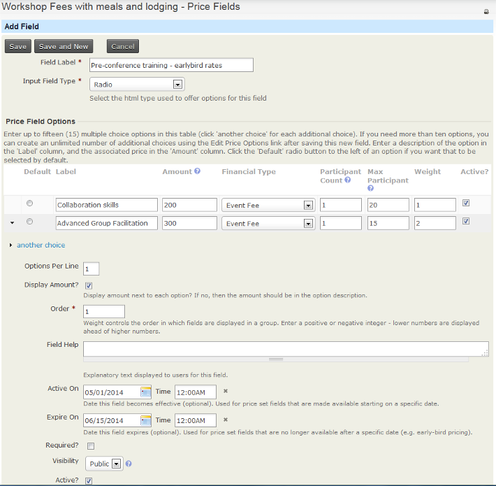
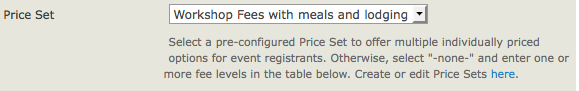
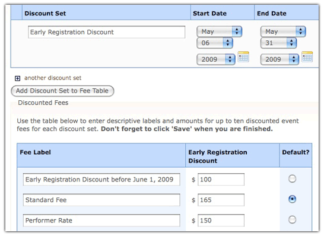

# Complex event fees

The regular fees layout form outlined in the *Creating an event* chapter of this section lets a registrant select one fee option from a list. If that single-option format does not meet your event registration needs, you can use **price sets** and **discounts** to compose more complex pricing options.

## Price sets

Price Sets let you break event fees into smaller pieces and set a fee for each piece. For example, you can offer an optional post-conference dinner or a book at extra cost.

This example shows a price set for a Conference with optional pre-conference training sessions, meals and lodging:

### Create a new price set

1. Navigate to **CiviEvent &gt; New Price Sets**.
2. In the Price Set form, enter the name of your price set and check **Used For &gt; Event**.
3. Select the **financial type** to be used (in this case it will be Event Fee).
4. You can add pre or post form help (help text for the user).
5. Check the **Is this price set active** box.
6. Press **Save**. A form appears for you to create the first field in your price set.

### Create a new price field

Begin by entering a name for the event item in the Field Label**.**

The Input Field Type has a structure similar to custom data fields, with some unique qualities and usage relevant to fee structures:

- **Text/Numeric Quantity:** Lets you set a unit price. The registrant enters a quantity in a text box, and that quantity is multiplied by the unit value to calculate the fee.
- **Select:** Displays a dropdown box from which the registrant selects one option.
- **Radio:** Displays multiple options in a list, allowing the registrant to select one fee choice.
- **Checkbox:** Displays fields in a list from which the registrant can select or unselect any number of options.

You can combine these field types to create virtually any fee structure.

Enter a number in the Participant Count field if you want to increment the number of registered participants per unit against the maximum number of participants allowed for the event. For example, if the price field is for a table at a fundraiser that seats eight people, set Participant Count to 8.

For Text/Numeric Quantity fields, enter an amount in the Price field. For Select, Radio and Checkbox types, enter a price for each option in the table of options shown in the screenshot above.

To display the price next to the event item, check the **Display Amount?** box.

As when creating other custom data, you can enter a description for the Field Help, decide whether the event item is required, select whether it is visible to the public or only to the administrator in the Visibility field, and indicate whether it is Active. These fields are described in the *Custom fields* chapter in *Organising your data*.

You can also choose the dates when the price field is active. For example, you can have price fields offering discounted rates for people who register very early, standard rates for people who register up to two weeks before the event, and premium rates for people who register in the last two weeks before the event.

Press **Save** to finish configuring the event item, or **Save and New** to create another price field for the price set.

### Add the price set to an event

Once you finish configuring the price set, add it to your event on the Fees tab. Select its name in the Price Set field, as shown below.

As with custom data fields, it is helpful to plan the structure of your registration fees and build the price set before creating the event. If you begin creating the event and then determine that you need a price set, you can complete the process, create the price set, and return to the event configuration page to assign it.

Price sets can be reused in multiple events. This is particularly helpful for organizations that run multiple events in a series, such as a regional training seminar program.

### Manage price sets

To manage existing CiviEvent price sets:

- Navigate to **Manage Price Sets** and choose the **Events** link; or
- Navigate to **CiviEvent &gt; Manage Price Sets** and choose **Administer**.

## Discounts

CiviEvent also lets you offer early bird discounts determined by sign-up date if you use a simple fee structure. These discounts override regular event fees during the period you specify.

To set up an early bird discount, check the **Discounts by sign up date** box underneath your regular fees in the fees section of your event configuration. Create the discount set and add it to the fee table. A new fee table appears toward the bottom of the page, duplicating the original fee table shown in the screenshot below. Edit the labels and fees to correspond to the discounts offered for each original fee option.

You can create multiple date-based discount sets for an event. This may be useful if you have a series of early bird dates that progressively increase the cost of registration as the event gets closer.

Discount sets and discounts via price sets are out-of-the-box CiviCRM that allow you to do offer discounts based on sign up dates. For more sophisticated discounts, you can install the [CiviDiscount extension](https://civicrm.org/extensions/cividiscount). It allows a variety of discounts, including Discount codes and discounts based on membership status.

<!-- Source: events/complex-event-fees.md -->
