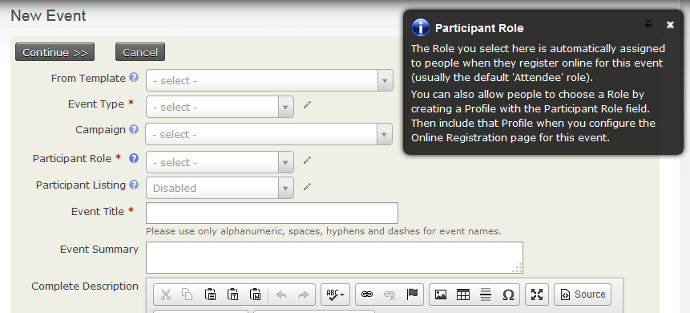
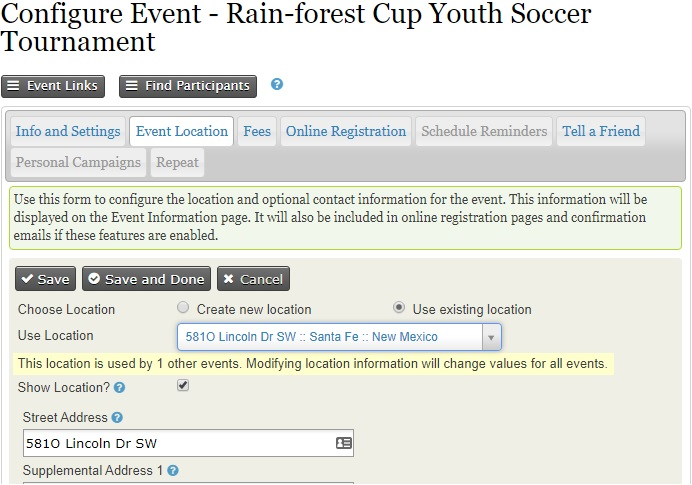
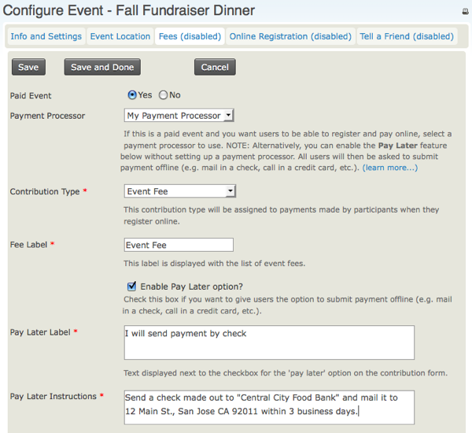
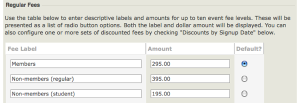
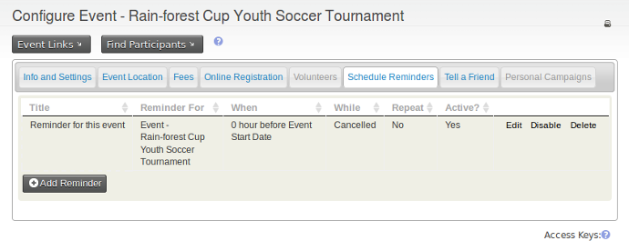
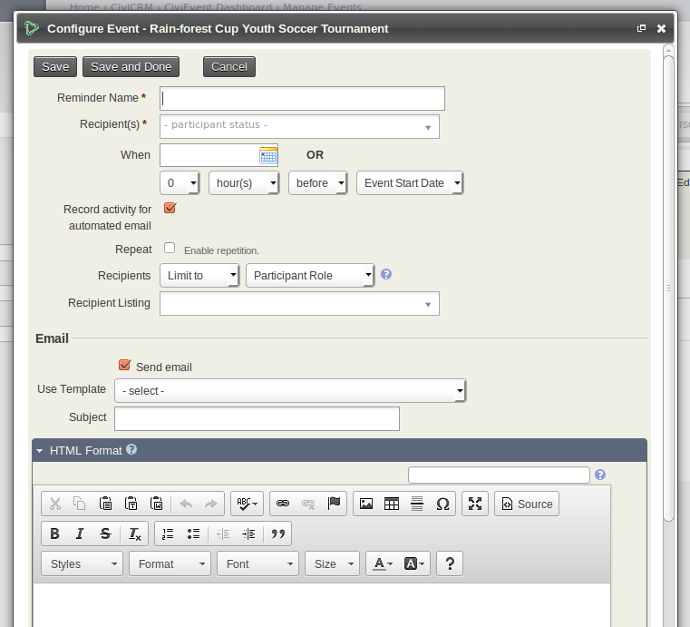
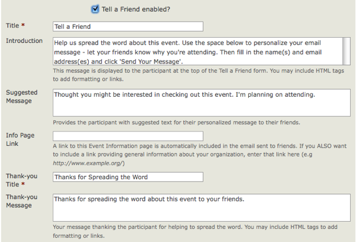
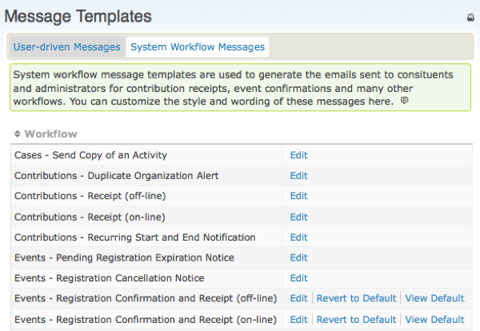

# Creating an event

This page covers how to create a new event and the options available during setup. If you're going to allow online registration, also read [online event registration](online-event-registration.md). If not, read [manual event registration](manual-event-registration.md).

To get started, choose **Events &gt; New Event** from the menu. If you can't see the events menu, make sure that you have enabled the Events component in **Administer &gt; System Settings &gt; Components**.

## Event information and settings

The first page you see when creating an event requests basic information online about the event. Click a blue question mark for help with a field. Where a pencil appears, clicking it takes you to a screen where you can edit the available options. Depending on your permissions, you may not be able to edit these options and therefore will not see the pencil.

- **From template** lets you create an event from a template rather than from scratch. See the *Event templates* chapter in this section.
- **Event type** lets you categorise the event.
- If **CiviCampaign** is enabled, you can select a campaign for the event. See the [Campaign](../campaign/everyday-tasks.md) section for more details.
- **Roles** distinguish participants such as attendees, speakers and staff. The value in this field is assigned by default when users register online or when you import registrations, unless you include the field Participant Role with other values in your CSV import file. The most common value is Attendee.
- **Participant Listings** can show support for an event and help generate interest within your constituent community. Decide whether users should see a list of participants and how much information to reveal. The options here only *enable* participant listings &amp;mdash; to display one, you must create a menu item or link to the listing on your website. After you create the event, the participant listing link appears on the event configuration page. See [Event management](event-planning-and-management.md) for information on [participant listings](keeping-track-of-events-and-participants.md#finding-and-administering-participants) and other ways to [promote your events](event-planning-and-management.md#promoting-your-events).
- **Event Title** appears on event information pages, registration pages, event listings, and the Manage Events administrative page. Choose a meaningful title for your event.
- **Event Summary** and **Complete Description** both appear on event information pages. Use the rich-text editor for the description field to include photo, images, and formatted text.
- **Start date/time** and **End date/time** appear on the event information page and event listings.
- **Maximum number of participants** lets you set a limit and define a message to display when it is reached.
- To display a map of the event location, use either Google Maps or Open Street Maps. Configure your mapping solution through **Administer &gt; System Settings &gt; Mapping and Geocoding**.
- Select **Public Event** to include the event in promotional listings such as RSS feeds, iCal files or feeds, and event listing pages.
- Select **Allow sharing through social media** to include links for sharing the event on the Event Info page, Thank-you page, Tell-a-Friend page (if enabled), and in event confirmation emails.
- An event can be active or inactive. If configuration will take some time, consider leaving it inactive until it is complete so it is not inadvertently listed on event listing feeds. You can activate it when you are ready to publicize it.
- Select **Show Calendar Links** if you want CiviCRM to add links for downloading a calendar meeting invitation on the information page and in registration mails. These invites do not work well if participants are in different timezones than the server. Test thoroughly if you enable this.

After reviewing the details, click **Continue &gt;&gt;** to create the event and advance to the next step. On any subsequent page, you can interrupt configuration by clicking **Save and Done**, then return later to review and modify the settings.

To return to a saved event, go to **Events &gt; Manage Events** and click **Configure**.

## Event location

Next, complete the event's location and contact details.

After entering a location, you can reuse it for subsequent events by clicking **Use existing location** and selecting it from the dropdown list. If you choose an existing location and edit it, the change updates that location for all events that use it.

You can list phone numbers and email addresses on the event information page so registrants can contact event organizers directly. If the event is off-site from your organization's primary location, you may also want to provide contact information for the meeting location.

You can also select whether or not the event location is showed on the registration and event information screens.

## Fees

If the event is free, set **Paid Event** to **No**, click **Save**, and skip to Online Registration. If the event is paid, click **Yes** to show the available options.

**Contribution Type** (financial type) determines what is assigned to paid registrations for the event. The most common value is Event Fee, but you can define multiple Financial Types and assign them to different events. See *Set-Up* in the *Contributions* section for details.

If you plan to accept credit card payments through the online registration form, configure a **payment processor** before creating the event. See *Payment Processors* in the *Contributions* section for more information.

To let registrants pay later by mailing a check, paying on-site with cash or credit card, or arranging another payment method, enable the **Pay Later option** and define a label and payment instructions. If you leave it unchecked, registrants must pay by credit card.

**Regular Fees** provide price levels from which a registrant must select one, such as an individual registration for $50 or a family registration for $100. Each fee amount has a label, and you can set a default fee. This approach works well for many events and is easy to set up. Here is an example:

For a more complex pricing structure, with more options or additional add-ons, you may wish to use **price sets** or **discounts**. See the *Complex event fees* chapter in this section.

## Online registration

Online registration lets people register themselves through your web site. It can be convenient for constituents and save staff time and resources.

If you do not need online registration, do not check **Allow Online Registration**; move to the next step. If you do want it, see [Online event registration](online-event-registration.md).

## Scheduled reminders

Scheduled reminders can automatically email event registrants at certain times before or after an event. For example:

- A week before the event, remind them to check the conference schedule.
- A day after the event, ask them to fill in the feedback form.
- Two days before payment is due for a Pending from Pay Later registration, warn them that their registration will be cancelled if they do not provide payment details in the next 48 hours.

To set up a reminder for a specific event, click the scheduled reminders tab. It shows existing reminders for that event, if any. Click **Add Reminder**.

Fill in the form to send a message—for example, an email to all registered speakers 3 days before the event start date. You can limit recipients by status (registered, attended, etc.) and by role (speaker, attendee, volunteer, etc.). You can use a template or compose a message in the HTML format box.

You can also set up reminders for specific event types and add them to specific event templates. The approach is the same, but you access it through **Administer &gt; Communications &gt; Scheduled reminders**.

## Tell-A-Friend

The final event-creation page lets you enable "Tell-A-Friend" so constituents can share details about your organization and event with friends and colleagues. You can define the text and links included on that page and in the email sent from the tool.

Each time a participant sends mail to friends, a "Tell a friend" activity record is added to the participant's Activities tab. This lets you track your most active supporters and engage them further. People emailed through this feature are also automatically added to CiviCRM as contacts.

## Registration confirmation and receipting

You can send automated confirmation and receipt emails to participants who register online or are registered by staff or volunteers. Message templates control the content and layout of these emails. Both HTML and Text formats are provided. You can modify or add text, or add branding such as a logo to the HTML versions. To set up a from email address for confirmations and receipts, see Set-Up in the Email section.

Go to **Administer &gt; Communications &gt; Message Templates** and click the **System Workflow Message** tab to see the messages you can modify. Click **Edit** next to the "Events - Registration Confirmation and Receipt" rows to edit their content and layout.

These templates include both the text shown and necessary program logic. Take care not to modify the program logic. After making changes, test the workflow and review the emails sent. If changes cause problems, errors or missing information, you can revert to the system default for that workflow.

<!-- Source: events/creating-an-event.md -->
