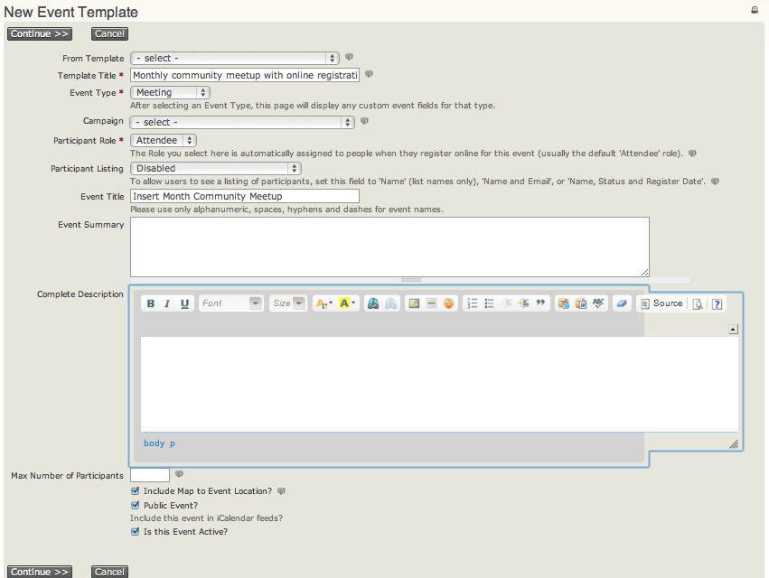
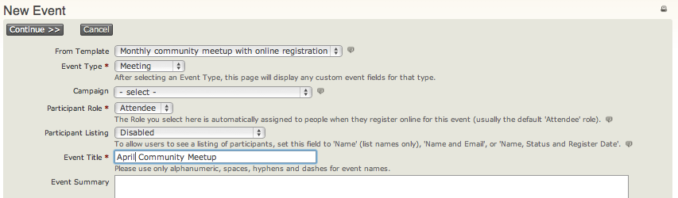

# Event templates

If you need to set up a number of events with similar configurations, you can streamline the process using event templates. Creating a template is similar to creating an event, with two differences:

- Assign a descriptive template title that identifies the type of event it is used for, such as Monthly community meetup with online registration.
- The template form has no starting or ending dates. Those dates are specific to an actual event instance.

## Create an event template

1. Navigate to **Events &gt; Event Templates** and click **Add Event Template**.
2. Enter a template title and event type.
3. Select a campaign if all events created from the template should be associated with a Campaign.
4. Continue the normal event set-up process, using settings that will be constant across events created from the template. Common characteristics might include location, event fees, online registration settings, and tell-a-friend settings.

## Use an event template

When you start to create a new event, select the template. The new event will be pre-filled with the saved configuration properties.

<!-- Source: events/event-templates.md -->
