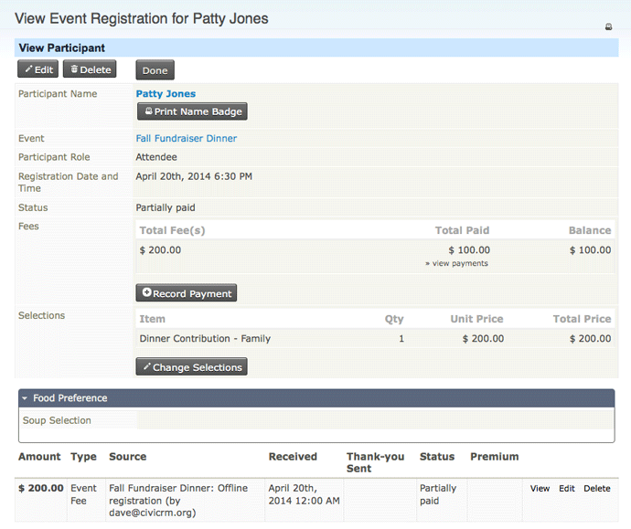
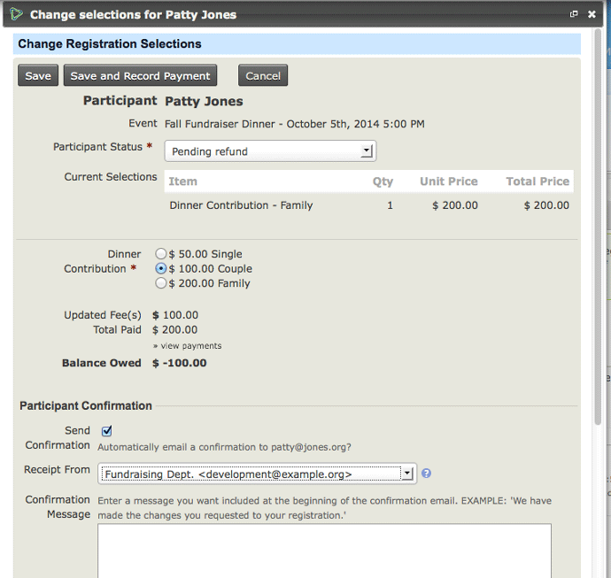

# Finding and administering event participants

These tasks apply to existing event participants. For how to add participants, see the *Manual event registration* chapter.

## View participants for an upcoming event

1. Navigate to **Events &gt; Dashboard**.
2. Click the **Counted:** link to see all the contacts for an event.

If any count is zero, the associated text will not be a hyperlink. Some participant roles may not count for the event total, such as someone who is on clean-up duty.

## Find participants using search criteria

1. Navigate to **Events &gt; Find Participants**.
2. In the event name field, start typing to see a list of events. Click the event you want. Set additional search choices for the fields you want to see.
3. Click Search.

When the search returns results, you can select all participants in the results or a subset and perform an action on them. Available **Actions** include:

- **Cancel registration** for the selected participants.
- **Delete participants from event:** Deleting participants does *not* delete the contact record; it deletes all transactions and activities associated with the participant *for this event*. This action cannot be undone.
- **Email - send now** generates an email to your search result list. For example, you may want to send details about parking options or changes to the programme before the event.
- **Export participants:** Export a predefined set of fields (export mapping), or create an export mapping that can be saved for reuse. The software exports to CSV format, which can be opened in standard spreadsheet software or used directly for mail merges.
- **Group - add contacts** to an existing group or one you create during this action.
- **Group - create smart group:** Smart groups are saved search results based on defined criteria, similar to a query. The system reruns the query using those criteria each time you open the smart group. This is helpful for complex searches you need to view regularly.
- **Name badges - print:** Select the type of badge you require. A printable PDF is generated with the names of the selected participants (see *Event Badges* in this chapter).
- **PDF letter - print for participants**
- **Participant status - change (emails sent)** When using this feature, emails are sent to participants when their status changes from one in the pending class (eg Pending (pay later), Pending from approval) to **Registered** or **Attended** (positive class). Emails are also sent if the status changes to Expired or Cancelled.
- **Print selected rows** prints what is shown on the screen for the rows you selected.
- **Update multiple participants:** Edit multiple fields for multiple participants in a table grid layout. You must create the profile set you want to use before taking this action. If you are not familiar with Profiles, see the [*Profiles*](../organising-your-data/profiles.md) chapter in the *Organising your Data* section.

## List a participant's individual fees

1. Navigate to **Search &gt; Custom Searches**.
2. Click **Event Aggregate**.
3. Choose your search criteria, and click **Search**.

## Change registration selections for an existing participant

An existing registration might need to change in any of these situations:

- A volunteer registered online with a pay later option for the event fees. Back-office staff want to change the person's role from attendee to volunteer and select a zero fee option from an admin-only price field.
- A conference participant no longer wants to attend the conference dinner and requests a refund of the dinner fee.
- A participant decides after registering online that they want to attend the pre-conference workshop. They contact the registration office with the request and provide credit card details for the extra charge.
- A child registered for a holiday program decides she wants to do archery rather than pottery one afternoon. Although the fees do not change, back-office staff need to update her registration so they know where she should be for that session.

Back-office staff can make these changes by editing the participant's event registration:

1. Navigate to the participant's event registration. One way to do this is via **Events &gt; Find Participants**.
2. Select **View** or **Edit** towards the right of the event record.

    ****

3. Click **Change Selections.**
4. Make the required adjustments. The event fee will be adjusted appropriately, and the event status will be set to **partially paid**, **registered** or **pending refund** based on the difference between the new event fee and the contribution(s) already processed.

****

Additional payments (credit card or offline methods) or a refund (offline methods only) need to be entered via the **record payment** link associated with the event registration record, as described in the section on partial payments.

<!-- Source: events/keeping-track-of-events-and-participants-part2.md -->
