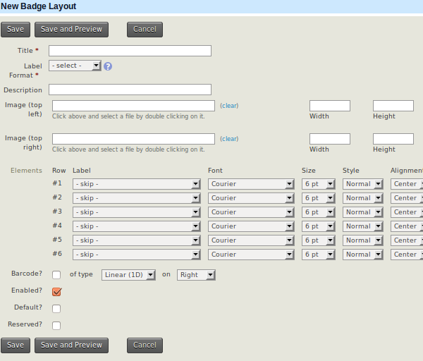

# Creating and printing event badges

You can create custom name badges for your event.

Navigate to **Administer &gt; CiviEvent &gt; Event Badge Layout &gt; New Badge Layout** to see the set-up screen.

Consider these layout options:

**Label format:** Four options are available:

- Avery 5395 - 2-1/3" x 3-3/8"
- A6 Badge Portrait 150x106
- Fattorini Name Badge 100x65
- Hanging Badge 3-3/4''x4-3/4''

**Image (top left)** and/or **Image (top right):** Select an existing image or upload a new one. Images can be positioned on the right and left to include your logo and that of a major sponsor.

**Elements - Rows:** Most standard or custom contact, event and participant fields can be selected to provide up to 6 rows on the labels. You can also select **spacer** to improve the layout. Typical fields include display name, current employer, country and/or participant role. If you have set up the appropriate custom fields, you could also include the sessions a participant registered for and their selected meal option.

**Barcode?:** A linear barcode or QR code can be added at the bottom of the badge.

**Enabled?:** This needs to be ticked for people to use the badge layout. For a special layout used only at an annual conference, you could untick this box for most of the year to prevent accidental usage.

**Reserved?:** Select this option to ensure that admin users do not accidentally delete the badge layout.

!!! note
    You will not be able to preview the badge layout unless at least
    one event has been created and at least one participant has been
    registered.

## Printing name badges

Once your list of event participants is finalised, print the name badges as follows:

1. Go to **Events &gt; Find Participants**.
2. Select the relevant participants.
3. Choose **Print Event Name Badges** from the drop-down list of actions and Click Go.
4. Select the name badge layout for this event.
5. Click **Make Name Badges**.

A PDF file will be created that you can print on the appropriate-sized labels.

<!-- Source: events/keeping-track-of-events-and-participants-part3.md -->
