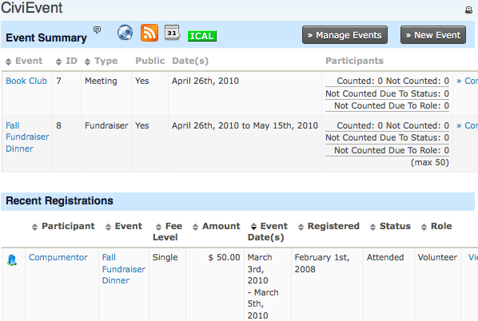

# Keeping track of events and participants

After creating your event and providing the registration form to web site visitors, you can manage participants through the CiviEvent administrative tools. The tasks vary depending on the type of event you are organising. This page describes how to view events and participants and find event management tools.

## Dashboard

The CiviEvent Dashboard (**Events &gt; Dashboard**) brings events and participant information together in one place. Its Event Summary table shows up to ten scheduled and recent Events. Click the **Event name** to view the event as it will be displayed to site visitors. Click the **Participants count** to see a list of participants.

To run your own customized searches, click **Find more event participants** at the end of the page. You can search by Participant Name, Event, Date Range and Status.

From the Dashboard, you can also:

- Click **Manage Events** to find and manage specific events.
- Click **New Event** to create a new event page.
- Use the icons for RSS feeds and calendars to use the data in external applications.

## Finding and viewing events

Another way to access your events is to navigate to **Events &gt; Manage Events**. This screen lists all CiviEvents that have been created. Search filters at the top of the page let you search by event name, specific event type or date.

At the right hand side of the page, you have four links for each event:

- **Configure** - access to amend the event settings, including Information and Settings, Location, Fees, Online Registration, Schedule Reminders and Tell a Friend
- **Participants** - quick links to lists of participants who are registered or attending the event, or participants who are not attending
- **Event Links** - quick links to Register Participant and the live event pages, including the event information page and the live online registration page

<!-- Source: events/keeping-track-of-events-and-participants.md -->
