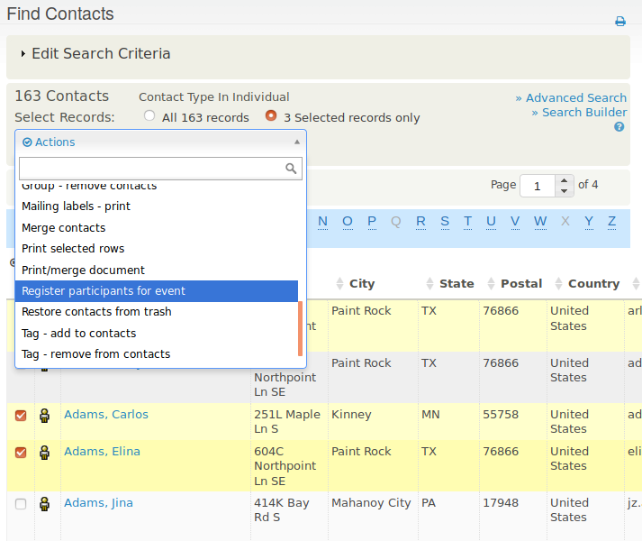

# Mass event registration

You can register multiple contacts for an event at one time. For example, Arts in Action anticipates high attendance at a youth leadership workshop from participants at a previous workshop. Staff search for those participants and register them with **Participant Status** set to **Pending**. They can then call or email the pending contacts. If someone confirms they will attend, the event organizer can change their status from **Pending** to **Registered**.

## Register multiple contacts

1. Search for the contacts you want to register. In the Arts in Action example, staff would use **Search &gt; Find Participants** to find participants at the previous workshop.
2. On the search results page, choose **All x records** or put a check mark next to each contact you want to register.

3. From the actions list above the search results, choose **Register participants for event**, then click **Go.**
4. Choose the event. You cannot currently register participants en masse for past events.
5. Complete the registration form, choosing the action choices for this set of people, such as **Participant Status** set to **Pending**. Your choices apply to all contacts in the set.
6. Click **Save**.

## Limitations of mass registrations

The action choices you make (in Step 3) are applied uniformly to the entire set of selected contacts. To use different choices, perform mass registration several times with different sets of contacts. For example, you might give contacts you plan to call and invite a **Participant Status** of **Pending**, then register event leaders you know will attend with a **Participant Status** of **Registered**.

You cannot do mass registration of participants for events in the past.

You cannot apply contribution information, such as a pay later contribution or credit card transaction, in a batch action. Mass registration is therefore best for free events or contacts who are not required to pay a fee at this point. You can add payment details for individual contacts later.

<!-- Source: events/manual-event-registration-part2.md -->
