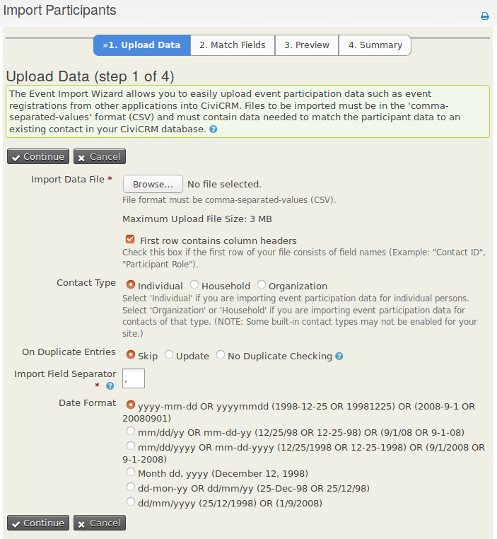

# Import event registrations

Importing registration information adds multiple registrations to an event from a comma-separated values (CSV) file. If most contacts are already in CiviCRM, mass registration may be faster.

## Match participants to contacts

The participant import tool is similar to the contact import tool, but the Individuals must already exist in the database as contacts. If they do not, run a contact import first, preferably including a unique external identifier, most often an ID assigned by the database or application from which you are importing records.

There are two ways to match a participant to a contact:

- Include the contact's external ID in a column of the CSV file. If you have the IDs on record but did not import them with the contacts, you can run a second contact import to update this field before importing participants.
- Match participants using your contact de-dupe rules, for example by including each individual's first name, last name and email address in the file. If a contact matches these three fields, the event participation is assigned to that contact.

## Prepare your data

Include the required fields in your CSV file. You need only one of the fields marked **(Match to Contact)**, not all of them:

- **Contact ID (Match to Contact)**
- **Email (Match to Contact)**
- **Event ID**
- **External Identifier (Match to Contact)**
- **Participant Status**

## Import registrations

1. From the navigation menu, go to **Events &gt; Import Participants**.
2. Browse to the data file on your local computer.
3. Select the appropriate contact type, date format and other options, and click **Continue**.
4. Match the fields of your CSV file to the CiviCRM fields.
5. If you may repeat this import in the future, check the **Save** this field mapping box.
6. **Preview** and **Save**.

<!-- Source: events/manual-event-registration-part3.md -->
