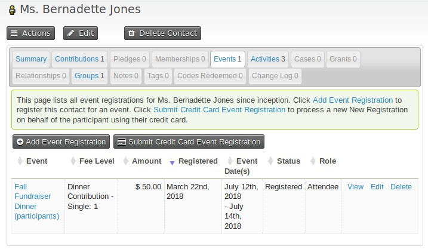
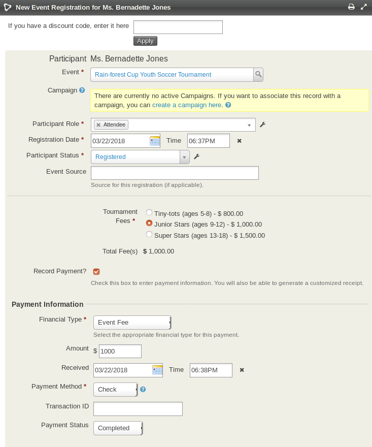
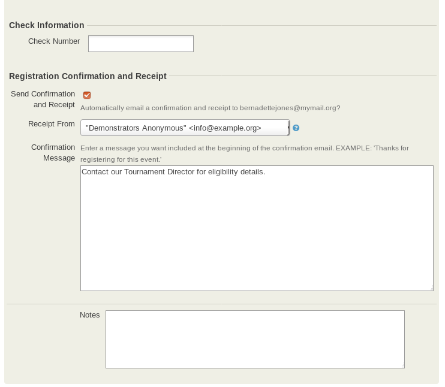
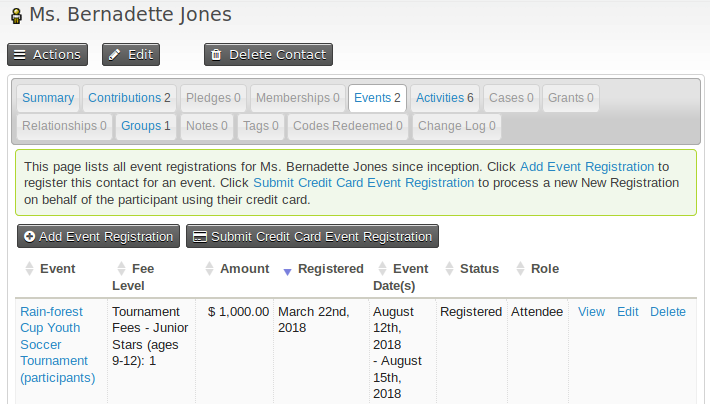
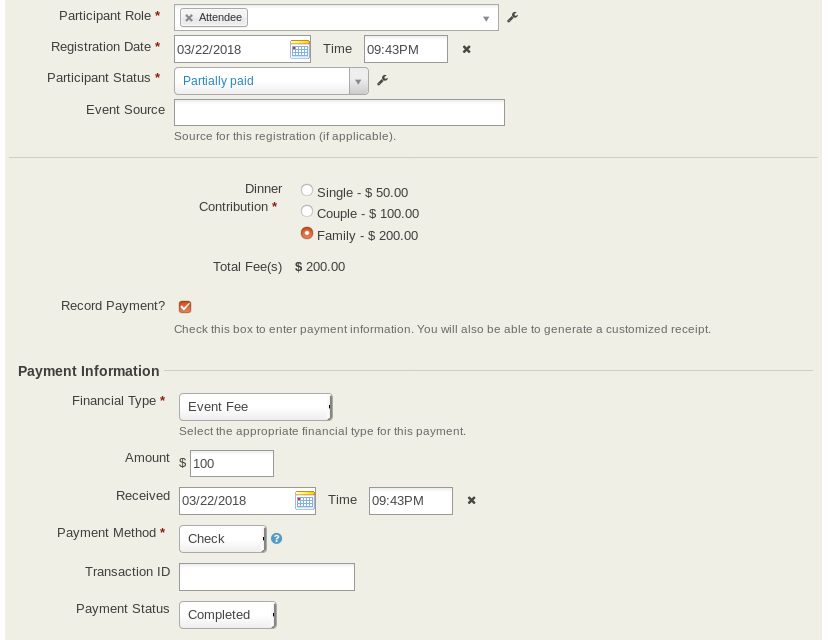
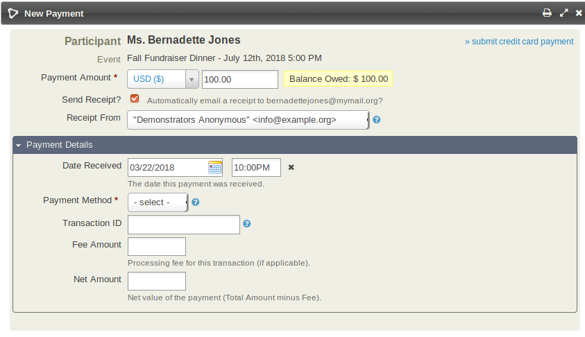
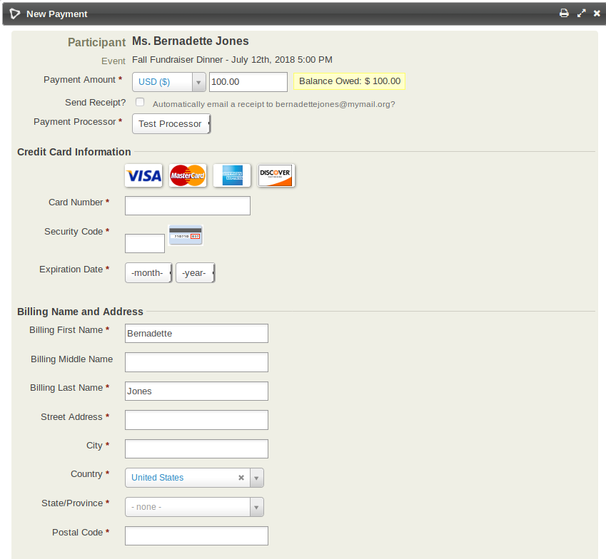
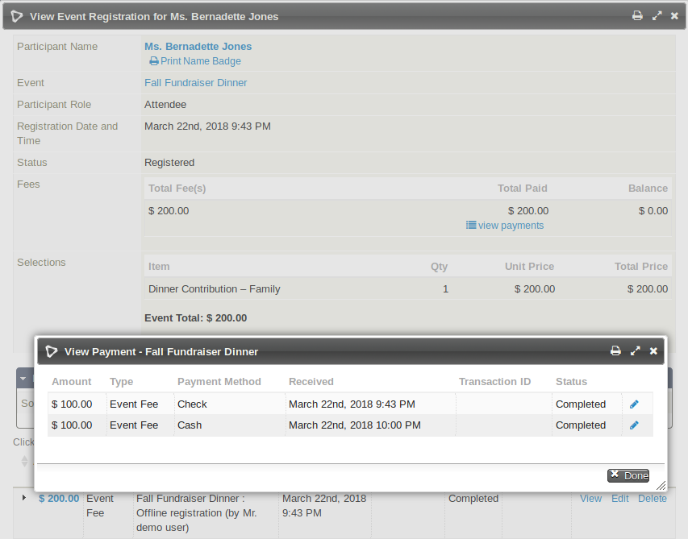
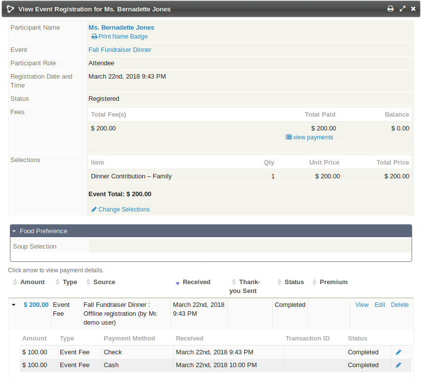

# Manual event registration

Office staff can register contacts through the admin interface, including people who register by phone or mail.

## Register a participant manually

For example, when someone calls the office to register:

1. Enter the person's name in the Quick search box.
2. Select the contact from the results.
3. Click the Events tab on the caller's contact record.
4. Add the person to the event.

The Events tab lists the contact's current and past event bookings and provides links to register the contact for a new event.

There are two registration options:

- **Add Event Registration**: For people who pay later, such as by sending a check or paying when they arrive at the event.
- **Submit Credit Card Event Registration**: For people paying immediately by credit card. This option is available only if a payment processor is configured that allows direct payments through your web site. If you are taking a registration over the phone, you can ask for the person's credit card information and enter it manually.

The forms are similar except for the fields that record payment details.

Sections of the form change to reflect your choices. For example, selecting an event and participant role automatically loads predefined custom data fields that pertain to those selections.

### Registration and payment records

For a paid event, the form shows the event fees section defined in the event configuration details and an option to record financial transaction details (**Record Payment**).

An event registration records a contact's participation in an event. A corresponding financial transaction records the monetary value associated with that participation. The records are independent but can be linked. For example, you can register a V.I.P., speaker, or someone participating in a limited way without creating an associated financial transaction if their fee is waived. CiviCRM records the registration under the Events tab and the financial record under the Contributions tab, then links the two records.

If the event is a paid event, click the **Record Payment** checkbox and enter information in the Payment Information section. This links the event registration and contribution record for the contact. After recording the registration, you can view the related contribution record at the bottom of the event registration record. If you do not select the Record Payment check box, only a registration record is created.

## Register a participant paying only a deposit (partial payment)

For a manual registration, you can enter a payment amount less than the event fees and make one or more additional payments later.

During registration, enter the amount being paid now in the **Amount** field in the Payment Information section and set **Participant Status** to Partially paid.

A **Partially paid** registration is included in the participant total in the same way as a **Pending from pay later** registration. Additional payments are expected until the full event fee is paid.

To make an additional payment:

1. Go to the registrant's contact record.
2. Click the **Events** tab.
3. Click **more** on the far right of the partially paid event record.
4. Select **Record Payment** or **Submit Credit Card payment**.

You can make more than one additional payment. When the event fee has been paid in full, **Participant status** automatically changes to **Registered**, unless you choose a different status when making the last payment. The linked contribution's status automatically changes to **Completed**.

From an accounting perspective, the event fee is added to accounts receivable when the registration is created. Each partial payment is added as a separate line item until the fee is paid in full.

The event registration and linked contribution always display the full event fee. To see how much is owed, choose to **View** the event registration. Select **›› view payments** under **Total Paid** to see a summary of each payment.

Alternatively, click the arrow next to the Contribution record at the bottom to see the payments.

<!-- Source: events/manual-event-registration.md -->
