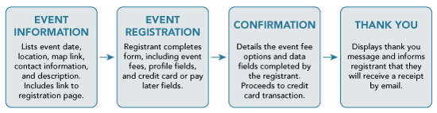
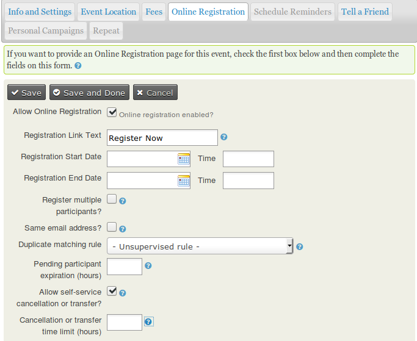
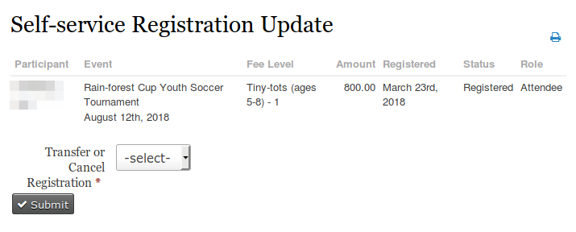
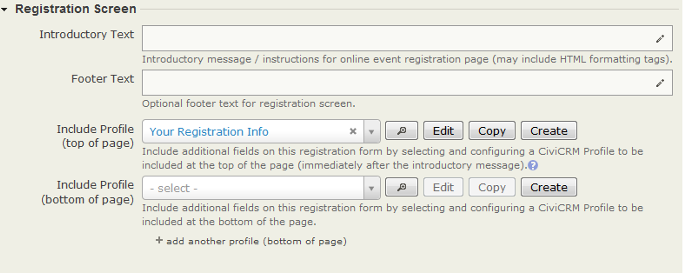
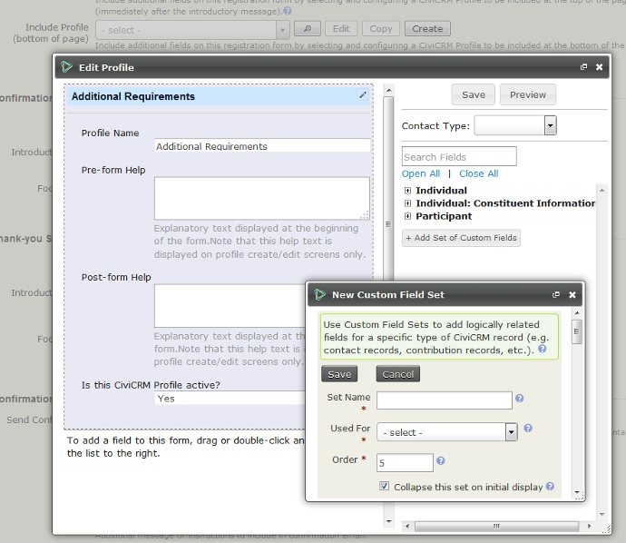
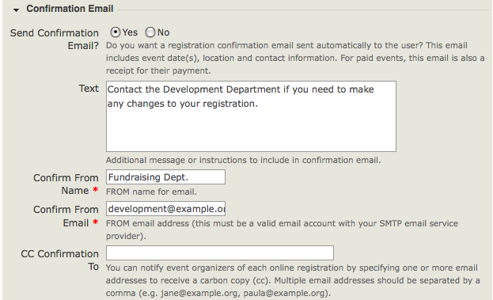
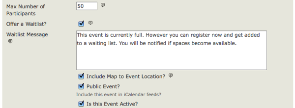
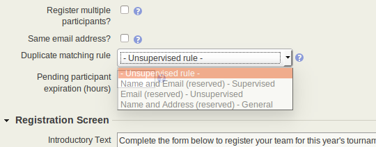

# Online event registration

Online registration lets constituents register for events at a convenient time and place while reducing administration for your organization. The standard registration flow is:

1. Event information
2. Event registration
3. Confirmation
4. Thank you



The **event information** lists the event date, location, map link, contact information, and description. It also includes a link to the registration page.

During **event registration**, the registrant completes the form, including event fees, profile fields, and credit card or pay later fields.

The **confirmation** details the event fee options and data fields completed by the registrant. It proceeds to the credit card transaction.

The **thank you** message informs the registrant that they will receive a receipt by email.

## Setting up online registration

To offer online registration, check **Allow Online Registration** in the Online Registration step of event creation. Use the options on that form to configure registration.

!!! warning "Users will overwrite their own contact record if they attempt to register someone else while logged in"
    When a logged-in user opens the registration form, CiviCRM pre-fills it with *their own* contact details. If the user is registering someone else and they overwrite the pre-filled fields with the other person's details instead of their own, CiviCRM saves those details onto the **logged-in user's own contact**, not a new one. On sites where the CMS user account is kept in sync with the contact record, this can also overwrite the logged-in user's CMS account email.

    If you expect logged in users to be registering other people then provide them with a link ending in `cid=0`:

    ```
    https://example.org/civicrm/event/register?reset=1&amp;id=123&amp;cid=0
    ```

    Whenever `cid=0` is present in the URL, CiviCRM skips the pre-fill entirely and shows a blank "you are completing this form on behalf of someone else" form from the start. It does not save the contact to the logged in user.



Define the text for the **link** from the event information page to the registration form, and set the starting and ending dates for registration. The link text appears on the event information page and is most commonly "Register Now" or similar.

The start and end dates define when web site visitors may register. The registration end date can differ from the event start date if you want to close registration early to prepare name tags or perform other administrative tasks.

Enabling **Register multiple participants** lets individuals register as many people as they choose and pay the fees in a single transaction. For example, an organisation may send multiple people to a conference, or an individual may register and pay for themselves and their partner. By default, this option requires a different name and email address for each person registered.

Checking **Allow same email and multiple registrations?** provides the same capabilities without requiring distinct email addresses for each registrant. In either case, CiviCRM uses a separate contact record for each individual registered: an existing record if the contact is already in the system, or a new record otherwise.

This setting also a contact to register multiple times for the same event. For example, if the person purchased a ticket to a concert, then wanted to purchase another ticket later on.

Information on the **Duplicate matching rule** is provided in the *Contact matching and duplicate management* sub-section of this chapter (below).

**Pending participant expiration (hours)** is the time for confirming or finishing registration by participants with any status classed as **Pending**. It works in conjunction with the scheduled job **Update Participant Statuses** (see **Administer &gt; System Setting &gt; Scheduled jobs**). If both are set, pending registration must be finalized within the set time. Otherwise, the registration will be cancelled and the would-be registrant notified by email.

This feature is useful with scheduled reminders for automatically managing **Pending from pay later** registrations if you have allowed that payment option on your online registration page. See the *Email* section for more details on [scheduled reminders](../email/scheduled-reminders.md).

**Allow self-service cancellation or transfer**: When selected, event participants receive a "self-service" link in their confirmation email. By clicking it, they can opt to transfer and/or cancel their registration.



**Cancellation or transfer time limit (hours)**: When set, self-service cancellations and transfers are disabled the selected number of hours before the event starts.

Next, define the text and fields that will appear on the online registration page.



The introductory text appears at the top of the page and the footer text at the bottom. Between them, some or all of the following appear in this order: profile, fee selection, credit card details, and additional profile(s).

## Collecting participant information with profiles

!!! tip "Alternative: use FormBuilder"
    [FormBuilder](../the-user-interface/formbuilder/example-event-booking-formbuilder.md) provides a new way to build the booking form if the built in Profiles don't offer the flexibility you need.

To collect information during online registration, include one or more profiles in your event configuration. You can include one profile immediately after the introductory message and one or more profiles under any fees and payment details you need to collect. If you are not sure what a profile is or why you would use one, see the *Profiles* chapter of *Organising you data*.

By default, the "Your Registration Info" profile is selected as the 'top' profile when you create an online registration form. It has three fields: first name, last name, and email address. However, CiviCRM requires only either first name and last name or email address for each contact. You can modify 'Your Registration Info' or create a profile with fewer fields. If you choose not to collect email addresses, be sure to uncheck "Send confirmation email?" at the bottom.

!!! warning
    If you modify an existing profile whilst configuring your Online Registration page, the changes apply everywhere that profile is used. Unless an existing profile **exactly** matches your requirements, copy it, then rename and edit the copy as required.

If the profile you need does not exist, you can create it without leaving the Online Registration configuration page. The drag-and-drop profile interface also lets you create custom fields for the profile. Custom fields can be created for all events or participants, or only specific Event Types or Participant Roles. See [Custom data on events](custom-data-for-events.md) for more details on where to store custom data.



Each profile appears on the registration form as a fieldset with a legend header. The legend is the profile Public Title if set; otherwise, it is the Profile Name. Give profiles names that help you identify them in a list and public titles that work as form-section headers.

For example, you could copy the Your Registration Info profile to add fields for workshops, name the copy "Workshop Registration", and give it the Public Title "Your Registration Info". You could then identify it when setting up workshop registration forms while keeping the same form header as other registration forms.

Several [Advanced Settings](../organising-your-data/profiles.md#advanced-settings) for profiles take effect when a profile is included in event online registration. You cannot edit these in the profile editing interface within online registration settings; you must use the main profile settings form:

- **Adding contacts to a group.** Many registrants do not wish or expect to join a mailing list merely because they signed up for an event.
- **CMS User account registration options.** A participant can be offered the option or required to log in or create a user account while registering.
- **Including ReCAPTCHA.** A CAPTCHA can be added to make registration more difficult for bots and people.

Other advanced settings, such as what to do upon duplicate match, are ignored on contribution pages.

For more information, read [Profiles](../organising-your-data/profiles.md).

## Registration confirmation

Once your registration page is configured, enter the text for the Confirmation page, Thank-you page, and emailed confirmations/receipts, if enabled.

For free events, the Confirmation step is skipped. For paid events, payment is processed between the Confirmation and Thank you pages.

For most events, you'll want to enable the Send Confirmation Email feature, shown below. For paid events, the confirmation email also acts as a receipt. Make sure the **Confirm From Email** address is a valid email account on your mail server.



The contents of the **Text** field are included in both TEXT and HTML versions of receipt emails, so HTML tags or formatting are not recommended here.

### Email alerts for event registrations

Add one or more staff email addresses to **CC Confirmation To** or **BCC Confirmation To** if you want real-time updates on registrations. Separate multiple addresses with commas.

!!! warning
    Make sure that the email addresses entered into the **CC Receipt To**
    and **BCC Receipt To** fields are **correct and do not bounce**
    or return an error email. Any return emails received by CiviCRM will be
    interpreted as a bounce for the CiviCRM Contact that the receipt
    was sent too and not as a bounce for the CC/BCC email address.
    This can have the adverse impact that the CiviCRM Contact's email
    address is put **On Hold** and **cause future emails to not be sent**.
    [For more details see this issue report](https://lab.civicrm.org/dev/core/-/issues/1999).

## Optional event registration features

The following features may be useful for your online event registration process.

### Waitlists

Your organization may have an attendance limit, such as 25 people for a training workshop or 200 for a fund-raising dinner. CiviEvent lets you set the maximum number of people who can register. When registrations reach that number, CiviEvent prevents further registrations and sends an automatic message: "The event is currently full." You can customize this message when creating an event and let people join a waitlist on a first-come-first-served basis.

The waiting list works as follows:

- When space becomes available, for example after a cancellation, On waitlist participants move to 'Pending from waitlist' status. They receive an email with a link to complete registration, including payment of any event fees.
- People remain pending for the time set in Pending participant expiration (hours). Set this in the **Online registration** tab under Pending participant expiration hours. You can set it to 0 for no limit.
- After that period, they move to expired and other people on the waitlist have an opportunity to register.

To enable the Waitlist feature, first enable the participant statuses **On waitlist** and **Pending from waitlist** in **Administer &gt; CiviEvent &gt; Participant statuses**. Then check **Offer Waitlist** on the **Info and settings** tab and set the message displayed on the event information page when the event is full.



For status processing to happen, the **Update Participant Statuses** scheduled job must be running (see **Administer &gt; System Setting &gt; Scheduled jobs**).

### Participant approval

For events open only to specific people, you can review registrations and approve those invited. For example, an organization might invite volunteers who donated 100 or more volunteer hours to an appreciation dinner. Invitees might tell friends about the event or forward its information, so registrations may need review.

To enable 'Participant approval', first enable **Awaiting approval**, **Pending from approval**, and **Rejected** in **Administer &gt; CiviEvent &gt; Participant Statuses**. Then check **Require participant approval?** on the **Online Registration** tab and set the approval message. You can also limit how long approved participants have to complete registration by entering a time in hours in the Pending participant expiration field. For example, enter "72" to allow 3 days.

When someone registers, they receive this reply: "Your registration has been submitted. Once your registration has been reviewed, you will receive an email with a link to a web page where you can complete the registration process." You can customize the reply for your organisation.

Participants are placed in 'Awaiting Approval' status. To review and approve them, go to 'Find Participants' and select the 'Change Participant Status' task. Approved participants move to 'Pending from approval' status and receive an email with a link to complete registration, including payment of any event fees.

For status processing to happen, the **Update Participant Statuses** scheduled job must be running (see **Administer &gt; System Setting &gt; Scheduled jobs**).

### Personal campaign pages

If you enable Personal Campaign Pages (PCPs), completed event registrants can create and customize a page to:

- Promote the event for which they registered.
- Promote an online contribution page.

For more information, see **Contributions &gt; Personal Campaign Pages** in this book. This is the last step in creating an event. Click **Save and Done.**

## Contact matching and duplicate management

Allowing people to interact with your database from outside it can create duplicate contacts. One way to address this is to require people to log in: remove the register for events permission from anonymous users and give it to logged-in users or a specific role. Depending on the event, that may reduce registrations. For a conference or AGM, for example, you may want as many people as possible to register.

If people do not have to log in, CiviCRM needs to determine whether a registrant matches an existing contact. For example, James Martin might already be in the database—or there might be two contacts named James Martin, one in London and one in Paris. Duplicate rules determine how contacts are matched.

For more general and detailed information, see the *Deduping and merging* chapter. This section covers matching and duplicate management in CiviEvent.



By default, CiviEvent uses the Unsupervised rule for matching. When configuring online registration, you can select a different duplicate matching rule for that event. The selected rule applies to the primary participant and any additional participants.

The Online Registration tab checks whether the included profiles have enough fields to match participants to existing contacts. It reviews the possible combinations of matching fields that satisfy the event's rule and checks whether any combination appears in the included profiles. "Duplicate Matching Impossible" appears if the rule cannot match duplicate contacts using those fields. "Duplicate Contacts Possible" appears if enough fields are present but not all are required.

## Registration permissions

If online event registration is enabled, review Drupal user permissions to ensure visitors can view event information and complete registration forms. Navigate to **Administer &gt; Users &gt; Permissions**.

Most organizations let anonymous users—those who have not logged in—view and register for events. To do so, assign these CiviCRM module permissions to the anonymous user role:

- access all custom data — required if you collect information from registrants in custom fields
- profile create — required if your online registration forms include profiles
- register for events
- view event info
- view event participants — required if you want to display a listing of registered participants

To exclude anonymous visitors from viewing or registering online for events, assign these permissions to an authenticated user role.

CiviCRM also has an Access Control Lists (ACLs) permissioning system for controlling access to CiviCRM data. A CiviCRM ACL Role is not related to a Drupal Role. See the *Permissions and access control* chapter for more information.

To limit access to specific events, you can use Manage Access Control to assign access to specific groups of contacts.

## Testing the registration process

Test event registration before making your event public:

1. Navigate to **Events &gt; Manage Events**.
2. From Event Links, select **Test-drive** to test the registration page. Test-drive mode uses your payment processor's sandbox options, if available, and creates a registrant record with a test indication so you can review and easily remove it.
3. Fill out the registration form and complete the registration process.
4. To find the new test participant record, navigate to **Events &gt; Find Participants**.
5. In the search criteria, check **Find Test Participants**.
6. If you need to adjust event settings, navigate to **Events &gt; Manage Events** and click **Configure** for the event.
7. If you find elements to edit, select **Configure** to return to the list of event setting pages.
8. If anonymous users register for your events, also test registration while not logged in. Refer to the Event Permissions information later in this chapter for details.

Once you are satisfied with the event information and registration form, it's time to display it on your website. The next section gives details of how to do this.

<!-- Source: events/online-event-registration.md -->
