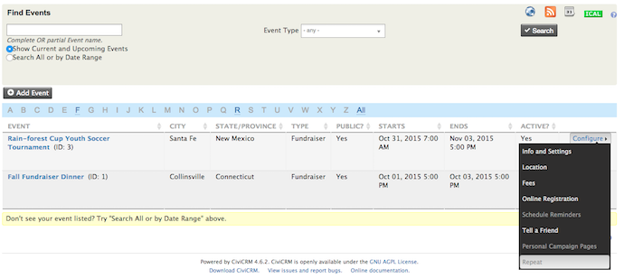
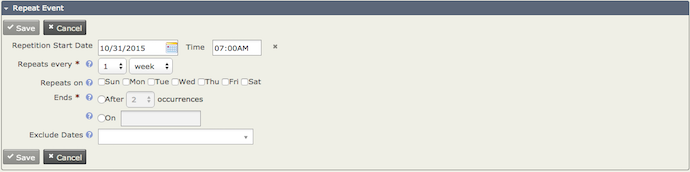
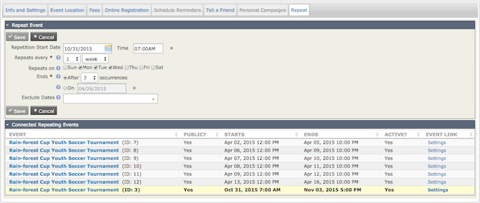

# Repeating events

You can set an Event to repeat on a certain day and time with a specific end date, and include dates to exclude from the repetition.

## Set up a repeating event

1. Go to **Manage Events**. Under **Configure**, select **Repeat** from the dropdown.

    

2. On the **Repeat Event Screen**, specify the Repeating intervals (in hours, days, weeks, months, or years), Event end date, and occurrence end date. It is also recommended that you specify the Repetition Start Date and Excluded Dates.

    

    !!! note
        If you would like your Scheduled Reminders to repeat, make sure you have setup Scheduled Reminders on the Event that you are repeating. You can edit this later. It is also recommended that you do not setup your reminders to repeat on specific days, but rather have them sent two weeks or a few days before the Event.

3. Once you have filled out all the appropriate fields, click **Save**. A popup window will prompt you to Continue with your selection.

<!-- Source: events/repeating-events.md -->
