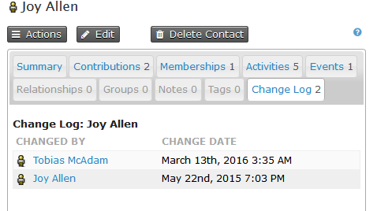
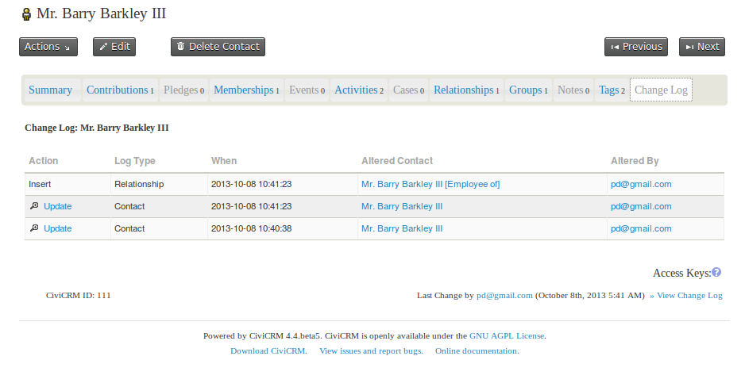
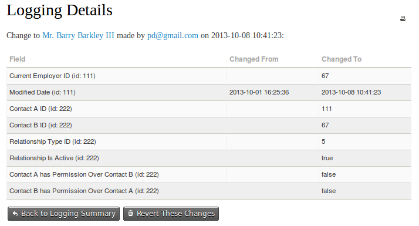

# Logging

CiviCRM keeps an eye on changes that you make to contacts, memberships, and so on. Each contact has a change log tab, which is populated each time a contact is added or edited. The change log shows who changed the record and when the change was made. This light-weight logging is turned on by default, and many users find it detailed enough.

One key missing piece is information about *what* was changed. Detailed logging adds that information and provides other features.

## Detailed logging

When enabled, detailed logging tracks all changes made to data in CiviCRM. Each time something is updated, CiviCRM keeps a note of:

- what the value was before
- what the value is after
- when the change was made
- who made the change

When you turn on detailed logging, the screen will look something like the image below. Clicking on update on the left hand side will show details of the change.

This logging extends to almost all data that exists in CiviCRM, including contact, membership, and event data. It also covers the 'meta data' in your install, such as Activity Types, Case types, and Contribution Types.

With detailed logging turned on, any changes made to your data can be reverted. This means you can worry less about unwanted changes, whether they are made by administrative staff or by contacts interacting via your website—maliciously or accidentally.

Logging all changes to the database can collect quite a lot of data and have a small performance impact on your database. For this reason, detailed logging is turned off by default in CiviCRM, and people can turn it on if they require it. Before deciding whether to turn it on, consider other ways in which time-based logging happens in CiviCRM.

## Activities vs. logging

Activities can be a useful alternative to logging. Since each activity happens at a specific point in time, you can view the activity tab on a contact record as a log of changes to that contact over time.

This does not mean you should record an activity each time you change a contact in CiviCRM. In some use cases, the activity log provides a good enough record of changes over time. A couple of manually recorded activities may supplement it sufficiently for your logging needs.

## Membership logs

Over time, a membership grows into a historical record, including any contributions that went toward that membership and any renewals, up-sells, and so on. This out-of-the-box logging might meet your needs without detailed logging.

## Reverting changes

One benefit of detailed logging is the ability to revert changes to your data. For many contact fields, a revert button at the bottom of the screen that shows details of the change makes this easy.

This screen is not available for all contact changes, but the data is still recorded behind the scenes. If you need to revert data that cannot be reverted via the user interface, contact your system administrator or get help from someone familiar with CiviCRM's detailed logging functionality.

<!-- Source: initial-set-up/change-logging.md -->
