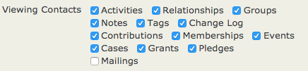
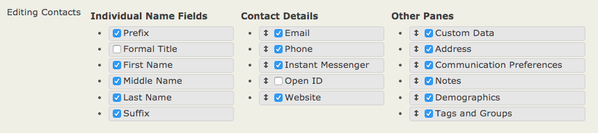
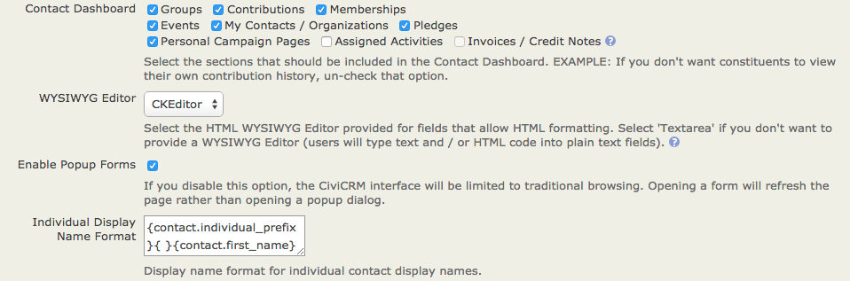
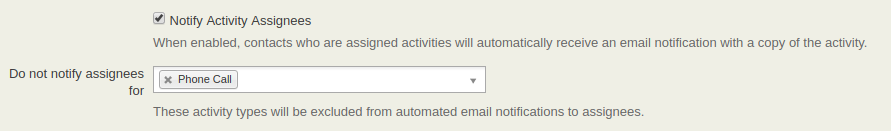
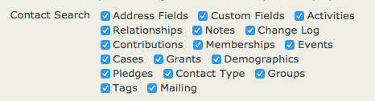
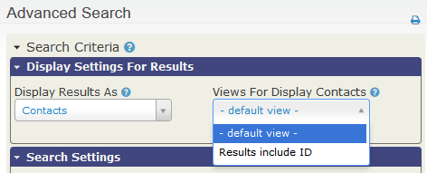

# Customizing the user interface

CiviCRM is highly flexible and customizable. This page describes ways to change the interface to suit your needs and make it easier for your users.

Customizing the data you collect and track is covered in *Organising Your Data* and in the *What you need to know* and *Set-up* chapters for the different CiviCRM components. For example, the *Events* section covers customizing event types.

## Changing dropdown options

You can add, rename, disable, or remove options in dropdown fields on contact entry and editing forms at **Administer &gt; Customize Data and Screens &gt; Dropdown Options**. These include:

- Gender
- Individual prefixes and suffixes (e.g., Ms., Mr. and Jr., Sr.)
- Phone types (e.g. Phone, Mobile, Pager)
- Mobile phone providers (e.g. Sprint, Verizon and Cingular)
- Instant messenger services (e.g., Yahoo, MSN, AIM, GTalk, Jabber and Skype)
- Website types (e.g., Work, Facebook, Twitter)
- Location types (e.g., Home, Work, Billing, Main). Billing location is assigned to Billing Addresses entered when constituents contribute or pay for event and membership fees online. Location type names may not contain spaces (e.g., Summer Home is not permitted; use SummerHome).

You can also change the Preferred Communication Methods choices (e.g., Phone, Email, Postal Mail, SMS) on the contact entry and editing form at **Administer &gt; Communications &gt; Preferred Communications Methods**.

Modifying dropdown options that define data—such as Activity Type, Relationship Type, and Contribution Status—is outside the scope of this page. See *Organising Your Data* and the sections on the different CiviCRM components.

## Changing display preferences

If you do not track certain activities or collect certain categories of data, you can hide their fields and tabs from users. Go to **Administer &gt; Customize Data and Screens &gt; Display Preferences**.

To change which tabs appear when viewing contact records, check or uncheck the boxes next to **Viewing Contacts**.

For example, if your organization does not use Cases or Grants, you can uncheck those boxes to hide the tabs. If you later decide to use them, check the boxes to display them again. Information stored in hidden tabs remains in your database and will appear when you display the tabs again.

To change which blocks appear when editing a contact, check or uncheck the boxes next to **Editing Contacts**.

For example, if your organization does not collect Demographics or Communication Preferences information, you can uncheck those boxes. Information in fields you hide remains in your database, and you can display it again by rechecking the boxes.

### Disabling popup forms

CiviCRM uses popup dialog boxes for viewing and editing data. To disable them and use traditional browsing, deselect **Enable Popup Forms** in **administer &gt; customize data and screens &gt; display preferences**. CiviCRM will be slower with this feature disabled because every form will require a complete page load in the browser.

### Disabling activity assignee notifications

By default, CiviCRM sends notifications to all activity assignees when an activity is created. To disable this, deselect **Notify Activity Assignees** in **Administer &gt; Customize Data and Screens &gt; Display Preferences**. You can also selectively disable email notifications for specific activity types by selecting them in the field below.

## Customizing search preferences

You can change CiviCRM's default search behavior at **Administer &gt; Customize Data and Screens &gt; Search Preferences**. Available options are:

- **Automatic Wildcard** (choose Yes or No): If you choose Yes, wildcards are added to the beginning and end of the search term when users search for contacts by Name. For example, searching for "ada" returns names that include those letters, such as Adams, Janet and Nadal, Jorge. If disabled, a wildcard is still added to the end of the search term. Searching for "ada" then returns a last name that begins with those letters, such as Adams, Janet, but not Nadal, Jorge. You might disable this to speed up searching on a large database.
- **Include Email** (choose Yes or No): If you choose Yes, email addresses are included when users search by Name. You might disable this to speed up searching on a large database.
- **Include Nickname** (choose Yes or No): If you choose Yes, the contents of the Nickname field are included when users search by Name.
- **Include Alphabetical Pager** (choose Yes or No): If you choose Yes, a bar appears at the top of search results so you can choose a letter of the alphabet. Clicking A, for example, takes you to a page displaying only contacts that begin with A. You might disable this to speed up searching on a large database.
- **Include Order By Clause** (choose Yes or No): If you choose No, your search results will not be ordered.
- **Smart group cache timeout**: Determines how often the smart group cache is refreshed. A value of 0 turns off caching. What works for your site may vary. More information is [in the admin guide.](https://docs.civicrm.org/sysadmin/en/latest/setup/optimizations/).
- **Autocomplete Contact Search**: Checkboxes for basic contact fields (name, email, phone, etc). Checked fields appear in the autocomplete results list when you use the Quick Search bar at the top left of all screens.
- **Contact Reference Options**: Checkboxes for basic contact fields (name, email, phone, etc). Checked fields appear in the autocomplete dropdown search results for 'Contact Reference' custom fields.
- **Autocomplete Results**: Determines the maximum number of results displayed when typing in an autocomplete field.

If your database is large and searches are slow, consider disabling some of these options to increase speed.

There is another place to customize search settings: **Administer &gt; Customize Data and Screens &gt; Display Preferences** has a block of **Contact Search** settings.

These checkboxes affect the **Search &gt; Find Contacts** and **Search &gt; Advanced Search** screens. Uncheck a box to remove the corresponding type of field from those search screens.

## Customizing date preferences

The default display preference for dates is set at **Administer &gt; Localization &gt; Date Formats**.

You can override this default and define the range of allowed dates for specific field types at **Administer &gt; Customise Data and Screens &gt; Date Preferences**.

By default, CiviCRM provides ranges for input on specific date fields. For instance, the default range for Activity Dates extends from 20 years before the current year through 10 years beyond it. To track activities that occurred 25 years ago, you would need to update this range so users can log them.

## Customizing the navigation menu

You can add, delete, rename, and move items in the CiviCRM navigation bar. For example, you can:

- Remove menu items you do not use.
- Add items to support specific workflows (e.g. data entry Profiles).
- Add links to non-CiviCRM web pages or apps.
- Rename menu items to use terms familiar to your users.
- Move menu items to better support your work.

To customize menu items, go to **Administer &gt; Customize Data and Screens &gt; Navigation Menu**. The menu items appear as folder icons in a file structure. Expand folders by clicking the small triangles to the left of their names.

- To delete an item, right-click it and select **Delete**.
- To rename an item, right-click it and select **Rename**.
- To move an item, drag and drop it to the desired location in the tree structure.
- To add an item:
  1. Click **Add Menu Item**.
  2. Enter the text you want to appear in the menu in the **Title** field.
  3. Enter the link to your item in the **Url** field.
  4. Select the location of the new item from the **Parent** dropdown menu. You can place it anywhere in the navigation, at any level. For a top-level item, leave this dropdown unselected.
  5. Check **Separator** if you want a line below the new item to separate it from the item below.

## Making custom data entry forms

If staff or volunteers often enter batches of similar contacts manually, you can create a Profile containing only the fields they need.

1. Go to **Administer &gt; Customize Data and Screens &gt; Profiles** and click **Add Profile**.
2. Give your Profile a clear name related to its purpose (e.g., Name and Address Data Entry Form).
3. Check the Standalone Form or Directory box in the **Used For** field.
4. Use **Pre-form Help** and **Post-form Help** to add text for people doing data entry.
5. Click **Save**. This takes you to the Add Fields screen, where you can choose fields for your Profile.
6. From **Field Name**, select the contact record type containing the field you want: Contact, Individual, Organization, Household, or a custom contact subtype you have created. Other record types on this menu will not work with data entry forms, so do not choose them. Fields that apply to more than one kind of contact record type, such as Phone or Email for both Individuals and Organizations, are found on the Contacts menu.
7. From the dropdown menu that appears, choose the field you want.
8. If the automatically populated **Field Label** is not what you want on the form, edit it.
9. If every record entered through the form must have data in this field, check **Required?**.
10. Use **Field Pre Help** and **Field Post Help** to add text for people doing data entry.
11. Use **Order** to change where the field appears on the form. Lower numbers appear before higher numbers.
12. Click **Save and New** to add more fields, and **Save** when you are finished.
13. On the screen listing your fields and settings, click **Preview (all fields)** to check the form. Click **Use (create mode)** to go to the page containing the form. Copy its link and use it to create a navigation menu item (see [Customizing the navigation menu](#customizing-the-navigation-menu)).

## Customizing search views

1. Create or open a profile and mark it as used for Search Views (known as Search Results in 4.1 and previous).
2. When adding fields to this profile, set their Visibility to Public Pages and check the Results Column box.

When conducting an advanced search, use the **Search Views** dropdown menu at the top right of the page to select your Profile.

## Using Word Replacement to change terminology

CiviCRM's Word Replacement setting lets you replace existing system text with text you choose. For example, if your organization calls monetary transactions "donations" rather than "contributions," you can define a replacement that changes the term throughout your CiviCRM instance.

To use Word Replacement:

1. Go to **Administer &gt; Customize Data and Screens &gt; Word Replacements**.
2. Enter the original text in the Original column on the left and the replacement text in the Replacement column on the right.
3. Check the Exact Match box on the right to replace only exact matches. For example, without Exact Match, replacing "Contribution" with "Donation" also replaces "Contributions" with "Donations"; with Exact Match, it does not.
4. Check the Enabled box on the left to enable the replacement.
5. Add additional rows using **Add row**.
6. Click **Save** when you have entered the replacements.

Anticipate alternate forms of words and different ways your chosen word or phrase may appear in CiviCRM.

!!! note
    If you're using CiviCRM in another language, word replacements only work if you enter the English words as the original text to replace, not the words in the language you are using.

<!-- Source: initial-set-up/customizing-the-user-interface.md -->
