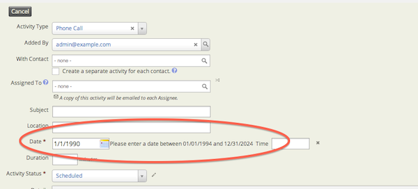

# Dates

## Date localization

Date and time conventions often vary by country and language. To configure the conventions for your locale, use **Administer &gt; Localization &gt; Date Formats**. The page includes several sections.

### Date display

Dates display differently depending on the context. An *accounting report* may list 1,000 donations in a data-table; to conserve space, the data-table uses a short notation (eg `09/19/22`). By contrast, an *event registration form* uses a long notation (eg `September 19th, 2022`) to maximize clarity.

CiviCRM defines ~7 common ways to format a date or time, and each one can be tuned to local preferences. For example, in the United States, a typical configuration might look like this:

| Format Name | Example Configuration | Example Value |
| --- | --- | --- |
| &quot;Complete Date and Time&quot; | `%B %E%f, %Y %l:%M %P` | September 18th, 2022 11:58 PM |
| &quot;Complete Date&quot; | `%B %E%f, %Y` | September 19th, 2022 |
| &quot;Short Date&quot; | `%m/%d/%Y` | 09/18/2022 |
| &quot;Month and Year&quot; | `%B %Y` | September 2022 |
| &quot;Time Only&quot; | `%l:%M %P` | 1:34 PM |
| &quot;Year Only&quot; | `%Y` | 2022 |
| &quot;Financial Batch&quot; | `%m/%d/%Y` | 09/19/2022 |

For a full listing of formatting codes, see [PHP Manual: strftime()](https://www.php.net/manual/en/function.strftime.php).

### Date input fields

Some forms require the user to enter a date or time. **Date Input Format** and **Time Input Format** adjust the data-entry screens.

### Calendar

Type in the day you want for the beginning of the week, and the month and day you want for the start of the fiscal year.

## Date preferences

By default, CiviCRM provides ranges for input on specific date fields. For instance, the default range for Activity Dates is 20 years prior to the current year through to 10 years beyond the current year. If you would like to track activities that occurred, say, 25 years ago, you need to update this range to enable your end users to log these activities.

To update these settings to the appropriate range, go to **Administer &gt; Customize Data and Screens &gt; Date Preferences**. If you leave these settings as the default, you will see an error such as this: Please enter a date between 01/01/1994 and 12/31/2024.

<!-- Source: initial-set-up/dates.md -->
