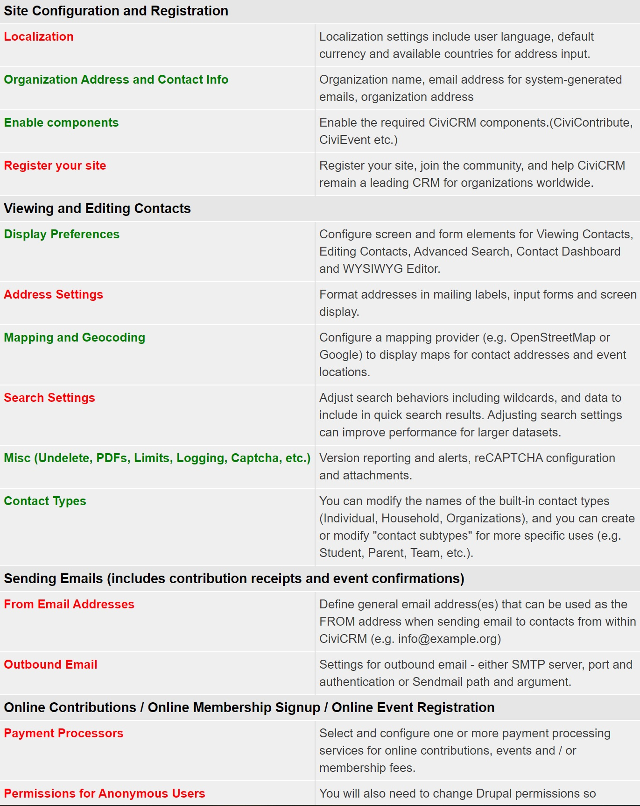
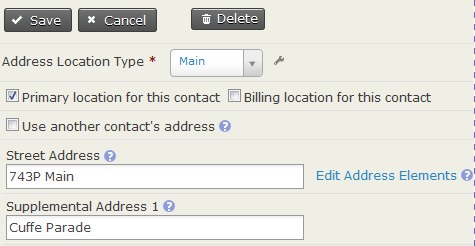
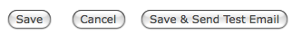
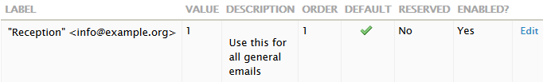

# Configure CiviCRM

## Configuration

Once CiviCRM is installed, review the initial configuration tasks to customize it for your organization.

Log in to your CiviCRM site and navigate to **Administer > Administration Console > Configuration Checklist**. This page covers general tasks; component-specific configuration is covered in each component section.

Use the checklist to review and complete configuration tasks for your site. You will be redirected back to it after saving each setting. Settings you have not yet reviewed appear in red. After you visit a page, its link appears in green, although you may still need to revisit it to complete or update the settings.



### Language and region

Localization adapts CiviCRM for use in a specific country or language by translating on-screen text and setting region-specific formats for dates and money, including currency. By default, CiviCRM is localized for the United States. Review and update the values on this screen if you use CiviCRM in a different country, need to store contact addresses in countries other than the United States, or want to use another language.

CiviCRM has been translated into a number of languages. Translations contributed by community members are available to download when you download CiviCRM. If CiviCRM is not available in your language, you may wish to translate it. You can find a translation guide on the wiki.

You can also configure your site to support multiple languages. In this mode, users can choose from a list of available languages after logging in. You can create and store multi-language versions of text, including custom field labels, an online contribution page, campaign information and event descriptions.

- **Default Language** - If the additional language files have been installed, this dropdown lets you select a language other than US English as the default. This affects all CiviCRM users.
- **Inherit CMS Language** - By default, the language CiviCRM uses is independent of the CMS. If 'yes', CiviCRM uses the language in use in the CMS.
- **Available Languages** - If 'Inherit CMS Language' is set to 'No', the 'Available Languages' option appears. It lets you make additional languages available to site users. If more than one language is selected, a language switcher block appears so users can select their interface language.
    - In multi-lingual mode, the list of 'Available languages' consists of those configured in the database.
- **Default Language for contacts** - Controls the default 'preferred language' when creating a new contact. Preferred Language is used for some communications on multi-lingual sites.

**Multiple Languages Support** - If multi-lingual mode is enabled, database tables are modified to store multiple translations of certain fields. For example, with English and French configured, two fields are created for a field such as event title: one in English and one in French. This mode can be useful for organisations operating in multiple languages.

You may also wish to configure how currency is displayed. CiviCRM lets you configure the characters that separate numbers: for example, in the US you would see 1,000.00, but in Demark it might look like 1.000,00. These are configured as the 'thousands separator' and 'decimal delimiter' on the localization page. However, from 5.43 these settings are ignored if you add the line below to your civicrm.settings.php; the system decides based on the locale instead. Allowing the system to decide is likely to give better results if you communicate with people in more than one language.

```
define('IGNORE_SEPARATOR_CONFIG', TRUE);
```

### Organization address and contact info

Use this screen to enter identifying information for the organization or entity that "owns" this CiviCRM installation. The organization name and address identify your organization in CiviMail mailings when you include the `{domain.name}` and `{domain.address}` [tokens](../common-workflows/tokens-and-mail-merge.md).

Enter a valid email address belonging to your organization. It will be used as the From field in system-generated (automated) emails.

### Enable components

This screen lets you turn components on or off for your CiviCRM system.

When you first install CiviCRM, the most frequently used components—CiviContribute, CiviEvent, CiviMail, CiviMember and CiviReport—are already enabled. You can disable components you do not need. You can also enable any or all of CiviCampaign, CiviCase, CiviGrant and CiviPledge. You can return to this page at any time to enable more components.

You can disable a component you have already used. Its information is retained and will still be there if you re-enable it, although disabling a component you have used would be unusual. If you want to simplify the administration menu and advanced search page, using [permissions](permissions-and-access-control.md) may be a better approach.

### Display preferences

This screen lets you modify screen and form elements for the following tasks:

- **Viewing Contacts** - Controls the tabs displayed when viewing a contact record. For example, if your organization does not track Relationships, deselect this option to simplify the display. Tabs for Contributions, Pledges, Memberships, Events, Grants and Cases are also hidden if the corresponding component is not enabled.
- **Viewing Smart Groups** - Controls the display of the smart groups a contact belongs to.
- **Editing Contacts** - Controls the sections included when adding or editing a contact record. For example, if your organization does not record Gender and Birth Date for individuals, deselect Demographics to simplify the form.
- **Contact Search** - Controls the sections included in the Advanced Search form. For example, if you do not track Relationships, you will not search for that section, so you can deselect the option to simplify the form.
- **Check for Similar Contacts** - Controls how new contacts are checked for similarity to existing contacts.
- **Notify Activity Assignees** - If enabled, assignees of new activities receive an email with a copy of the activity. Emails can be suppressed for specific Activity Types by entering them in 'Do not notify assignees for'.
- **Contact Dashboard** - Lets constituents view the groups they subscribe to, their contribution history, event registration information and more. You can control which sections appear. For example, deselect contribution history if you do not want constituents to view their own.
- **WYSIWYG Editor** - Select **CKEditor** to help users enter text in fields that allow HTML formatting, such as the introductory section of an online contribution page. You can configure CKEditor (http://ckeditor.com/) to add or remove functionality and change the order of toolbar elements using its built-in configuration page. Click the Configure CKEditor button to access that page. Select **Textarea** if you do not want a WYSIWYG editor.
- **Enable Popup Forms** - On by default. Uncheck it to return to opening a form by refreshing the page.
- **Individual Display Name** - Display name format for individual contact display names.
- **Individual Sort Name** - Sort Name format for individual contact sort names.
- **Menubar position** - Choose whether the CiviCRM menu appears above, below or in place of the CMS menu, or hide the CiviCRM menu altogether.
- **Menubar color** - Choose a background colour for the menubar. For accessibility, it is best practice to choose a colour that contrasts with the menubar font colour. Use a free online contrast ratio checker if you are unsure.
- **Backend Theme** - If you have installed a theme through the [Extension Manager](https://docs.civicrm.org/user/en/latest/introduction/extensions/#installing-extensions), you can specify it here or turn off CSS theming with 'None (Unstyled)'. If left at 'Automatic', CiviCRM uses its default theme (Greenwich).
- **Frontend Theme** - You can select a theme or remove theming for front-end pages.

### Address settings

At **Localization > Address Settings**, you can modify the default fields for adding and editing contact and event address data. You can also change the address field layout used on screens and mailing labels.

Review the out-of-the-box defaults by adding a new contact record and noting the address fields on the form. Save the record and note the order of fields on the Contact Summary screen. If you plan to generate mailing labels, review the label layout: select Mailing Labels from the *-actions-* drop-down after searching with the Find Contacts menu option.

After reviewing the default fields and layouts, review the Address Settings screen and make changes as needed.

!!! tip
    CiviCRM uses [tokens](../common-workflows/tokens-and-mail-merge.md) (e.g. `{contact.street_address}`) to reference specific fields in the database.

- **Mailing Labels** - Controls mailing-label formatting. The default format is:

    ```
    {contact.addressee}
    {contact.street_address}
    {contact.supplemental_address_1}
    {contact.supplemental_address_2}
    {contact.city}{, }{contact.state_province}{ }{contact.postal_code}
    {contact.country}
    ```

    You must include the `{contact.addressee}` token to include the addressee's name on labels. When generating labels from a list of contacts, users can select from label types corresponding to the label manufacturer code. Test your format with the label type and printer you plan to use to verify spacing.

- **Address Display** - Controls the layout of contact and event location addresses displayed on CiviCRM screens. The default format is:

    ```
    {contact.address_name}
    {contact.street_address}
    {contact.supplemental_address_1}
    {contact.supplemental_address_2}
    {contact.city}{, }{contact.state_province}{ }{contact.postal_code}
    {contact.country}
    ```

    This format also applies to event locations, despite using the *contact* record type in the layout. The *{contact.address_name}* token is particularly useful for events where you need to include a location name, such as "Smithson Hall".

- **Address Editing Fields** - Modifies the available address editing fields. You can hide fields you do not plan to use to simplify forms. For example, if you do not plan to record latitude and longitude for contacts, you can deselect those fields.
    - **Street Address Parsing** - CiviCRM uses the US Postal Service's (USPS) Postal Addressing Standards to parse an address into Street Number, Street Name and Apt/Unit/Suite fields. Entering addresses that conform to those standards helps keep data consistent and makes the best use of Street Address Parsing. When parsing is on, you can edit and or view the parsed address by clicking Edit Address Elements while editing an address.

    

   Learn more about USPS' Postal Addressing Standards at [http://pe.usps.com/text/pub28/welcome.htm](http://pe.usps.com/text/pub28/welcome.htm).

- **Address Standardization** - CiviCRM includes an optional interface to the United States Postal Services (USPS) Address Standardization web service. You must register at [https://www.usps.com/business/web-tools-apis/welcome.htm](https://www.usps.com/business/web-tools-apis/welcome.htm). If approved, you will receive a User ID and service URL. The URL provided by USPS will not be prefixed with "http://". When entering it in the CiviCRM settings field, you must prefix it with "http://".

### Mapping and geocoding

CiviCRM supports the Google and OpenStreetMap mapping services. These let users display contact addresses and event locations on a map. To enable mapping, select a mapping provider and obtain a key for your site from that provider.

You can also select a Geocoding Provider, which can be the same as or different from your mapping provider. Once enabled, the service automatically geocodes contact and event records as you add or edit address data: it calculates or retrieves latitude and longitude and inserts them.

Other mapping and geocoding services can be added by installing extensions.

### Search settings

These settings adjust search behaviors, including wildcard use and the data included in quick search results. Adjusting them can improve performance for large datasets.

A wildcard substitutes for other characters in a search. The percent character "%" substitutes for zero or more characters; the underscore character "_" substitutes for a single character. Wildcards can broaden search results. For example, 'Volunteer%' as an Activity Subject matches a subject starting with "Volunteer", such as "Volunteer for Open House" or "Volunteering Opportunities".

- **Automatic Wildcards** - By default, when users search for contacts by Name, the Search interface treats the text as though it were surrounded by percent signs. For example, 'ada' returns names containing those letters, such as 'Adams, Janet' and 'Nadal, Jorge'. Disabling this feature significantly speeds up searches in large databases, but users must explicitly use "%" or "_" for partial name searches.
- **Include Email** - By default, a Name search also searches email addresses. Disabling this feature significantly speeds up searches in large databases, but users must use Email search fields in Advanced Search, Search Builder or Profiles to find contacts by email address.
- **Include Nickname** - By default, nicknames are *not* included in Name searches. Set this to Yes to include them.
- **Include Alphabetical Pager** - Disabling this hides the alphabetical pager on search screens and improves search-result response time for large datasets.
- **Include Order By Clause** - Disabling this leaves search results unordered and significantly improves search-result response time for large datasets.
- **Default Contact Search Profile** - Select a Profile to override the default columns in Find Contacts search results.
- **Smart group cache timeout** - Smart groups are saved searches. Their contact lists are cached in the database so the saved search does not run every time a smart group is accessed. This field sets the number of minutes before the cache is refreshed. The default, 0, empties the cache immediately when a contact is edited or added. If contact data changes frequently, a value of 5 minutes or longer may reduce server processing load. The drawback is that users may see old data for a few minutes after new data is added.
- **Autocomplete Contact Search** - If enabled, selected fields appear in auto-complete dropdown lists and the "Quick Search" box on the navigation menu. The contact name is always included.
- **Contact Reference Options** - Selected fields appear in autocomplete dropdown search results for 'Contact Reference' custom fields. Contact Name is always included.

    !!! note
        You must assign 'access contact reference fields' permission to the anonymous role to use custom contact reference fields in profiles on public pages. In most situations, use 'Limit List to Group' when configuring a contact reference field for a public form to prevent exposing your entire contact list.

- **Autocomplete Results** - Sets the maximum number of contacts shown at a time when typing in an autocomplete field. The default is 10.
- **InnoDB Full Text Search** - If you use MySQL 5.6+, you can enable InnoDB full-text search optimizations.

### Miscellaneous (undelete, PDFs, limits, logging, etc.)

Use the Miscellaneous Settings screen to configure these behaviors:

- **Dashboard Cache Timeout** - Number of minutes to cache dashlet content on the dashboard.
- **Checksum Lifespan** - Number of days before a personalized (hashed) link expires.
- **Contact Trash and Undelete** - If enabled, deleted contacts move to the trash rather than being destroyed. Users with the proper permission can search for and restore them, or delete them permanently.
- **Logging** - See [Logging Settings](https://docs.civicrm.org/sysadmin/en/latest/setup/logging/) in the System Administrator Guide.
- **Attach PDF copy to receipts** - If enabled, CiviCRM attaches a PDF receipt during event sign-up or online contribution.
- **Path to wkhtmltopdf executable** - wkhtmltopdf is an alternative PDF-generation utility that may perform better when generating many PDF letters or receipts. Your system administrator must download and install it, then enter its executable path here. WARNING: wkhtmltopdf is no longer under active development and its latest tagged release of 0.12.6 from June 2020 (https://github.com/wkhtmltopdf/wkhtmltopdf/tree/0.12.6) is insecure and should not be used (https://cve.mitre.org/cgi-bin/cvename.cgi?name=CVE-2022-35583).
- **New Version Alerts** - If enabled, on-screen alerts appear for users with "Administer CiviCRM" permissions when a new CiviCRM version is available. This works only if "Version Check & Statistics Reporting" is enabled.
- **Version Checking and Statistics Reporting** - Automatically checks for a newer stable CiviCRM version. New version alerts appear on the main CiviCRM Administration page. The following statistics are anonymously reported to the CiviCRM team to help prioritize development: CiviCRM version; PHP, MySQL and framework (Drupal/Joomla!/WordPress) versions; default language; and record counts, but no actual data. Set this field to No if you are not comfortable reporting this information for your site.
- **Display "empowered by CiviCRM"** - If enabled, "empowered by CiviCRM" appears at the bottom of public forms. This helps increase awareness of CiviCRM.
- **Maximum Attachments** - Increase or decrease the maximum number of files, such as documents and images, that can be attached to emails, activities and grant records. The default is 3.
- **Maximum File Size (in MB)** - Maximum size of a file, such as a document or image, that can be attached to emails or activities. Your PHP configuration files, *php.ini*, should support a file size at least as large as the value specified here.
- **Allow second-degree relationship permissions** - If enabled, contacts who can edit a related contact inherit that contact's permission to edit other related contacts. For example, this can let a class teacher edit the records of students in that class when both are linked to the class, set up as an organisation sub-type, through relationships.

### Contact types

You can change the names of the built-in Contact Types (Individual, Household, Organizations) and create or modify "contact subtypes" for more specific uses, such as Student, Parent or Team.

### Outbound email

To send emails to contacts through CiviCRM, enter settings that let CiviCRM connect to your mail server. These emails include contributor receipts, event registration confirmations and CiviMail bulk mailings.

CiviCRM supports three methods of connecting to a mail server: mail (the built-in PHP mail function), SMTP (Simple Mail Transport Protocol) and Sendmail. Each requires specific settings. If you do not know which method or values to use, check with your system administrator, ISP or hosting provider.

Always send a test email after entering or changing the settings. Click "Save and Send Test Email", shown below. An email is sent to the address associated with your user login account. The From email address is the default From address configured in the previous section.



If CiviCRM cannot send the test email, a message on the screen gives the specific error and suggestions for trouble-shooting it.

**Disable Outbound Email** - If selected, no mails are sent. If you disable outbound email while using Online Contribution pages or online Event Registration, turn off automated receipting and registration confirmations, which are enabled by default. Otherwise, constituents will see errors after completing a contribution or registration.

**Redirect to Database** - If selected, all emails are recorded as archived mailings instead of being sent.

See [Email System Configuration](https://docs.civicrm.org/sysadmin/en/latest/setup/civimail/) in the System Administration guide for more details.

### From email addresses

CiviCRM uses the default From address defined here for automated emails. If you have entered an email address on the Domain Information screen, it is listed here, as illustrated in the leftmost field below.



When users send an email through CiviCRM, their primary email address is the default From address. They can instead select one of the general email addresses defined here. To prevent users from sending from their own Primary address and restrict them to the "From Email Address Options", use the Outbound Mail settings at **Administer › System Settings › Outbound Email(SMTP/Sendmail)**.

### Payment processors

Payment processors handle credit card transactions for merchants and non-profit organizations, then transfer funds to the organization's bank account. If you plan to accept online contributions, online membership sign-up and renewal, or online event registration through CiviCRM, select and configure a payment processor.

CiviCRM supports several processors, and third-party developers can add support for others based on their clients' needs. Processors differ in pricing and features. Investigate the options to find the best fit for your organization. See [Payment Processors](../contributions/payment-processors.md) for factors to consider.

Configuration and testing steps differ by processor. See [installing payment processors](https://docs.civicrm.org/sysadmin/en/latest/setup/payment-processors/) in the System Administrator Guide.

### Permissions

See [Permissions and access control](permissions-and-access-control.md) for information on setting permissions.

### System workflow templates

CiviCRM includes system-generated emails, such as contribution receipts and event registration confirmations. These system workflow templates will be sent with your organization's name. Review them and customize their style and wording here.

Workflow messages contain both text AND necessary program logic. Edit carefully to avoid changing the program logic. After making changes, test the workflow and review the emails sent. If changes cause problems, errors or missing information, you can "Revert" to the system default for that workflow.

You should now have reviewed the basic configuration tasks. The remaining checklist tasks require an understanding of how to record and use contact data and are best left until you have read more in this book.

### System status

The system status screen at **Administer > Administration Console > System Status** (or `/civicrm/a/#/status`) reports potential problems with your installation, configuration or server environment. See [System Status](https://docs.civicrm.org/sysadmin/en/latest/setup/#civicrm-system-status) in the System Administrator Guide for help interpreting the results and responding to reported problems.

<!-- Source: initial-set-up/installation-and-basic-set-up-part2.md -->
