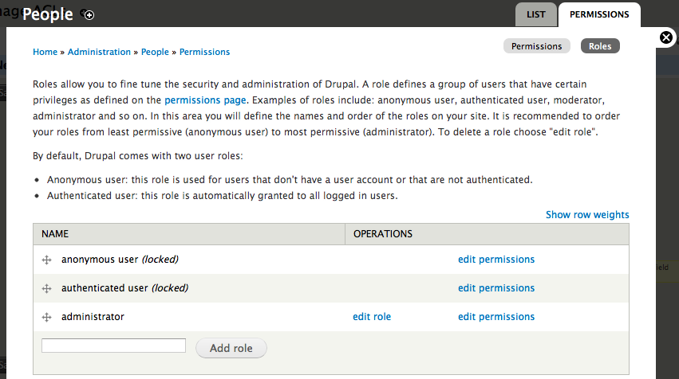
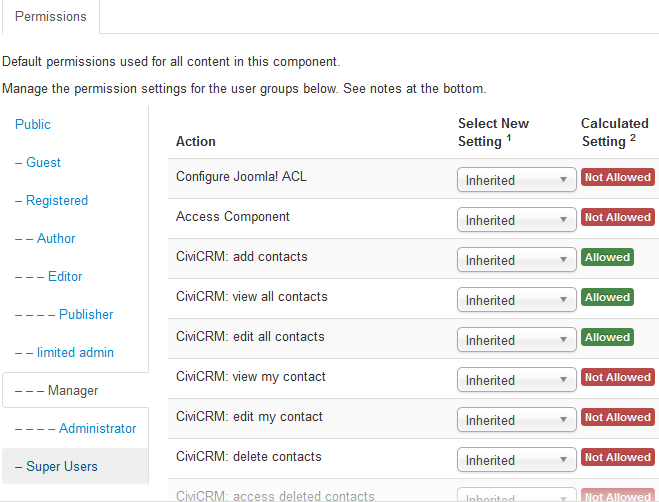
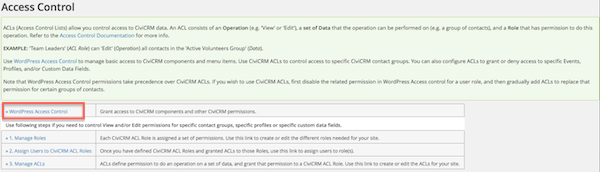
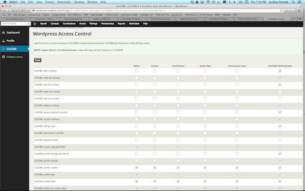

# CMS permissions

All CMS have the same set of CiviCRM permissions, but the permissions are found in different places and differ slightly in appearance.

## Permissions in Drupal

To access Drupal's permissions, go to the Drupal menu, choose **People** and click the **Permissions** tab in the top right corner of the pop-up window. The list shows possible operations or actions in CiviCRM and Drupal, with a column for each existing role type. Checking an option in a column grants that role the ability to perform the action.

You may create new roles and edit existing ones. To edit roles, click **Roles** toward the top right of the page while in the **Permissions** tab.

Roles can be assigned to users in either of these ways:

- Open a user's contact record (a contact in CiviCRM with a user account), click **Actions** at the top and select **User Record**. On the next screen, click the **Edit** tab at the top right, then scroll to **Roles** to change their level of access.
- As an administrator, select **People** from the Drupal menu. In the list of active users, click the user's name to open their Drupal user profile. Click the **Edit** tab at the top right, then scroll to **Roles**.

## Permissions in Joomla!

To find permissions in Joomla!:

1. Log into the Joomla! administrative portal.
2. Go to **Components** and select **CiviCRM**.
3. In CiviCRM's menu, navigate to **Administer > User and Permissions > Permissions (Access Control)**.
4. Click **Joomla Access Control** at the top of the list.

Joomla! assigns permissions through user groups (roles). Each group is either a parent or child of another group; child groups lower in the table inherit permissions set for groups above them. When editing a user group's permissions, you can choose:

- **Inherited**: if the group above has the permission, this group can also perform the action.
- **Allowed**: users in this group can perform the operation.
- **Denied**: users in this group cannot perform the action.

Joomla! has two additional permissions not used by Drupal or WordPress: **Configure Joomla! ACL** (the user can configure Joomla! ACLs and is assigned all CiviCRM permissions) and **Show CiviCRM Component** (the user can see CiviCRM in the Components list).

To assign a user group to a user or change their existing group, log in as an administrator and use either method:

- In CiviCRM, open the user's contact record, click **Action** and select **User Record**. Change roles in **Assigned User Groups**.
- In the Joomla! administrative portal, click **User Manager** under **User**. Click a name in the list of users to open their account settings, including user group.

## Access Control (Permissions) in WordPress

In CiviCRM, go to **Administer** > **User and Permissions** > **Permissions (Access Control)**. Select **WordPress Access Control**. Here you can adjust the CiviCRM settings for each predefined User Role from WordPress.

Roles can be assigned to users in either of these ways:

- Open a user's contact record (a contact in CiviCRM with a user account), click **Actions** at the top and select **User Record**. On the **Edit User** screen, change their **Role** to change their level of access.
- In the WordPress Site Admin area, select **Users** to see all users. Click a name to open the **Edit User** screen, where you can change their **Role**.

## Financial Type Permissions

By default, access to Contribution data is controlled by **access CiviContribute**, **edit contributions** and **delete in CiviContribute**. These permissions apply to all contributions, regardless of financial type.

To set different permissions for contributions based on financial type:

1. Begin with CiviCRM installed within Drupal, Backdrop, or WordPress. (This feature is not yet available for Joomla.)
2. Go to **Administer** > **CiviContribute** > **CiviContribute Component Settings**.
3. Check **Enable Access Control by Financial Type**.
4. Edit your CMS permissions. CiviCRM has added a 'view', 'edit' and 'delete' permission for every financial type. Assign these permissions as needed.

!!! tip
    You must grant the add and view permission for each financial type to the anonymous user role for visitors to be able to access your contribution pages.

For example, you may use this feature to let some users manage event payments without seeing donation data.

## Anonymous and Authenticated roles

You will encounter both role types when working with access controls. Their names may differ between CMSes, but the basic principle is the same.

The **anonymous** role (**public** in Joomla!) applies to visitors who have *not* logged in. It has the lowest level of permissions.

The default CiviCRM permissions for this role are listed below. Actual permissions may vary depending on your CMS and how you installed CiviCRM, so check that they are set up as you want them.

| Permission | Description |
| -- | -- |
| CiviCRM: access all custom data | View all custom fields - i.e. see/enter information in custom data fields in forms |
| CiviCRM: access uploaded files | View / download files including images and photos |
| CiviCRM: profile create | Add data in a profile form |
| CiviCRM: profile edit | Edit data in a profile form |
| CiviCRM: profile view | View data in a profile |
| CiviEvent: register for events | Register for events on your website |
| CiviEvent: view event info | View event information pages |
| CiviEvent: view event participants | View the participants that have signed up to an event |
| CiviContribute: make online contributions | Make payments or donations through your website |
| CiviMail: access CiviMail subscribe/unsubscribe pages | Subscribe/unsubscribe from mailing lists |
| CiviMail: view public CiviMail content | View mailings on your website |
| CiviCampaign: sign CiviCRM Petition | Sign petitions (if CiviCampaign is enabled) |

The **authenticated** role (**registered** in Joomla, **subscriber** in WordPress) applies to visitors who have logged in. It is the default role for new user accounts and cannot be deleted. By default, its CiviCRM permissions are the same as those for the **anonymous** role.

You can alter permissions for anonymous and authenticated users. The following scenarios show when you might do so.

### Taking online contributions

If you only want contributions from logged-in users, remove **make online contributions** from the "anonymous" or "public" role.

### Viewing event info and registering for events

If **view event info** and **register for events** are enabled for anonymous and authenticated roles, all visitors can register for any event. To let only specific users view or register for *some* events, use a CiviCRM ACL. Give a role "view" access if its users should only view event information, or "edit" permission if they can register. For this to work, disable the CMS **register for events** permission, which would otherwise override these settings.

For example, a charity holds public fundraising events and private evening dinners for some corporate donors. Any visitor can register for a fundraising event, but only some donors should have access to the dinners. CiviCRM ACLs can specify which events each group can access, unlike the CMS **register for events** permission.

### Editing profile data in online forms

Profiles are collections of default and custom fields. They can be used in online forms to collect information from visitors or to build searchable directories (see "Profiles").

If a standalone profile in an online form is used to search for and edit CiviCRM data—for example, if it is not part of an event registration page—only authenticated users may edit. You can give **profile edit** to the anonymous role, but visitors who are not logged in still cannot edit unless they have a [checksum](../common-workflows/tokens-and-mail-merge.md#checksum) (a unique URL to one page where they may edit their own data; read "Everyday tasks" in the email section for more information). For checksum tokens to work, anonymous users must have **profile edit**.

### Collecting data from anonymous visitors using profiles

To collect data from anonymous visitors through profiles in online forms, such as event registration pages, contribution pages and standalone profile forms, give **profile create** to the "anonymous" role. If the profile contains custom fields, an additional permission is needed depending on the circumstances. See "Accessing custom data" below.

### Creating searchable directories for the public

Profiles can build searchable directories: search criteria that gather results from the database, such as organisations by location. To give a group of users access to search pages published on the website, check **profile listings** for that role or user group.

### Profile view

When a profile is embedded in an online page—for example, to display an organisation's name, description and contact details from the database—a visitor needs **profile view** to see it.

### Using the "Profile listings and forms" permission

!!! caution
    The "Profile listings and forms" permission is equivalent to granting `profile_view`, `profile_create`, `profile_edit` and `profile_listing`. This is a lot of permission and should be assigned carefully!

Assign this access right only to trusted roles. It grants access to:

- Add data through profiles in online forms.
- Edit data displayed in standalone profiles on public pages, if the option is given (for example, contact information).
- Use public searchable directories.

Where possible, assign each access right separately rather than through this 'allow all actions' permission. "Profile listings and forms" is not enabled for the "anonymous" and "authenticated" roles by default.

If this role were given to anonymous users, a visitor would still need to be logged in or use a [checksum token](../common-workflows/tokens-and-mail-merge.md#checksum) to edit data (see "Everyday tasks" in the section on email).

### Accessing custom data

If an online form or profile uses custom data fields, users cannot interact with them unless they have permission to view and/or edit custom data. There are two ways to assign access:

1. Enable **access all custom data** for roles that need both view and edit access. For example, giving it to the "anonymous" role lets visitors view and edit all custom fields in online forms, including custom fields in a profile incorporated into an event registration page. This is an 'all or nothing' approach.
2. Create CiviCRM ACLs to give roles access only to *specific* sets of custom data fields. For example, a team in Amsterdam might access only custom volunteer fields, while a head office in Scotland accesses both custom volunteer and custom donor fields. These ACLs will not function if **access all custom data** is assigned.

### Accessing uploaded files

Enable **access uploaded files** for any role that needs to view images, photos and files attached to CiviCRM records and pages. Assign it to the "anonymous" role if visitors should see photos attached to contact records, personal campaign pages, documents intended for public consumption, and similar files.

### Giving users the ability to view their contact dashboard

You can give authenticated (logged-in) users access to a screen where they can review their mailing group subscriptions, contributions, memberships and event registrations, where applicable. Assign **access contact dashboard** to roles whose users need this feature. **Do not** enable it for the "anonymous" role.

## Other CMS Roles

Each CMS has other predefined roles with varying levels of CiviCRM access. You can change their permissions, but always keep one role (Administrator/Super Users/Admin) that can administer CiviCRM, including managing access control.

You may also add roles for more graduated access to CiviCRM functionality.

More information on CiviCRM permissions (access control options), including permissions required for certain back-office functions, is available at [http://wiki.civicrm.org/confluence/display/CRMDOC/Default+Permissions+and+Roles](http://wiki.civicrm.org/confluence/display/CRMDOC/Default+Permissions+and+Roles).

<!-- Source: initial-set-up/permissions-and-access-control-part2.md -->
