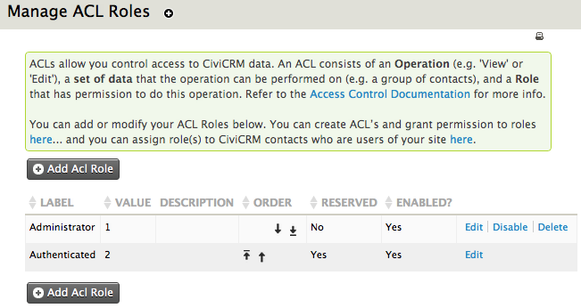
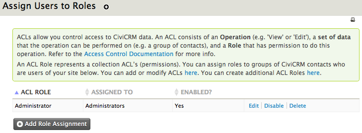
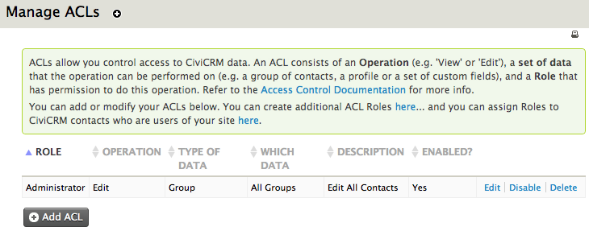

# Native CiviCRM ACLs

CiviCRM ACLs provide more granular access to records through contact groups assigned to ACL roles. CMS access controls can turn off visibility of entire CiviCRM sections and determine whether users can view, edit, delete or create data in different areas. They cannot subdivide those rules by record type.

> A charity based in Chicago has three regional offices. Its fundraising staff need to create and edit contact records for prospective donors, but each office's fundraising department should access only its local contacts. The CMS (Drupal, Joomla! or WordPress) can grant **add contacts** to authenticated users. If **view all contacts** and **edit all contacts** were also assigned through the CMS, it could not differentiate between the three groups of donors by location. This requires a CiviCRM ACL.

To begin, go to **Administer** > **User and Permissions** > **Permissions (Access Control)**. This screen links to the CMS access control list and the three steps for managing native CiviCRM ACLs.

## Manage Roles

Create ACL roles here. By default, you have "administrator" and "authenticated" (logged in). Only the administrator role can be edited: "authenticated" is a reserved role and core to the system.

Click "Add Acl Role" to create a role using these options:

- **Label**: the role's name, visible to users.
- **Description**: a description of the role that you can create and format.
- **Weight**: a number determining the role's place in the list. For example, "1" places it near the top, while "20" might put it near the bottom; lower numbers appear before higher ones.
- **Enabled?**: whether the role is active. Disabling it may cause functionality to stop working for some users.

## Assign Users to CiviCRM ACL Roles

Once roles are configured, assign them to users in two steps:

1. Create an access control group for users who should have the same level of access. There are multiple ways to do this, outlined in the chapter "Groups and tags".
2. Assign the ACL contact group to a role. On the access control menu screen, click "Assign Users to CiviCRM ACL Roles", then "Add Role Assignment". Complete these fields:
    - **ACL Role**: select an available ACL role.
    - **Assigned To**: choose a contact group to assign to the role.
    - **Enabled?**: whether the assignment is active.

## Manage ACLs

The third step is to create ACLs. For each ACL, decide:

1. Which role can perform the action?
2. What is the action or operation—such as view, edit, delete or create?
3. On which set of data can the action be performed?

Return to the Access Control screen (**Administer > User and Permissions > Permissions...**) and click "manage ACLs". The list of existing controls will likely include one allowing administrators to edit all contacts in the database. Click "Add ACL" and complete:

- **Description**: a clear description of what the ACL does.
- **Role**: the role to assign the ACL to, selected from the drop-down list.
- **Operation**: the action the role can perform, such as view, edit, create or delete.
- **Type of Data**: the data type the operation relates to:
    - A group of contacts
    - A profile
    - A set of custom data fields
    - Events
- **Group/Profile/Custom Data/Event**: this field's label depends on **Type of Data**. Select the specific group of contacts, profile, custom data or event for the ACL.
- **Enabled?**: whether the ACL is active.

<!-- Source: initial-set-up/permissions-and-access-control-part3.md -->
