# WordPress Multisite, CiviCRM Multi-Domain Setup

These instructions are for setting up a network from scratch. If you already have an existing WordPress Multisite, then some of the procedures will need to be skipped and some will need to be amended for your situation. This is the recommended procedure, however, since getting the basics right means that whatever is built on top of that is based on solid foundations.

## Install WordPress Single Site as normal

Add the following plugins but do not activate them:

- [_CiviCRM_](https://civicrm.org/download)
- [_CiviCRM Admin Utilities_](https://wordpress.org/plugins/civicrm-admin-utilities/)
- [_CiviCRM Permissions Sync_](https://develop.tadpole.cc/plugins/civicrm-permissions-sync)

## Enable WordPress Multisite

Add the following to `wp-config.php`

```php
/**
 * Allow multisite.
 *
 * This can be commented out once Multisite has been set up - the only thing it
 * does is enable the "Network Setup" menu item.
 */
define( 'WP_ALLOW_MULTISITE', true );
```

Run WordPress Multisite "Network Setup" under Tools

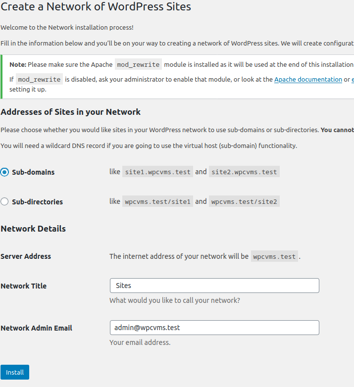

- Choose subdomain or sub-directory. Both work the same way.
  - Example is subdomain as that takes slightly more setup.
- Update `wp-config.php`  add the following lines:

```php
/**
 * WordPress Multisite setup.
 */
define('MULTISITE', true);
define('SUBDOMAIN_INSTALL', true);
define('DOMAIN_CURRENT_SITE', 'wpcvms.test');
define('PATH_CURRENT_SITE', '/');
define('SITE_ID_CURRENT_SITE', 1);
define('BLOG_ID_CURRENT_SITE', 1);
```

- Update `.htaccess` and replace all existing WordPress rules with:

```bash
RewriteEngine On
RewriteBase /
RewriteRule ^index\.php$ - [L]

# add a trailing slash to /wp-admin
RewriteRule ^wp-admin$ wp-admin/ [R=301,L]

RewriteCond %{REQUEST_FILENAME} -f [OR]
RewriteCond %{REQUEST_FILENAME} -d
RewriteRule ^ - [L]
RewriteRule ^(wp-(content|admin|includes).*) $1 [L]
RewriteRule ^(.*\.php)$ $1 [L]
RewriteRule . index.php [L]
```

- Log back in and now we have a network

## _CiviCRM_ Setup

### Site 1

Activate the following plugins:

- _CiviCRM Permissions Sync_
  - Check that the `CIVICRM_PERMISSIONS_SYNC_MODE` constant is set to your liking. The choices can be found [in the plugin's code](https://develop.tadpole.cc/plugins/civicrm-permissions-sync/-/blob/master/civicrm-permissions-sync.php#L19-38). For this kind of install, the default of `groups` is fine.
  - Network Activate
- _CiviCRM_
  - Activate _only_ on Site 1
  - Run Installer
  - Using a separate database for CiviCRM is probably a wise choice.
- _CiviCRM Admin Utilities_
  - Network Activate

Go To _CiviCRM_

- Create a Group for Site 1
  - This will be the Domain Group for Domain 1
- Add the [Multisite Extension](https://lab.civicrm.org/extensions/multisite)
- On Site 1 Go to _CiviCRM Admin Utilities_ Settings, then Domain tab
  - You should see:

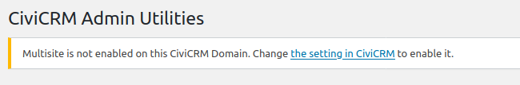

- Follow the link and set up Site 1 "Multisite" (in the CiviCRM sense)
- Go back to _CiviCRM Admin Utilities_
  - The "Domain" tab should look like:

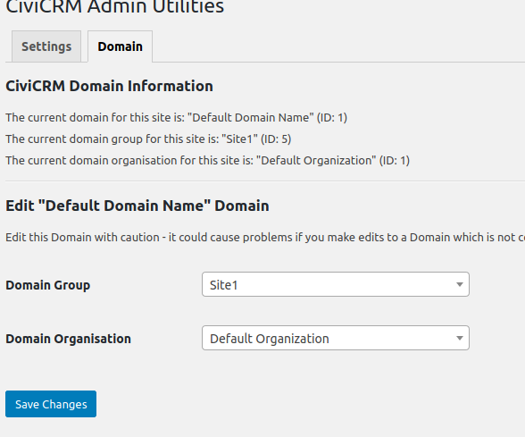

- Go to WordPress Network Admin, then _CiviCRM Admin Utilities_ Settings
  - The "Domain" tab should look like:

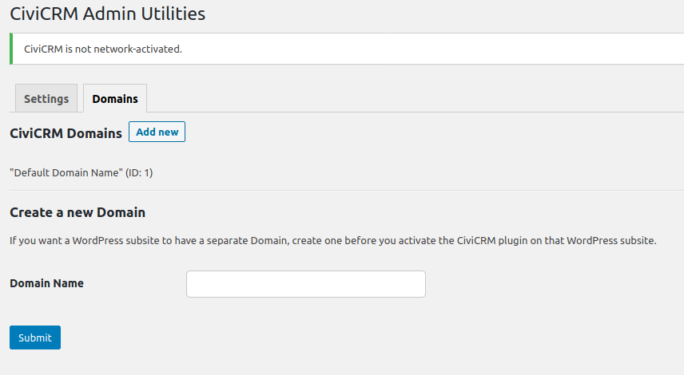

### Site 2

- Create a new WordPress Sub-site (Site 2)

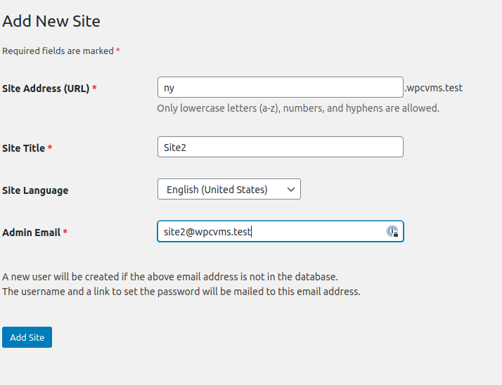

- Edit the new site
- Look at the URL
  - It MUST match what you will be setting _CiviCRM_ to. Make sure the URL begins with `https` not  `http` - edit if necessary

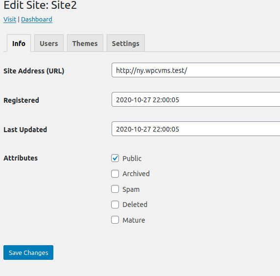

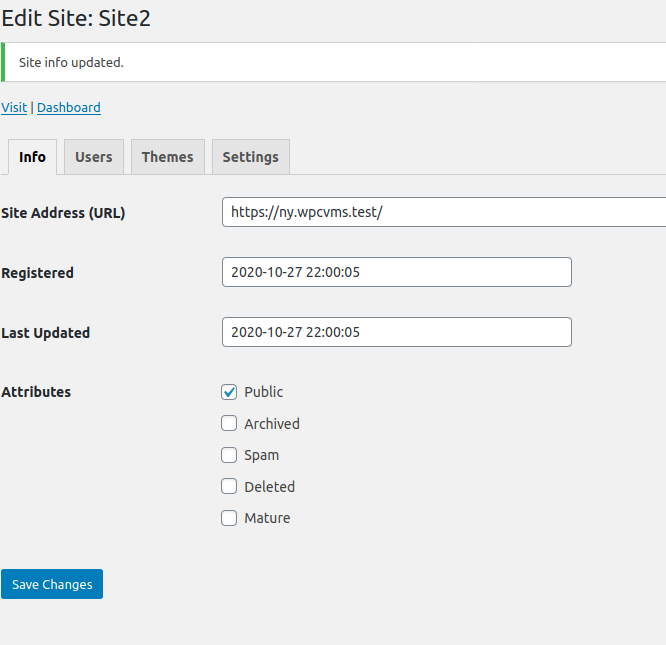

- Update `wp-config.php` to use a single `civicrm.settings.php` file
- Add the following:

```php
/**
 * Force CiviCRM to use a single settings file.
 */
if ( ! defined( 'CIVICRM_SETTINGS_PATH' ) ) {
    define( 'CIVICRM_SETTINGS_PATH', '/srv/www/wpcvms/wp-content/uploads/civicrm/civicrm.settings.php' );
}
```

- Add `civicrm.domains.php` to same directory as `civicrm.settings.php`

```php
<?php
/**
 * CiviCRM Multisite Domain functionality.
 *
 * @see https://gist.github.com/christianwach/5ca120670152df3dbfb8d3ca42079a96
 */

/**
 * Define CiviCRM Multisite Domain constants and settings.
 *
 * When a WordPress site is accessed, CiviCRM needs to know a number of settings
 * that enable Multisite Domain functionality. Define that data here.
 *
 * Once the Domain has been created (e.g. via the form on the "Domains" tab of
 * the CiviCRM Admin Utilities network settings page) add the corresponding data
 * array for the Domain to the array below. The four uncommented entries are
 * required. Do this *before* enabling CiviCRM on the WordPress sub-site.
 *
 * The good thing about separating this functionality out in this way is that we
 * can now read the correspondences between WordPress sites and CiviCRM Domains.
 * The main array is keyed by the `home_url()` of the relevant WordPress site.
 *
 * If you want easy access to the `domain_group_id` and/or the `domain_org_id` for
 * a WordPress site, then these can be filled out and uncommented, though they are
 * not strictly necessary for multiple CiviCRM Domains to work and can be discovered
 * by other means.
 *
 * @return array $data The CiviCRM Multisite Domain data.
 */
function civicrm_multisite_get_domain_data() {

	// Define CiviCRM Multisite Domain data.
	$data = array(

		// Always put the data for the main site first.
		'https://wpcvms.test' => array(
			'domain_id' => 1,
			//'domain_group_id' => 5,
			//'domain_org_id' => 1,
			'extensionsDir' => '/srv/www/wpcvms/wp-content/uploads/civicrm/ext/',
			'extensionsURL' => 'https://wpcvms.test/wp-content/uploads/civicrm/ext/',
			'userFrameworkResourceURL' => 'https://wpcvms.test/wp-content/plugins/civicrm/civicrm/',
		),

		// Add sub-sites after the main site.
		'https://ny.wpcvms.test' => array(
			'domain_id' => 2,
			//'domain_group_id' => 6,
			//'domain_org_id' => 203,
			'extensionsDir' => '/srv/www/wpcvms/wp-content/uploads/civicrm/ext/',
			'extensionsURL' => 'https://ny.wpcvms.test/wp-content/uploads/civicrm/ext/',
			'userFrameworkResourceURL' => 'https://ny.wpcvms.test/wp-content/plugins/civicrm/civicrm/',
		),

	);

	// --<
	return $data;

}

/**
 * Get the URL for the requested WordPress site.
 *
 * @return str $url The URL for the requested WordPress site.
 */
function civicrm_multisite_get_url_from_server_vars() {

	// We first need to find the URL of the current site.
	if ( function_exists( 'home_url' ) ) {

		// When WordPress is bootstrapped, this is always correct.
		$url = home_url();

	} else {

		/*
		 * The following code deals with WordPress multisite when it is configured
		 * for sub-directories.
		 *
		 * If your multisite uses subdomains and you are not routing all calls to
		 * CiviCRM via WordPress (e.g. by using WP-REST instead of `extern/*.php`
		 * or `bin/*.php`) then you'll have to amend this.
		 *
		 * Q: How do we discover sub-directory paths from $_SERVER alone?
		 * A: There isn't a reliable way unless all sites are known.
		 *
		 * The true solution to this guesswork is never to bootstrap CiviCRM except
		 * via WordPress. I'm looking at you `extern/*.php`.
		 *
		 * tl;dr Always route via WordPress.
		 */

		// Protocol is easy:
		$protocol = strstr( 'HTTPS', $_SERVER['SERVER_PROTOCOL'] ) ? 'https://' : 'http://';

		// Get "site path" - the first part of the path.
		$path = '';
		if ( ! empty( $_SERVER['REQUEST_URI'] ) ) {
			$tmp_path = explode( '/', $_SERVER['REQUEST_URI'] );
			$path = isset( $tmp_path[0] ) ? '/' . $tmp_path[0] : '';
		}

		// Put it all together.
		$url = $protocol . $_SERVER['SERVER_NAME'] . $path;

	}

	// --<
	return $url;

}

/**
 * Set CiviCRM Multisite Domain constants and settings.
 *
 * When a WordPress site is accessed, CiviCRM needs to know what Domain is being
 * accessed. This is far from trivial :(
 */
function civicrm_multisite_set_domain_data_for_site() {

	// We need access to some CiviCRM globals.
	global $civicrm_setting, $civicrm_paths;

	// Get the URL for the requested site.
	$url = civicrm_multisite_get_url_from_server_vars();

	// Get CiviCRM data.
	$data = civicrm_multisite_get_domain_data();

	// Use Main Site if we don't have an entry.
	if ( empty( $data[$url] ) ) {
		$settings = array_shift( $data );
	} else {
		$settings = $data[$url];
	}

	// Always set the Base URL.
	define( 'CIVICRM_UF_BASEURL', $url );

	// Set the CiviCRM Domain ID.
	if ( isset( $settings['domain_id'] ) ) {
		define( 'CIVICRM_DOMAIN_ID', $settings['domain_id'] );
	}

	// CiviCRM does not need these two constants, but you may wish to set them for reference.
	if ( isset( $settings['domain_group_id'] ) ) {
		define( 'CIVICRM_DOMAIN_GROUP_ID', $settings['domain_group_id'] );
	}
	if ( isset( $settings['domain_org_id'] ) ) {
		define( 'CIVICRM_DOMAIN_ORG_ID', $settings['domain_org_id'] );
	}

	// These paths are crucial for CiviCRM.
	if ( isset( $settings['extensionsDir'] ) ) {
		$civicrm_setting['domain']['extensionsDir'] = $settings['extensionsDir'];
	}
	if ( isset( $settings['extensionsURL'] ) ) {
		$civicrm_setting['domain']['extensionsURL'] = $settings['extensionsURL'];
	}
	if ( isset( $settings['userFrameworkResourceURL'] ) ) {
		$civicrm_setting['domain']['userFrameworkResourceURL'] = $settings['userFrameworkResourceURL'];
	}

}

// Trigger Multisite discovery immediately.
civicrm_multisite_set_domain_data_for_site();
```

- Now go back and edit `civicrm.settings.php`:
  * Around line 80 or so, comment out the paths and URL settings:

```php
// Additional settings generated by installer:
/*
$civicrm_paths['wp.frontend.base']['url'] = 'https://wpms.test/';
$civicrm_paths['wp.backend.base']['url'] = 'https://wpms.test/wp-admin/';
$civicrm_setting['domain']['userFrameworkResourceURL'] = 'https://wpms.test/wp-content/plugins/civicrm/civicrm';
*/

```

- Further down the `civicrm.settings.php` file:
  * Around line 235 or so, comment out the code that defines `CIVICRM_UF_BASEURL`
  * Include/require the `civicrm.domains.php` file
  * (The settings could be included here, but it's cleaner to have a separate file)

```php
/*
if (!defined('CIVICRM_UF_BASEURL')) {
  define( 'CIVICRM_UF_BASEURL'      , 'https://wpms.test');
}
*/

// Include the Domain settings file.
require_once 'civicrm.domains.php';
```

- Now back to WordPress Network Admin, _CiviCRM Admin Utilities_, "Domain" tab

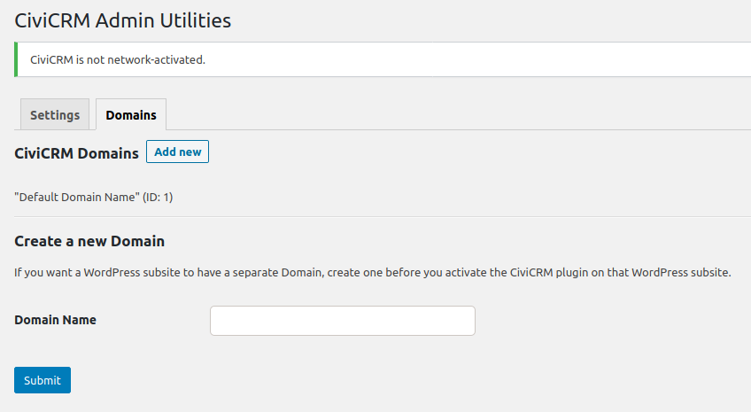

- Create a new _CiviCRM_ Domain

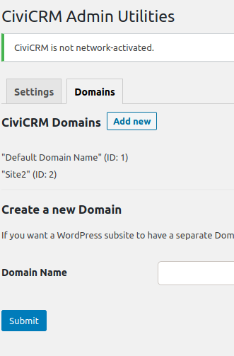

- Activate _CiviCRM_ on Site 2
- Go To Site 2 Settings menu --> _CiviCRM Admin Utilities_ --> "Domain" tab

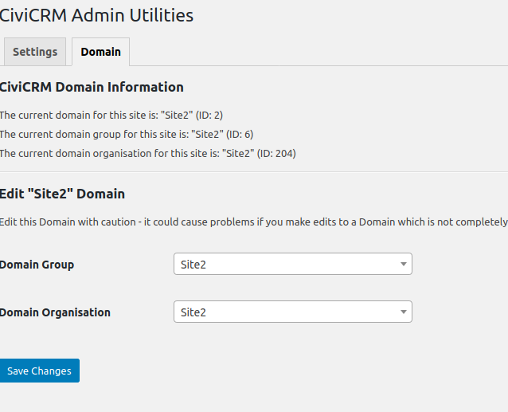

- Repeat for other Domains

## Permissions

- You will need to set permissions to limit access. Administrators and Network Admins will have pre-defined rights.

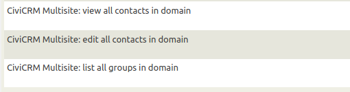

<!-- Source: multisite/wordpress.md -->
