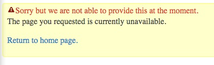
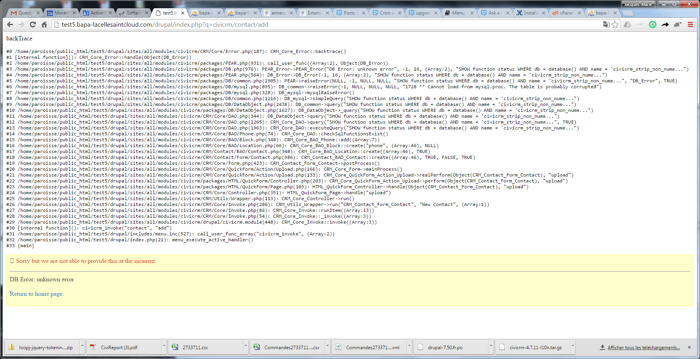
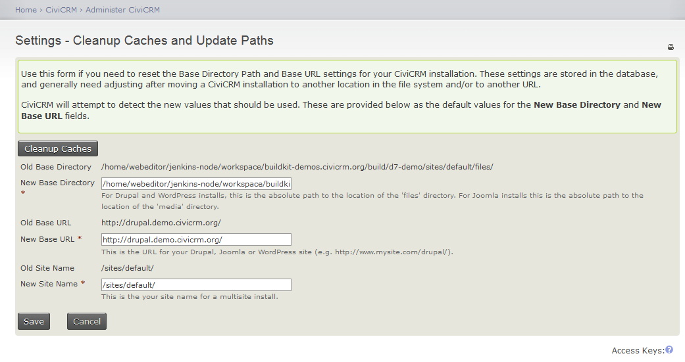

# Troubleshooting CiviCRM installation

## General advice

Search the [CiviCRM Stack Exchange](https://civicrm.stackexchange.com/tour) for solutions.

Try to replicate the problem on the CiviCRM sandboxes - see "Testing Sandboxes" on the [CiviCRM demo page](https://civicrm.org/demo). If you can demonstrate that the problem doesn't just exist for you, more community members will give assistance.

Post a question on [CiviCRM Stack Exchange](https://civicrm.stackexchange.com/tour). Be sure to include:

* your CiviCRM version
* which CMS you use
* your CMS version

Consider improving the question with screenshots and/or detailed error messages. Be sure to mention if the problem exists on the demo site.

## More detailed errors (debugging and backtrace) {:#debugging}

If you receive a CiviCRM fatal error, you can find a more detailed error in one of two ways.

CiviCRM fatal errors are characterized by a yellow background:



### Review the CiviCRM log

If you have direct access to the files on your server, the CiviCRM log can be found in the ConfigAndLog directory. [Directions to find the ConfigAndLog directory can be found here](https://civicrm.stackexchange.com/a/15932/12). Errors are labeled with timestamps, and include both debug and backtrace information.

### Use the built-in debugging tools

Go to **Administer menu > System Settings > Debugging and Error Handling**, select "Yes" to both "Enable Debugging" and "Display Backtrace", and press "Save". Repeat the steps that caused your error, and you'll see a much more detailed error.

!!! danger "Do NOT Leave Debug Turned On in Production Sites"
    When debugging is turned on, some internal settings are visible to site visitors. For security purposes, it's best to avoid turning on debugging/backtrace on public sites whenever possible.

Example with debug/backtrace enabled:



## Symptoms

* **Directory Cleanup** - Empties template cache and/or upload file folders.
    * To empty template cache (civicrm/templates_c folder), add `&directoryCleanup=1`
    * To remove temporary upload files (civicrm/upload folder), add `&directoryCleanup=2`
    * To cleanup both, add `&directoryCleanup=3`

* **Stack Trace** - To display stack trace at the top of the page when an error occurs, set Enable Backtrace from **Administer » System Settings » Debugging** **and Error Handling**.

### "civicrm_strip_non_numeric does not exist"

This error occurs when your database has lost a MySQL function definition for `civicrm_strip_non_numeric`. It can happen when moving from one server to another with the wrong `mysqldump` parameters, or if you use phpMyAdmin or certain other tools to rename a database, since they copy most but not all of the contents of the database to a database with the new name before deleting the old one. [Re-build your database triggers](#trigger-rebuild) to fix the problem.

### "Could not find valid Key"

If you are getting this error when submitting a form (search or adding / editing records), check the following:

* Ensure cookies are enabled on browser. Like most web applications, CiviCRM can not function properly with cookies disabled.
* Ensure your configuration settings are using the same "machine name" for CiviCRM and your CMS. For example, you will have problems if CiviCRM is configured to use `http://example.com` as its `BASE_URL` and your CMS is using `http://www.example.com`. You can use an `.htaccess` entry to redirect to the configured URL if needed (i.e. push all users to `http://www.example.com` even if they hit `http://example.com`).
    1. For Drupal sites, ensure that `uid = 0` exists in your Drupal users table. This is required for anonymous access to CiviCRM pages and forms to work properly.
    1. For Drupal sites, ensure that Drupal sessions table uses UTF8 collation, AND that the session column in this table is of SQL type longtext in the schema. You can check both of these in phpMyAdmin, or issue these commands from mysql command line:

        ```sql
        desc session;
        show create table sessions;
        ```

### "DB_DataObject Error: DB Error: connect failed"

If you get this error on a new Drupal/CiviCRM installation, you may have skipped the step of running CiviCRM's installation script. You can not install CiviCRM using the standard Drupal module installer.

### "Failed to initialize storage module: user" fatal error message (new installs)

If you see this error, you may need to modify the session.save_handler method for your site. Check with your hosting provider for the recommended way to do this.

### Page doesn't reload and spinner shows when tryibng to re-create triggers, eventually showing "DB Error: unknown error"

There can be multiple reasons for this, but they usually relate to MySQL user or connection issues. Check the MySQL user exists, and that it can log in to the database from the server accessing MySQL with the password in civicrm.settings.php. You may want to check logs then. A solution on some systems with MySQL binary logging is to add log_bin_trust_function_creators = 1 to the mysqld config file.

### "Your PHP version is missing zip functionality"

If you get this error when installing or upgrading CiviCRM for Joomla, download and use the `civicrm-x.x.x-joomla-alt.zip` package.

### WordPress menus are wrong

Try [rebuilding the WordPress menus](#rebuild-wp-menus).

## Solutions

### Cleanup caches and update paths {:#clear-cache}

On this settings page you can:

* Clear the cache
* View and update the value that CiviCRM has determined for your Base Url and site name.

    

Although you enter your Base URL in `civicrm.settings.php` the value shown here reflects additional attempts by CiviCRM to automatically detect the correct base url in various environments - for example in multilingual sites.

### Create a config file pointing to your Drupal sites directory {:#conf-drupal-sites}

If your CiviCRM codebase is not located in either `<drupal_root>/modules/civicrm` or `<drupal_root>/sites/all/modules` (for example, if you're using a symlink from there to your codebase) - you will need to create a local file in the top-level directory of your codebase which points to the location of your drupal sites directory.

```php
// Create a new file - settings_location.php
// Enter the following code (substitute the actual location of your
// <drupal root>/sites directory)
<?php
define( 'CIVICRM_CONFDIR', '/home/lobo/public_html/drupal/sites' );
?>
```

### Make CiviCRM available behind a NAT firewall {:#nat-firewall}

If CiviCRM is installed on a server behind a firewall with NAT, you'll need to add your **internal** IP address and host name to `/etc/hosts` (on Linux). Otherwise, the dashboard will time out and the Force Secure URLs option will have issues. The reasoning behind this is, the dashboard tries to connect to `http(s)://www.example.org` to load the dashboard, but times out since `example.org` is being resolved via the public IP address. Your server can't access this public IP address if it's behind a firewall with NAT.

### Rebuild CiviCRM menus {:#rebuild-civicrm-menus}

Sometimes it helps to rebuild the menu/admin dashboard by visiting the following URL:

`http://example.org/civicrm/menu/rebuild?reset=1`

### Rebuild database triggers {:#trigger-rebuild}

If you need to rebuild your database triggers, navigate to the following url:

`http://example.org/civicrm/menu/rebuild?reset=1&triggerRebuild=1`

Note the `&triggerRebuild=1` key-value pair.

### Rebuild WordPress menus {:#rebuild-wp-menus}

You can re-build the menu/admin dashboard by visiting the following url

`http://example.org/wp-admin/admin.php?page=CiviCRM&q=civicrm/menu/rebuild&reset=1`

### Reset config_backend

Having strange problems with Administrative settings forms after upgrade? Try deleting all files in the following directories:

* `sites/default/files/civicrm/templates_c/`
* `sites/default/files/civicrm/ConfigAndLog/Config.IDS.ini`

### Reset your user session {:#reset-session}

To reset your user session:

1. Temporarily enable CiviCRM debug features:
    * Go to **Administer CiviCRM » System Settings » Debugging and Error Handling**
    * Set **Enable Debugging** to Yes and click Save.
1. Click the Administer CiviCRM menu (or any other CiviCRM menu item). After the page is loaded, add an additional query string value (`sessionReset=2`) to the URL in your browser's location bar, and reload the page.
1. Now reset **Enable Debugging** to No and click Save.

!!! danger "Do Not Leave Debug Features Enabled for a Public Site"
    Debugging should be disabled for publicly available sites as it may allow browsers to view system configuration information.

### Roll back to previous version of CiviCRM (from a backup)

Sometimes an upgrade fails and you need to get back to the last working version. You should have backups of the database saved as well as a backup of the civicrm files from the `/sites/all/modules/` directory. Here are the steps you need to take in order to roll back to the last working version before your upgrade:

1. Go into maintenance mode and take the site offline.
1. In the modules screen, disable all the CiviCRM modules EXCEPT the Core CiviCRM module. Make sure to take note of which CiviCRM modules you've disabled so you can enable them again after you restore the backups.
1. Make sure to drop all the tables in the civicrm database that relate to civicrm. If you're sharing a database with Drupal, make sure to ONLY drop the tables that belong to CiviCRM and NOT the tables for Drupal. If Drupal's tables are in a separate database, then you should be safe as long as you don't touch any of the Drupal tables.
1. Restore all the civicrm tables from your database backup back into the database.
1. In the `/sites/all/modules` directory, make sure to delete the entire civicrm directory (`../sites/all/modules/civicrm`).
1. Restore the civicrm directory in `/sites/all/modules/` from your files backup.
1. CRUCIAL: Remove the `templates_c` directory from `../sites/default/files/civicrm/` (don't worry, CiviCRM will recreate these files when you reload the pages).
1. Go back to Drupal's Modules screen and enable the CiviCRM modules you disabled.
1. Bring the site back online by turning off Maintenance mode.
1. Load up civicrm by going to `http://example.org/civicrm` (or wherever you have civicrm installed). This should have restored you back to the last working condition.

Sometimes it helps to [rebuild the CiviCRM menus](#rebuild-civicrm-menus).

### Update Base Directory and Base URL Settings {:#base-settings}

To update your Base Directory and Base URL Settings in the database, visit this settings page:

* **Administer CiviCRM > System Settings > Cleanup Caches and Update Paths**

<!-- Source: troubleshooting/index.md -->
